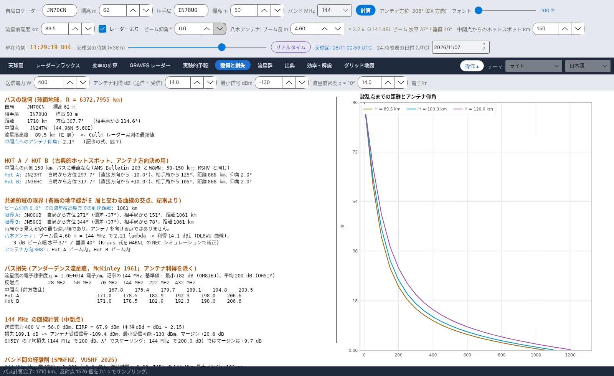

[English](Grid-Square-Map) · [Italiano](Grid-Square-Map-it) · [Deutsch](Grid-Square-Map-de) · [Nederlands](Grid-Square-Map-nl) · [Français](Grid-Square-Map-fr) · [Español](Grid-Square-Map-es) · [Português](Grid-Square-Map-pt) · [Português (Brasil)](Grid-Square-Map-pt-BR) · [Dansk](Grid-Square-Map-da) · [Norsk](Grid-Square-Map-nb) · [Svenska](Grid-Square-Map-sv) · [Íslenska](Grid-Square-Map-is) · [Eesti](Grid-Square-Map-et) · [Lietuvių](Grid-Square-Map-lt) · [Latviešu](Grid-Square-Map-lv) · [Polski](Grid-Square-Map-pl) · [Čeština](Grid-Square-Map-cs) · [Magyar](Grid-Square-Map-hu) · [Română](Grid-Square-Map-ro) · [Ελληνικά](Grid-Square-Map-el) · [Русский](Grid-Square-Map-ru) · [Українська](Grid-Square-Map-uk) · [Türkçe](Grid-Square-Map-tr) · [Afrikaans](Grid-Square-Map-af) · [العربية](Grid-Square-Map-ar) · [עברית](Grid-Square-Map-he) · [اردو](Grid-Square-Map-ur) · [हिन्दी](Grid-Square-Map-hi) · [বাংলা](Grid-Square-Map-bn) · [ไทย](Grid-Square-Map-th) · [Bahasa Indonesia](Grid-Square-Map-id) · [Tagalog](Grid-Square-Map-tl) · **日本語** · [한국어](Grid-Square-Map-ko) · [中文](Grid-Square-Map-zh) · [中文 (繁體)](Grid-Square-Map-zh-TW)

# グリッド地図

*タブ: グリッド地図。*

ログの ADIF ファイルから読み込んだ、**交信済**と**確認済**のマイデンヘッド グリッド (4 文字) をヨーロッパの地図上に表示します – **バンドごとにサブタブ: 50、70、144、222、432 MHz**。

## 操作

| 操作 | 機能 |
|---|---|
| **ADIF ファイルを読込...** | `.adi` / `.adif` ファイルを読み込みます。新しい ADIF は以前のデータを**置き換えます**。 |
| **メモリ消去** | ADIF から読み込んだ全グリッドを消去します (確認あり)。 |
| マウス | **ホイール = ズーム、ドラッグ = 移動、グリッド上にマウス = QSO** (日付付きで最大 6 つのコールサイン。確認済のものは *(確認済)*) |

読み込み後、ステータスに *… QSO 読込、50-432 MHz の QSO グリッド …、除外 QSO … (他バンドまたはグリッドなし)* と表示されます。各バンドの地図には *…: 交信済グリッド …、確認済 …* という説明が付きます。

| 色 | 意味 |
|---|---|
| 橙 | 交信済 |
| 緑 | 確認済 (QSL または LoTW) |

## ADIF の読み方

- 使用するフィールド: `CALL`、`GRIDSQUARE`、`VUCC_GRIDS`、`BAND`、`FREQ`、`QSO_DATE`、`QSL_RCVD`、`LOTW_QSL_RCVD` (ADIF 仕様)。
- バンドは `BAND` から、または周波数から: 50–54 MHz = 6 m、69.9–71.5 MHz = 4 m、144–148 MHz = 2 m、219–225 MHz = 1.25 m、420–450 MHz = 70 cm。
- グリッド内の少なくとも 1 つの QSO が `QSL_RCVD = Y` または `LOTW_QSL_RCVD = Y` なら、そのグリッドは**確認済**です。
- グリッドは別のファイルを読み込むか **メモリ消去** を押すまで `data/adif_quadrati.csv` に保存されます。

YA-MS は LoTW に**接続しません**: ログソフト (または LoTW) から ADIF を出力して、ここで読み込んでください。
