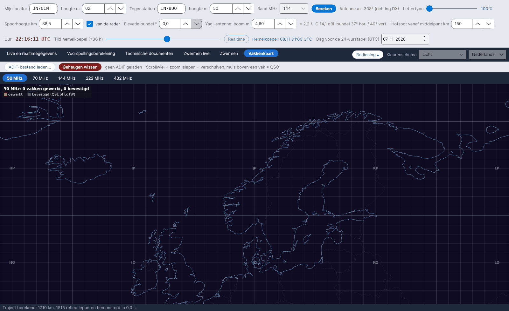

**English** · [Русский](Grid-Square-Map-ru) · [Deutsch](Grid-Square-Map-de) · [日本語](Grid-Square-Map-ja)

# Vakkenkaart

*Tabblad: Vakkenkaart.*

De Maidenhead-vakken (4 tekens) die je hebt **gewerkt** en **bevestigd**, gelezen uit het ADIF-bestand van je log, op een kaart van Europa – **één subtabblad per band: 50, 70, 144, 222 en 432 MHz**.

## Bediening

| Element | Wat het doet |
|---|---|
| **ADIF-bestand laden...** | Leest een `.adi`- / `.adif`-bestand. Een nieuw ADIF-bestand **vervangt** de vorige gegevens. |
| **Geheugen wissen** | Wist alle uit het ADIF geladen vakken (vraagt om bevestiging). |
| Muis | **Scrollwiel = zoom, slepen = verschuiven, muis boven een vak = QSO** (tot zes roepnamen met datum, *(bevestigd)* als bevestigd) |

Na het laden toont de status *… QSO's gelezen, … QSO-vakken in de banden 50-432 MHz, … QSO's verworpen (andere banden of zonder vak)*. Elke bandkaart heeft het bijschrift *… vakken gewerkt, … bevestigd*.

| Kleur | Betekenis |
|---|---|
| Oranje | gewerkt |
| Groen | bevestigd (QSL of LoTW) |

## Hoe het ADIF wordt gelezen

- Gebruikte velden: `CALL`, `GRIDSQUARE`, `VUCC_GRIDS`, `BAND`, `FREQ`, `QSO_DATE`, `QSL_RCVD`, `LOTW_QSL_RCVD` (ADIF-specificatie).
- Band uit `BAND`, of uit de frequentie: 50–54 MHz = 6 m, 69,9–71,5 MHz = 4 m, 144–148 MHz = 2 m, 219–225 MHz = 1,25 m, 420–450 MHz = 70 cm.
- Een vak is **bevestigd** als minstens één QSO erin `QSL_RCVD = Y` of `LOTW_QSL_RCVD = Y` heeft.
- De vakken blijven in `data/adif_quadrati.csv` totdat je een ander bestand laadt of op **Geheugen wissen** drukt.

YA-MS maakt **geen** verbinding met LoTW: exporteer het ADIF uit je logprogramma (of uit LoTW) en laad het hier.
