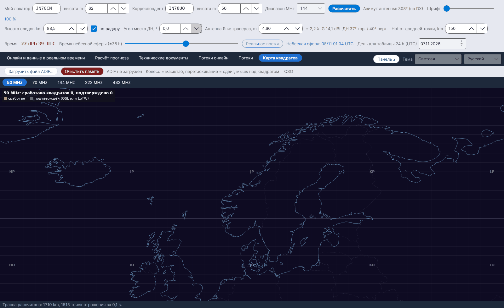

[English](Grid-Square-Map) · [Italiano](Grid-Square-Map-it) · [Deutsch](Grid-Square-Map-de) · [Nederlands](Grid-Square-Map-nl) · [Français](Grid-Square-Map-fr) · [Español](Grid-Square-Map-es) · [Português](Grid-Square-Map-pt) · [Português (Brasil)](Grid-Square-Map-pt-br) · [Dansk](Grid-Square-Map-da) · [Norsk](Grid-Square-Map-nb) · [Svenska](Grid-Square-Map-sv) · [Íslenska](Grid-Square-Map-is) · [Eesti](Grid-Square-Map-et) · [Lietuvių](Grid-Square-Map-lt) · [Latviešu](Grid-Square-Map-lv) · [Polski](Grid-Square-Map-pl) · [Čeština](Grid-Square-Map-cs) · [Magyar](Grid-Square-Map-hu) · [Română](Grid-Square-Map-ro) · [Ελληνικά](Grid-Square-Map-el) · **Русский** · [Українська](Grid-Square-Map-uk) · [Türkçe](Grid-Square-Map-tr) · [Afrikaans](Grid-Square-Map-af) · [العربية](Grid-Square-Map-ar) · [עברית](Grid-Square-Map-he) · [اردو](Grid-Square-Map-ur) · [हिन्दी](Grid-Square-Map-hi) · [বাংলা](Grid-Square-Map-bn) · [ไทย](Grid-Square-Map-th) · [Bahasa Indonesia](Grid-Square-Map-id) · [Tagalog](Grid-Square-Map-tl) · [日本語](Grid-Square-Map-ja) · [한국어](Grid-Square-Map-ko) · [中文](Grid-Square-Map-zh) · [中文 (繁體)](Grid-Square-Map-zh-tw)

# Карта квадратов

*Вкладка: Карта квадратов.*

**Сработанные** и **подтверждённые** квадраты Maidenhead (4 символа), прочитанные из файла ADIF вашего аппаратного журнала, на карте Европы – **по одной вложенной вкладке на диапазон: 50, 70, 144, 222 и 432 MHz**.

## Элементы управления

| Элемент | Что делает |
|---|---|
| **Загрузить файл ADIF...** | Читает файл `.adi` / `.adif`. Новый ADIF **заменяет** прежние данные. |
| **Очистить память** | Удаляет все квадраты, загруженные из ADIF (с запросом подтверждения). |
| Мышь | **Колесо = масштаб, перетаскивание = сдвиг, мышь над квадратом = QSO** (до шести позывных с датой, *(подтверждено)* для подтверждённых) |

После загрузки строка состояния показывает *Прочитано QSO: …, квадратов-QSO на диапазонах 50-432 MHz: …, отброшено QSO: … (другие диапазоны или без квадрата)*. У карты каждого диапазона есть подпись *сработано квадратов …, подтверждено …*.

| Цвет | Значение |
|---|---|
| Оранжевый | сработан |
| Зелёный | подтверждён (QSL или LoTW) |

## Как читается ADIF

- Используемые поля: `CALL`, `GRIDSQUARE`, `VUCC_GRIDS`, `BAND`, `FREQ`, `QSO_DATE`, `QSL_RCVD`, `LOTW_QSL_RCVD` (спецификация ADIF).
- Диапазон берётся из `BAND` или из частоты: 50–54 MHz = 6 m, 69,9–71,5 MHz = 4 m, 144–148 MHz = 2 m, 219–225 MHz = 1,25 m, 420–450 MHz = 70 cm.
- Квадрат считается **подтверждённым**, если хотя бы одна QSO в нём имеет `QSL_RCVD = Y` или `LOTW_QSL_RCVD = Y`.
- Квадраты хранятся в `data/adif_quadrati.csv`, пока вы не загрузите другой файл или не нажмёте **Очистить память**.

YA-MS **не** подключается к LoTW: экспортируйте ADIF из своей программы аппаратного журнала (или из LoTW) и загрузите его здесь.
