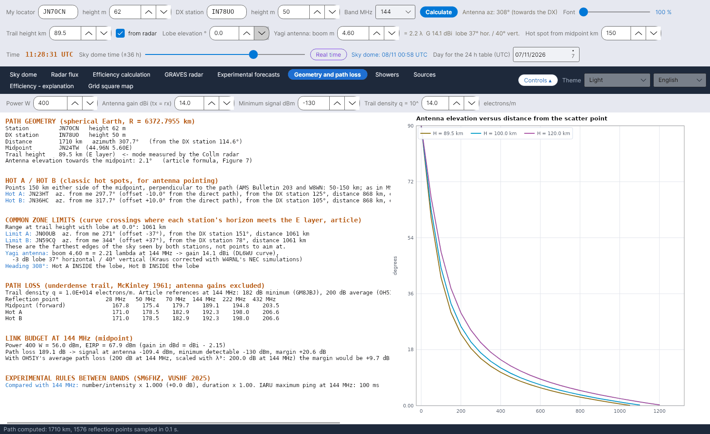

[English](Grid-Square-Map) · [Italiano](Grid-Square-Map-it) · [Deutsch](Grid-Square-Map-de) · [Nederlands](Grid-Square-Map-nl) · [Français](Grid-Square-Map-fr) · [Español](Grid-Square-Map-es) · [Português](Grid-Square-Map-pt) · [Português (Brasil)](Grid-Square-Map-pt-br) · [Dansk](Grid-Square-Map-da) · [Norsk](Grid-Square-Map-nb) · [Svenska](Grid-Square-Map-sv) · [Íslenska](Grid-Square-Map-is) · [Eesti](Grid-Square-Map-et) · [Lietuvių](Grid-Square-Map-lt) · [Latviešu](Grid-Square-Map-lv) · [Polski](Grid-Square-Map-pl) · [Čeština](Grid-Square-Map-cs) · [Magyar](Grid-Square-Map-hu) · [Română](Grid-Square-Map-ro) · [Ελληνικά](Grid-Square-Map-el) · [Русский](Grid-Square-Map-ru) · [Українська](Grid-Square-Map-uk) · **Türkçe** · [Afrikaans](Grid-Square-Map-af) · [العربية](Grid-Square-Map-ar) · [עברית](Grid-Square-Map-he) · [اردو](Grid-Square-Map-ur) · [हिन्दी](Grid-Square-Map-hi) · [বাংলা](Grid-Square-Map-bn) · [Bahasa Indonesia](Grid-Square-Map-id) · [Tagalog](Grid-Square-Map-tl) · [ไทย](Grid-Square-Map-th) · [日本語](Grid-Square-Map-ja) · [한국어](Grid-Square-Map-ko) · [中文](Grid-Square-Map-zh) · [中文 (繁體)](Grid-Square-Map-zh-tw)

# Kare haritası

*Sekme: Kare haritası.*

Logunuzun ADIF dosyasından okunan, **çalıştığınız** ve **onaylanmış** Maidenhead kareleri (4 karakter), bir Avrupa haritası üzerinde – **her bant için bir alt sekme: 50, 70, 144, 222 ve 432 MHz**.

## Kontroller

| Kontrol | Ne yapar |
|---|---|
| **ADIF dosyası yükle...** | Bir `.adi` / `.adif` dosyası okur. Yeni bir ADIF önceki verilerin **yerini alır**. |
| **Belleği temizle** | ADIF'ten yüklenen tüm kareleri siler (onay ister). |
| Fare | **Tekerlek = yakınlaştırma, sürükleme = kaydırma, fare bir karenin üzerinde = QSO'lar** (tarihleriyle en çok altı çağrı işareti, onaylıysa *(onaylandı)*) |

Yüklemeden sonra durum satırı şunu gösterir: *… QSO okundu, 50-432 MHz bantlarında … QSO karesi, … QSO atıldı (diğer bantlar ya da karesiz)*. Her bant haritasının altında *… kare çalışıldı, … onaylandı* yazısı bulunur.

| Renk | Anlamı |
|---|---|
| Turuncu | çalışıldı |
| Yeşil | onaylandı (QSL ya da LoTW) |

## ADIF nasıl okunur

- Kullanılan alanlar: `CALL`, `GRIDSQUARE`, `VUCC_GRIDS`, `BAND`, `FREQ`, `QSO_DATE`, `QSL_RCVD`, `LOTW_QSL_RCVD` (ADIF belirtimi).
- Bant `BAND` alanından ya da frekanstan: 50–54 MHz = 6 m, 69,9–71,5 MHz = 4 m, 144–148 MHz = 2 m, 219–225 MHz = 1,25 m, 420–450 MHz = 70 cm.
- Bir kare, içindeki en az bir QSO'da `QSL_RCVD = Y` ya da `LOTW_QSL_RCVD = Y` varsa **onaylanmıştır**.
- Kareler, başka bir dosya yükleyene ya da **Belleği temizle**'ye basana kadar `data/adif_quadrati.csv` içinde saklanır.

YA-MS LoTW'ye **bağlanmaz**: ADIF'i log programınızdan (ya da LoTW'den) dışa aktarın ve buraya yükleyin.
