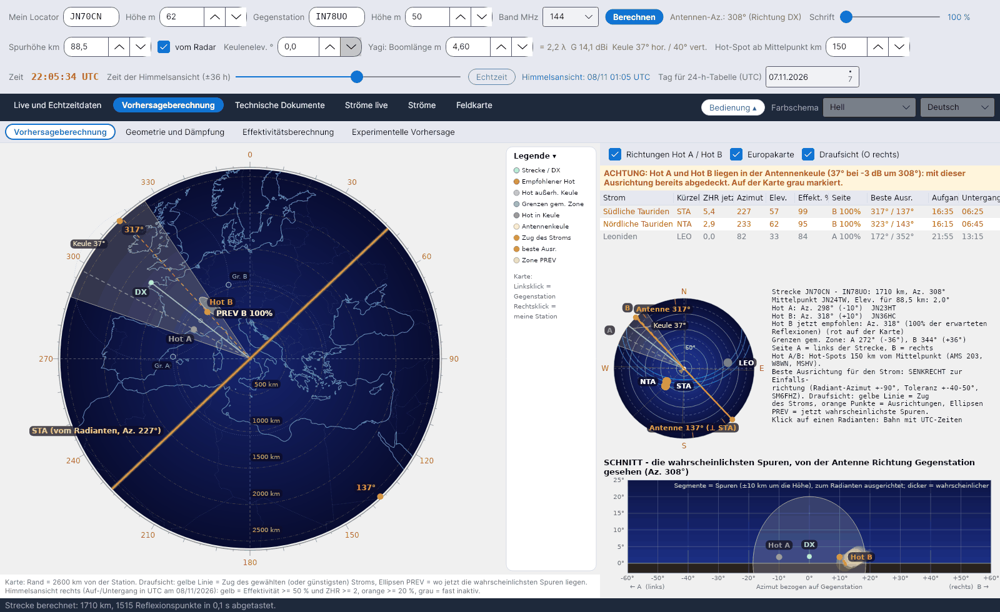
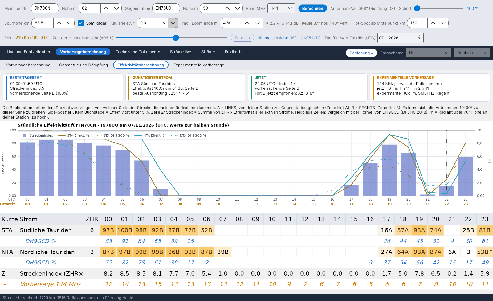
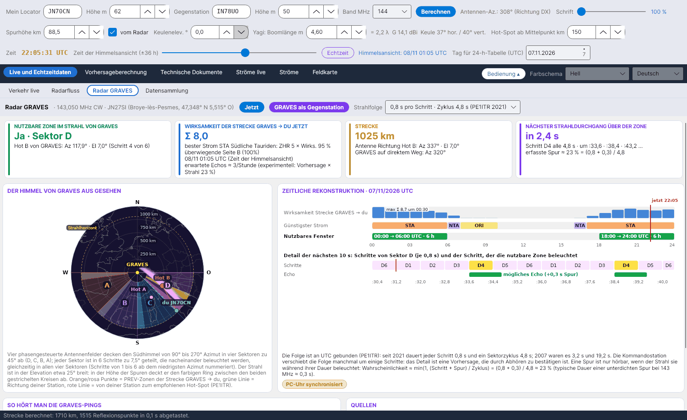

[English](Home) · [Русский](Home-ru) · **Deutsch** · [日本語](Home-ja)

# YA-MS – Meteorscatter-Vorhersagen und Live-Effektivität der Meteorströme

*von Costantino Cerrotta IC8TEM*

**YA-MS** ist ein kostenloses Programm für Funkamateure, die **Meteorscatter (MS) auf 50, 70, 144, 222 und 432 MHz** betreiben. Für die tatsächliche Strecke zwischen deinem Locator und dem der Gegenstation berechnet es Stunde für Stunde, wie stark jeder aktive Meteorstrom die Strecke unterstützt (seine **Effektivität**), von welcher Seite der Strecke die Reflexionen kommen (**Hot A / Hot B**), wohin die Antenne zeigen soll, und eine experimentelle Vorhersage der Reflexionen pro Stunde, abgeleitet von einem **Live-Meteorradar** (Collm, Deutschland). Es läuft unter **Windows, Linux und macOS** (.NET 8 + Avalonia), in 6 Sprachen der Oberfläche.

Die Hauptquelle ist der Artikel von **C. Cerrotta IC8TEM und G. Sartori IV3GTH**, *"METEOR-SCATTER. Ovvero come collegare l'Europa in VHF tutto l'anno senza tante pretese"* (Version 7). Jede Formel und jede Angabe im Programm nennt ihre Quelle; siehe [Quellen](Sources-de).

<table><tr>
<td width="33%" align="center"> Himmelsansicht</td>
<td width="33%" align="center"> Effektivitätsberechnung</td>
<td width="33%" align="center"> Radar GRAVES</td>
</tr></table>

## Für wen es gedacht ist

- Für OMs, die wissen wollen, **wann** eine Meteorscatter-Strecke offen ist und **wohin** sie die Antenne richten sollen – über das allgemeine „heute Nacht ist das Maximum des Stroms“ hinaus.
- Für Stationen, die **lange Strecken auf 144 und 432 MHz** arbeiten, wo die Position des Radianten entscheidet, ob ein Strom nützlich oder nutzlos ist.
- Für alle, die **die Zahlen nachprüfen** wollen: Das Berechnungshandbuch und die Erklärung im Programm geben jeden Schritt mit seiner Herkunft an: eine veröffentlichte Quelle, eine Prüfung am Programm oder eine Entscheidung des Programms.

## Die Reiter

Seit Version 1.6 haben die Hauptreiter **Unterreiter** (eine hellere Reihe unter der Hauptreihe). Beim Start zeigt ein 5-Sekunden-Startbild die Perseiden über dem VLT der ESO (Foto ESO/S. Guisard, CC BY 4.0).

| Reiter | Unterreiter | Was er zeigt |
|---|---|---|
| **Live und Echtzeitdaten** | [Verkehr live](Live-Traffic-de) | Azimutalkarte des gesamten gesammelten MS-Verkehrs, mit einer Wolke der wahrscheinlichsten Spuren für jede Verbindung, Bandfarben, blinkenden neuen Spots |
| | [Radarfluss](Radar-Flux-de) | Stündliche Meteorzählungen und Spurhöhen vom SKiYMET-Radar Collm, Bild aus Sodankylä, Schätzung für dein Band |
| | [Radar GRAVES](GRAVES-Radar-de) | Die Forward-Scatter-Strecke GRAVES → du: nutzbare Zone im Strahl, Sektor und Schritt, nächster Strahldurchgang, wie man zuhört |
| | [Datensammlung](Data-Collection-de) | Drei Telnet-Cluster-Verbindungen (DX-Cluster, RBN, DM4X/PSKReporter) und der MS-Spotfilter |
| **Vorhersageberechnung** | [Vorhersageberechnung](Sky-View-de) | Draufsicht der Strecke mit Hot A / Hot B, Antennenkeule, PREV-Zonen und Zug des Stroms; Liste der Ströme; kleine Himmelsansicht mit den Radianten und den richtigen Antennenrichtungen; Schnitt von der Antenne aus gesehen |
| | [Geometrie und Dämpfung](Geometry-and-Path-Loss-de) | Entfernung, Mittelpunkt, Elevation, Hot A / Hot B, Grenzen der gemeinsamen Zone, Streckendämpfung 28–432 MHz, Streckenbilanz, Antenne |
| | [Effektivitätsberechnung](Efficiency-Calculation-de) | Übersichtskarten, stündliche Effektivität jedes Stroms mit Seite A/B, Streckenindex, Vergleich mit DH9GCD, Diagramm |
| | [Experimentelle Vorhersage](Experimental-Forecasts-de) | Collm-Fluss auf 144 MHz (oder jede Frequenz) umgerechnet mit λ^k und Stationsfaktor K, 24-Stunden-Vorhersage, RMOB-Vergleich |
| **Technische Dokumente** | [Quellen](Sources-de) | Alle Quellen; die wichtigste ist der Artikel von Cerrotta–Sartori |
| | [Karte der europäischen Radare](European-Radar-Map-de) | Wo Collm, Sodankylä, GRAVES und CMOR bezogen auf deine Station liegen |
| | [Effektivität - Erklärung](Efficiency-Explanation-de) | Schritt-für-Schritt-Dokument zur Berechnung der Effektivität, nach Word exportierbar |
| [Ströme live](Live-Showers-de) | – | Gemessene ZHR des Global Meteor Network und Radiantenkarten von CMOR |
| [Ströme](Showers-de) | – | IMO-Katalog mit dem nächsten Maximum (IMO-Datum und -Uhrzeit oder berechnet) |
| [Feldkarte](Grid-Square-Map-de) | – | Gearbeitete und bestätigte Maidenhead-Felder aus einer ADIF-Datei, ein Reiter pro Band |

Über den Reitern liegen drei Bedienzeilen (dein Locator, Gegenstation, Band, Antenne, Spurhöhe, Zeit); siehe [Erste Schritte](Getting-Started-de). Die Schaltfläche **Bedienung** klappt sie ein, Sprache und Farbschema wählst du oben rechts; siehe [Einstellungen und Datenordner](Settings-and-Data-Folder-de).

## Kurz gesagt

- **Tatsächliche Strecke, keine festen Richtungen**: Die Effektivität wird für die Großkreisstrecke zwischen den beiden Locatoren berechnet (ältere Programme nutzten vier feste Richtungen).
- **Modell der spiegelnden Reflexion** (McKinley) an Punkten der E-Schicht alle 15 km, mit der Spurhöhe live vom Collm-Radar.
- **Hot A / Hot B** 150 km beiderseits des Mittelpunkts (einstellbar 30–400 km), der empfohlene rot, die bereits in deiner Antennenkeule liegenden grau.
- **Live-Radar**: Collm wird alle 5 Minuten geprüft, nur geänderte Quellen werden neu geladen; offline arbeitet das Programm mit den zuletzt gespeicherten Daten weiter.
- **Experimentelle** Vorhersage auf 50/144/432 MHz mit der λ³-Regel von SM6FHZ, vergleichbar mit RMOB-Beobachtern.
- Alles in einem einzigen Ordner **`data`** neben dem Programm: kein AppData, keine Systemordner.

> Die Effektivität ist ein experimentelles Modell (spiegelnde Reflexion + unterdichte Spuren). Vergleiche sie mit MCG_MS, MS-Soft und deiner eigenen Erfahrung auf dem Band.

## Wo anfangen

1. [Installation](Installation-de)
2. [Erste Schritte](Getting-Started-de)
3. [Fehlerbehebung und FAQ](Troubleshooting-FAQ-de), wenn etwas nicht funktioniert.

Downloads: **[Releases](https://github.com/ic8tem/YA-MS/releases)** auf GitHub.
