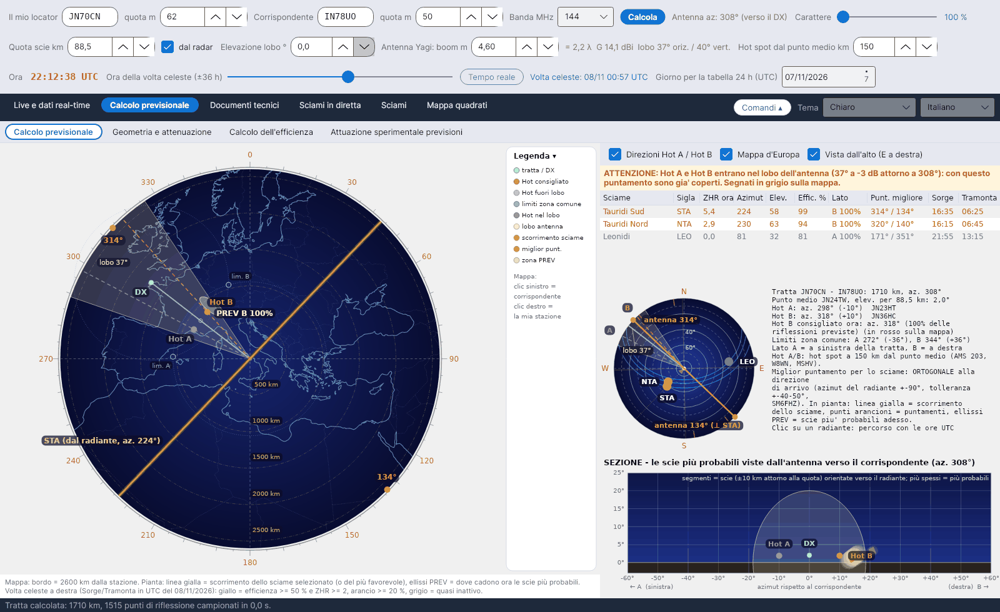
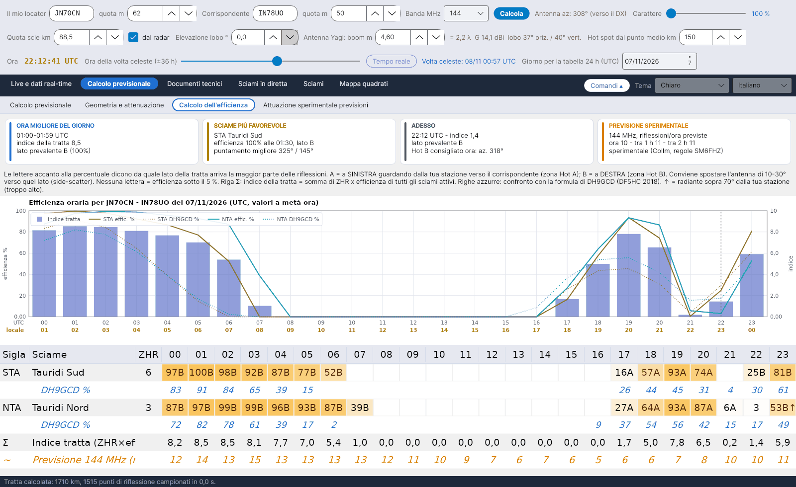
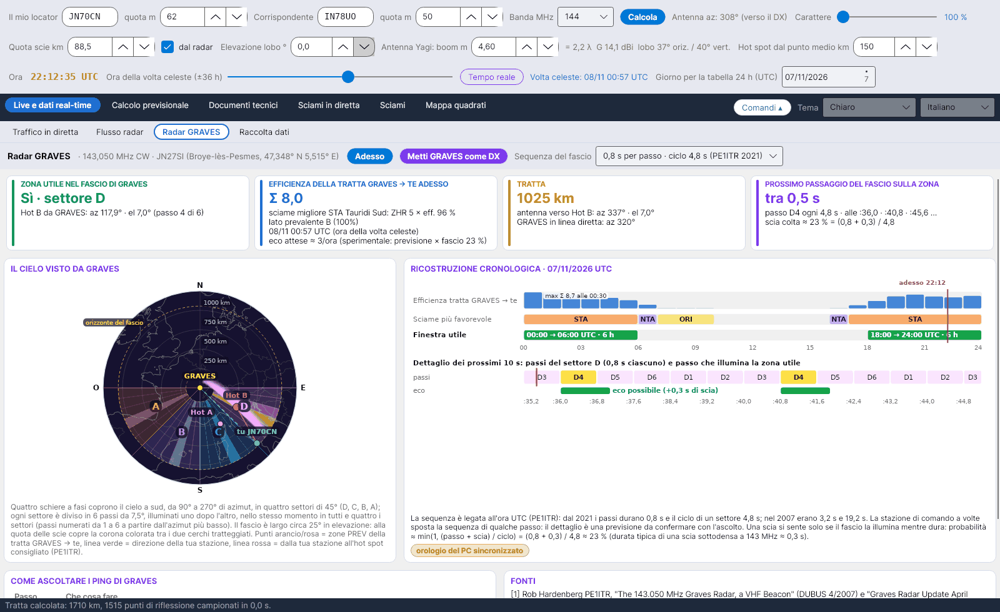

[English](Home) · **Italiano** · [Deutsch](Home-de) · [Nederlands](Home-nl) · [Français](Home-fr) · [Español](Home-es) · [Português](Home-pt) · [Português (Brasil)](Home-pt-br) · [Dansk](Home-da) · [Norsk](Home-nb) · [Svenska](Home-sv) · [Íslenska](Home-is) · [Eesti](Home-et) · [Lietuvių](Home-lt) · [Latviešu](Home-lv) · [Polski](Home-pl) · [Čeština](Home-cs) · [Magyar](Home-hu) · [Română](Home-ro) · [Ελληνικά](Home-el) · [Русский](Home-ru) · [Українська](Home-uk) · [Türkçe](Home-tr) · [Afrikaans](Home-af) · [العربية](Home-ar) · [עברית](Home-he) · [اردو](Home-ur) · [हिन्दी](Home-hi) · [বাংলা](Home-bn) · [Bahasa Indonesia](Home-id) · [Tagalog](Home-tl) · [ไทย](Home-th) · [日本語](Home-ja) · [한국어](Home-ko) · [中文](Home-zh) · [中文 (繁體)](Home-zh-tw)

# YA-MS – previsioni meteor scatter ed efficienza degli sciami in diretta

*a cura di Costantino Cerrotta IC8TEM*

**YA-MS** è un programma gratuito per i radioamatori che lavorano in **meteor scatter (MS) su 50, 70, 144, 222 e 432 MHz**. Per la tratta reale tra il tuo locator e quello del corrispondente calcola, ora per ora, quanto ogni sciame meteorico attivo favorisce la tratta (la sua **efficienza**), da quale lato della tratta arrivano le riflessioni (**Hot A / Hot B**), dove puntare l'antenna e una previsione sperimentale delle riflessioni all'ora ricavata da un **radar meteorico in diretta** (Collm, Germania). Funziona su **Windows, Linux e macOS** (.NET 8 + Avalonia), con 36 lingue dell'interfaccia.

La fonte principale è l'articolo di **C. Cerrotta IC8TEM e G. Sartori IV3GTH**, *"METEOR-SCATTER. Ovvero come collegare l'Europa in VHF tutto l'anno senza tante pretese"* (versione 7). Ogni formula e ogni dato del programma cita la sua fonte; vedi [Fonti](Sources-it).

<table><tr>
<td width="33%" align="center"> Volta celeste</td>
<td width="33%" align="center"> Calcolo dell'efficienza</td>
<td width="33%" align="center"> Radar GRAVES</td>
</tr></table>

## A chi è rivolto

- A chi vuole sapere **quando** una tratta in meteor scatter è aperta e **dove** puntare, oltre il generico "stanotte c'è il massimo dello sciame".
- Alle stazioni che lavorano **tratte lunghe su 144 e 432 MHz**, dove la posizione del radiante decide se uno sciame è utile o inutile.
- A chiunque voglia **verificare i numeri**: il manuale di calcolo e la spiegazione nel programma danno ogni passaggio con la sua origine: una fonte pubblicata, una verifica fatta sul programma o una scelta del programma.

## Le linguette

Dalla versione 1.6 le linguette principali hanno delle **sotto-linguette** (una riga più chiara sotto quella principale). All'avvio una schermata di 5 secondi mostra le Perseidi sopra il VLT dell'ESO (foto ESO/S. Guisard, CC BY 4.0).

| Linguetta | Sotto-linguetta | Che cosa mostra |
|---|---|---|
| **Live e dati real-time** | [Traffico in diretta](Live-Traffic-it) | Mappa azimutale di tutto il traffico MS raccolto, con una nuvola delle scie più probabili per ogni collegamento, colori per banda, spot nuovi lampeggianti |
| | [Flusso radar](Radar-Flux-it) | Conteggi orari delle meteore e quote delle scie letti dal radar SKiYMET di Collm, immagine di Sodankylä, stima sulla tua banda |
| | [Radar GRAVES](GRAVES-Radar-it) | La tratta in forward scatter GRAVES → te: zona utile nel fascio, settore e passo, prossimo passaggio del fascio, come ascoltare |
| | [Raccolta dati](Data-Collection-it) | Tre flussi telnet dai cluster (DX cluster, RBN, DM4X/PSKReporter) e il filtro degli spot MS |
| **Calcolo previsionale** | [Calcolo previsionale](Sky-View-it) | Mappa in pianta della tratta con Hot A / Hot B, lobo d'antenna, zone PREV e scorrimento degli sciami; elenco degli sciami; piccola volta celeste con i radianti e le direzioni d'antenna giuste; sezione vista dall'antenna |
| | [Geometria e attenuazione](Geometry-and-Path-Loss-it) | Distanza, punto medio, elevazione, Hot A / Hot B, limiti della zona comune, attenuazione di tratta 28–432 MHz, bilancio del collegamento, antenna |
| | [Calcolo dell'efficienza](Efficiency-Calculation-it) | Schede riassuntive, efficienza oraria di ogni sciame con lato A/B, indice della tratta, confronto con DH9GCD, grafico |
| | [Attuazione sperimentale previsioni](Experimental-Forecasts-it) | Flusso di Collm traslato a 144 MHz (o a qualsiasi frequenza) con λ^k e fattore di stazione K, previsione sulle 24 ore, confronto con RMOB |
| **Documenti tecnici** | [Fonti](Sources-it) | Tutte le fonti; la principale è l'articolo Cerrotta–Sartori |
| | [Mappa dei radar europei](European-Radar-Map-it) | Dove si trovano Collm, Sodankylä, GRAVES e CMOR rispetto alla tua stazione |
| | [Efficienza - spiegazione](Efficiency-Explanation-it) | Documento passo per passo su come si calcola l'efficienza, esportabile in Word |
| [Sciami in diretta](Live-Showers-it) | – | ZHR misurati dal Global Meteor Network e mappe dei radianti di CMOR |
| [Sciami](Showers-it) | – | Catalogo IMO con il prossimo massimo (data e ora IMO o calcolate) |
| [Mappa quadrati](Grid-Square-Map-it) | – | Quadrati Maidenhead lavorati e confermati da un file ADIF, una linguetta per banda |

Sopra le linguette ci sono tre righe di comandi (il tuo locator, il corrispondente, la banda, l'antenna, la quota delle scie, l'ora); vedi [Primi passi](Getting-Started-it). Il pulsante **Comandi** le ripiega, mentre la lingua e lo schema di colori si scelgono in alto a destra; vedi [Impostazioni e cartella dei dati](Settings-and-Data-Folder-it).

## In breve

- **Tratta reale, non direzioni fisse**: l'efficienza è calcolata sulla tratta ortodromica tra i due locator (i programmi più vecchi usavano quattro direzioni fisse).
- **Modello di riflessione speculare** (McKinley) su punti dello strato E ogni 15 km, con la quota delle scie letta in diretta dal radar di Collm.
- **Hot A / Hot B** a 150 km da una parte e dall'altra del punto medio (regolabile 30–400 km), quello consigliato in rosso, quelli già dentro il lobo della tua antenna in grigio.
- **Radar in diretta**: Collm controllato ogni 5 minuti, si riscaricano solo le fonti cambiate; senza rete il programma continua a funzionare con gli ultimi dati salvati.
- Previsione **sperimentale** a 50/144/432 MHz con la regola λ³ di SM6FHZ, confrontabile con gli osservatori RMOB.
- Tutto in un'unica cartella **`data`** accanto al programma: niente AppData, niente cartelle di sistema.

> L'efficienza è un modello sperimentale (riflessione speculare + scie sottodense). Confrontala con MCG_MS, MS-Soft e con la tua esperienza in aria.

## Da dove cominciare

1. [Installazione](Installation-it)
2. [Primi passi](Getting-Started-it)
3. [Problemi e domande frequenti](Troubleshooting-FAQ-it) se qualcosa non funziona.

Download: **[Releases](https://github.com/ic8tem/YA-MS/releases)** su GitHub.
