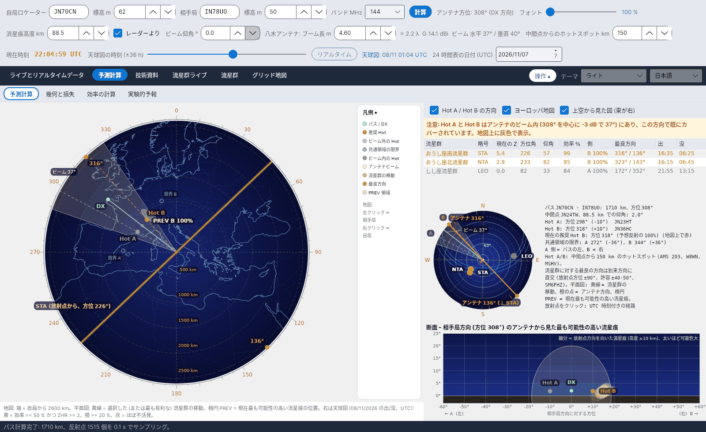
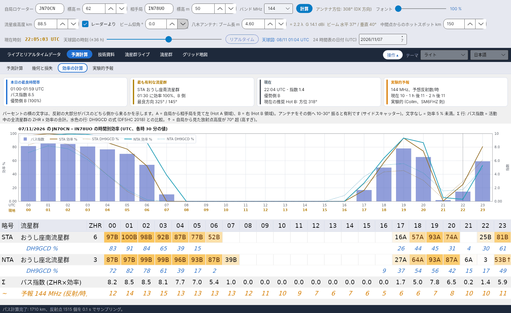
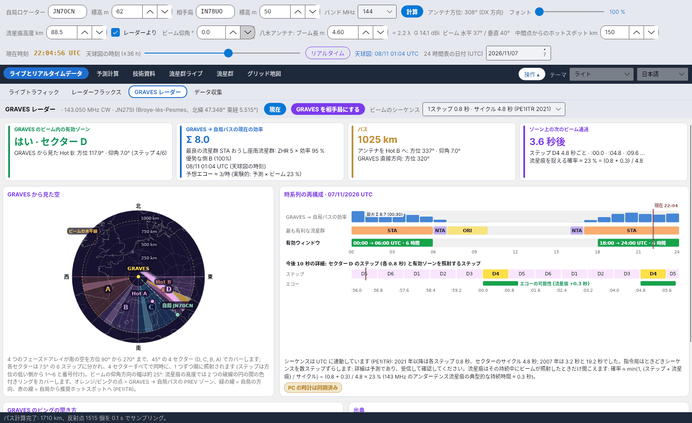

[English](Home) · [Italiano](Home-it) · [Deutsch](Home-de) · [Nederlands](Home-nl) · [Français](Home-fr) · [Español](Home-es) · [Português](Home-pt) · [Português (Brasil)](Home-pt-BR) · [Dansk](Home-da) · [Norsk](Home-nb) · [Svenska](Home-sv) · [Íslenska](Home-is) · [Eesti](Home-et) · [Lietuvių](Home-lt) · [Latviešu](Home-lv) · [Polski](Home-pl) · [Čeština](Home-cs) · [Magyar](Home-hu) · [Română](Home-ro) · [Ελληνικά](Home-el) · [Русский](Home-ru) · [Українська](Home-uk) · [Türkçe](Home-tr) · [Afrikaans](Home-af) · [العربية](Home-ar) · [עברית](Home-he) · [اردو](Home-ur) · [हिन्दी](Home-hi) · [বাংলা](Home-bn) · [ไทย](Home-th) · [Bahasa Indonesia](Home-id) · [Tagalog](Home-tl) · **日本語** · [한국어](Home-ko) · [中文](Home-zh) · [中文 (繁體)](Home-zh-TW)

# YA-MS – 流星散乱通信の予報と流星群効率のリアルタイム計算

*作成: Costantino Cerrotta IC8TEM*

**YA-MS** は、**50、70、144、222、432 MHz で流星散乱通信 (メテオスキャッター、MS)** を運用するアマチュア無線家のための無料プログラムです。自局と相手局のロケーター間の実際のパスについて、活動中の各流星群がそのパスにどれだけ役立つか (**効率**)、反射がパスのどちら側から来るか (**Hot A / Hot B**)、アンテナをどこへ向けるか、そして**リアルタイムの流星レーダー** (ドイツ Collm) から求めた 1 時間あたりの反射数の実験的予報を、1 時間ごとに計算します。**Windows、Linux、Raspberry Pi、macOS** (.NET 8 + Avalonia) で動作し、表示言語は 6 か国語です。

主な出典は **C. Cerrotta IC8TEM と G. Sartori IV3GTH** の記事 *"METEOR-SCATTER. Ovvero come collegare l'Europa in VHF tutto l'anno senza tante pretese"* (第 7 版) です。プログラム内のすべての式とデータには出典が示されています。[出典](Sources-ja) を参照してください。

<table><tr>
<td width="33%" align="center"> 天球図</td>
<td width="33%" align="center"> 効率の計算</td>
<td width="33%" align="center"> GRAVES レーダー</td>
</tr></table>

## 対象となる方

- 「今夜は流星群が極大」という一般的な情報を超えて、流星散乱通信のパスが**いつ**開き、**どこへ**アンテナを向けるべきかを知りたい運用者。
- **144 MHz と 432 MHz で長距離パス**を運用する局。放射点の位置によって流星群が役立つか役に立たないかが決まります。
- **数値を確かめたい**方。計算マニュアルとプログラム内の解説では、すべての手順をその根拠 (公表された出典、プログラムで行った検証、またはプログラム独自の選択) とともに示しています。

## タブ

バージョン 1.6 から、メインタブには**サブタブ** (メインの列の下にある明るい色の列) があります。起動時には、ESO の VLT の上空を流れるペルセウス座流星群のスプラッシュ画面が 5 秒間表示されます (写真 ESO/S. Guisard, CC BY 4.0)。

| タブ | サブタブ | 表示内容 |
|---|---|---|
| **ライブとリアルタイムデータ** | [ライブトラフィック](Live-Traffic-ja) | 収集したすべての MS トラフィックの方位図。交信ごとに最も可能性の高い流星痕の雲を描き、バンドごとに色分けし、新しいスポットは点滅します |
| | [レーダーフラックス](Radar-Flux-ja) | Collm SKiYMET レーダーから読み取った時間別の流星数と流星痕高度、Sodankylä の画像、自局バンドでの推定 |
| | [GRAVES レーダー](GRAVES-Radar-ja) | GRAVES → 自局の前方散乱パス: ビーム内の有効ゾーン、セクターとステップ、次のビーム通過、受信方法 |
| | [データ収集](Data-Collection-ja) | 3 つの telnet クラスター接続 (DX クラスター、RBN、DM4X/PSKReporter) と MS スポットのフィルター |
| **予測計算** | [予測計算](Sky-View-ja) | Hot A / Hot B、アンテナビーム、PREV 領域、流星群の移動を描いたパスの平面図; 流星群リスト; 放射点と正しいアンテナ方向を示す小さな天球図; アンテナから見た断面 |
| | [幾何と損失](Geometry-and-Path-Loss-ja) | 距離、中間点、仰角、Hot A / Hot B、共通領域の限界、28–432 MHz のパス損失、回線計算、アンテナ |
| | [効率の計算](Efficiency-Calculation-ja) | 概要カード、A/B 側付きの各流星群の時間別効率、パス指数、DH9GCD との比較、グラフ |
| | [実験的予報](Experimental-Forecasts-ja) | λ^k と局係数 K で 144 MHz (または任意の周波数) に換算した Collm のフラックス、24 時間予報、RMOB との比較 |
| **技術資料** | [出典](Sources-ja) | すべての出典。主な出典は Cerrotta–Sartori の記事 |
| | [ヨーロッパのレーダー地図](European-Radar-Map-ja) | Collm、Sodankylä、GRAVES、CMOR が自局から見てどこにあるか |
| | [効率 - 解説](Efficiency-Explanation-ja) | 効率の計算方法を順を追って説明する文書。Word に出力可能 |
| [流星群ライブ](Live-Showers-ja) | – | Global Meteor Network の実測 ZHR と CMOR の放射点マップ |
| [流星群](Showers-ja) | – | 次の極大 (IMO の日時または計算値) 付きの IMO カタログ |
| [グリッド地図](Grid-Square-Map-ja) | – | ADIF ファイルから読み込んだ交信済・確認済のマイデンヘッド グリッド。バンドごとに 1 タブ |

タブの上には 3 段の操作部 (自局ロケーター、相手局、バンド、アンテナ、流星痕高度、時刻) があります。[はじめに](Getting-Started-ja) を参照してください。**操作** ボタンでこれを折りたためます。表示言語と配色は右上で選びます。[設定とデータフォルダー](Settings-and-Data-Folder-ja) を参照してください。

## 概要

- **固定方向ではなく実際のパス**: 効率は 2 つのロケーター間の大圏パスについて計算します (従来のプログラムは 4 つの固定方向を使っていました)。
- E 層上に 15 km ごとに取った点での**鏡面反射モデル** (McKinley)。流星痕高度は Collm レーダーからリアルタイムで読み取ります。
- 中間点の両側 150 km (30–400 km で調整可) に **Hot A / Hot B**。推奨側は赤、既に自局のアンテナビーム内にあるものは灰色で表示します。
- **リアルタイム レーダー**: Collm を 5 分ごとに確認し、変化したソースだけを再取得します。オフラインでも最後に保存したデータで動作を続けます。
- SM6FHZ の λ³ 則による 50/144/432 MHz の**実験的**予報。RMOB の観測者と比較できます。
- すべてはプログラムの隣にある 1 つの **`data`** フォルダーに入ります。AppData もシステムフォルダーも使いません。

> 効率は実験的なモデル (鏡面反射 + アンダーデンス流星痕) です。MCG_MS、MS-Soft、そして実際の運用経験と比較してください。

## どこから始めるか

1. [インストール](Installation-ja)
2. [はじめに](Getting-Started-ja)
3. うまく動かないときは [トラブルシューティングと FAQ](Troubleshooting-FAQ-ja)

ダウンロード: GitHub の **[Releases](https://github.com/ic8tem/YA-MS/releases)**。
