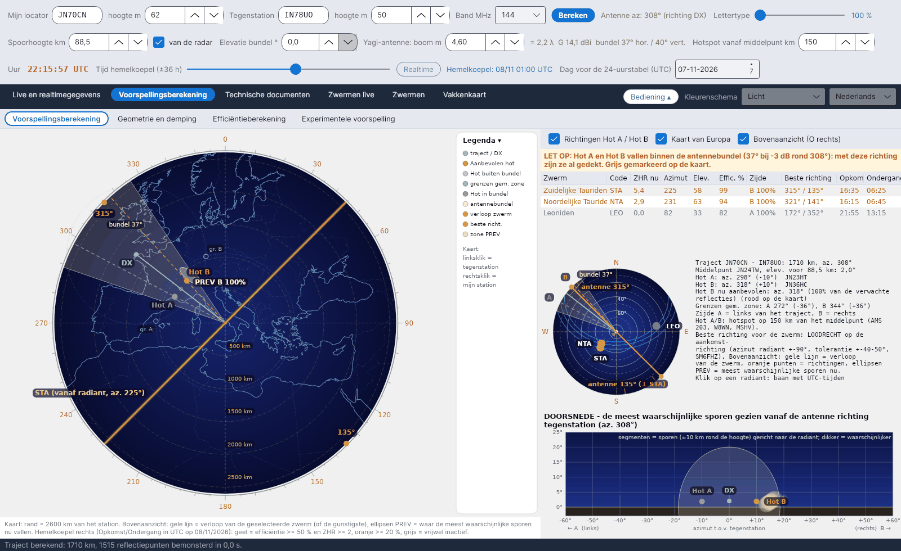
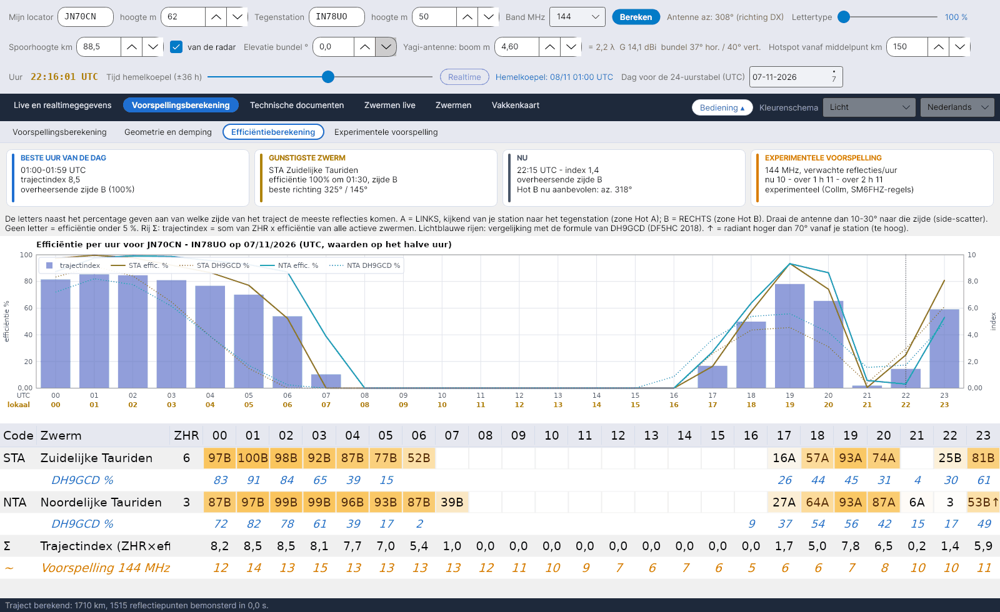
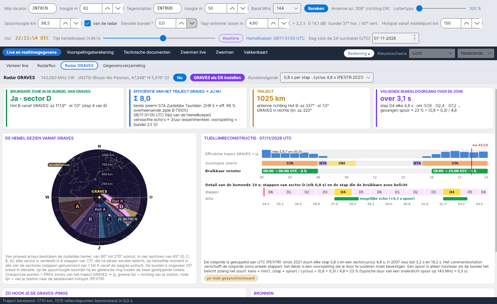

[English](Home) · [Italiano](Home-it) · [Deutsch](Home-de) · **Nederlands** · [Français](Home-fr) · [Español](Home-es) · [Português](Home-pt) · [Português (Brasil)](Home-pt-br) · [Dansk](Home-da) · [Norsk](Home-nb) · [Svenska](Home-sv) · [Íslenska](Home-is) · [Eesti](Home-et) · [Lietuvių](Home-lt) · [Latviešu](Home-lv) · [Polski](Home-pl) · [Čeština](Home-cs) · [Magyar](Home-hu) · [Română](Home-ro) · [Ελληνικά](Home-el) · [Русский](Home-ru) · [Українська](Home-uk) · [Türkçe](Home-tr) · [Afrikaans](Home-af) · [العربية](Home-ar) · [עברית](Home-he) · [اردو](Home-ur) · [हिन्दी](Home-hi) · [বাংলা](Home-bn) · [Bahasa Indonesia](Home-id) · [Tagalog](Home-tl) · [ไทย](Home-th) · [日本語](Home-ja) · [한국어](Home-ko) · [中文](Home-zh) · [中文 (繁體)](Home-zh-tw)

# YA-MS – meteorscatter-voorspellingen en live efficiëntie van de zwermen

*door Costantino Cerrotta IC8TEM*

**YA-MS** is een gratis programma voor radioamateurs die **meteorscatter (MS) werken op 50, 70, 144, 222 en 432 MHz**. Voor het werkelijke traject tussen jouw locator en die van het tegenstation berekent het uur voor uur hoeveel elke actieve meteorenzwerm het traject helpt (de **efficiëntie**), van welke kant van het traject de reflecties komen (**Hot A / Hot B**), waarheen je de antenne moet richten, en een experimentele voorspelling van het aantal reflecties per uur, afgeleid van een **live meteorradar** (Collm, Duitsland). Het draait op **Windows, Linux en macOS** (.NET 8 + Avalonia), met 36 talen voor de interface.

De hoofdbron is het artikel van **C. Cerrotta IC8TEM en G. Sartori IV3GTH**, *"METEOR-SCATTER. Ovvero come collegare l'Europa in VHF tutto l'anno senza tante pretese"* (versie 7). Elke formule en elk gegeven in het programma vermeldt zijn bron; zie [Bronnen](Sources-nl).

<table><tr>
<td width="33%" align="center"> Hemelkoepel</td>
<td width="33%" align="center"> Efficiëntieberekening</td>
<td width="33%" align="center"> Radar GRAVES</td>
</tr></table>

## Voor wie

- Operators die willen weten **wanneer** een meteorscatter-traject open is en **waarheen** ze moeten richten, verder dan het algemene "vannacht is het maximum van de zwerm".
- Stations die **lange trajecten op 144 en 432 MHz** werken, waar de positie van de radiant bepaalt of een zwerm bruikbaar of nutteloos is.
- Iedereen die **de getallen wil controleren**: de rekenhandleiding en de uitleg in het programma geven elke stap met zijn herkomst: een gepubliceerde bron, een controle op het programma of een keuze van het programma.

## De tabbladen

Sinds versie 1.6 hebben de hoofdtabbladen **subtabbladen** (een lichtere rij onder de hoofdrij). Bij het opstarten toont een opstartscherm van 5 seconden de Perseïden boven de VLT van ESO (foto ESO/S. Guisard, CC BY 4.0).

| Tabblad | Subtabblad | Wat het toont |
|---|---|---|
| **Live en realtimegegevens** | [Verkeer live](Live-Traffic-nl) | Azimutale kaart van al het verzamelde MS-verkeer, met per verbinding een wolk van de meest waarschijnlijke sporen, kleuren per band, knipperende nieuwe spots |
| | [Radarflux](Radar-Flux-nl) | Uurtellingen van meteoren en spoorhoogtes uitgelezen van de SKiYMET-radar in Collm, beeld van Sodankylä, schatting op jouw band |
| | [Radar GRAVES](GRAVES-Radar-nl) | Het forward-scatter-traject GRAVES → jij: bruikbare zone in de bundel, sector en stap, volgende bundeldoorgang, hoe je luistert |
| | [Gegevensverzameling](Data-Collection-nl) | Drie telnet-stromen van clusters (DX-cluster, RBN, DM4X/PSKReporter) en het filter voor MS-spots |
| **Voorspellingsberekening** | [Voorspellingsberekening](Sky-View-nl) | Plattegrond van het traject met Hot A / Hot B, antennebundel, PREV-zones en verloop van de zwermen; lijst van zwermen; kleine hemelkoepel met de radianten en de juiste antennerichtingen; doorsnede gezien vanaf de antenne |
| | [Geometrie en demping](Geometry-and-Path-Loss-nl) | Afstand, middelpunt, elevatie, Hot A / Hot B, grenzen van de gemeenschappelijke zone, trajectdemping 28–432 MHz, linkbudget, antenne |
| | [Efficiëntieberekening](Efficiency-Calculation-nl) | Overzichtskaarten, efficiëntie per uur van elke zwerm met zijde A/B, trajectindex, vergelijking met DH9GCD, grafiek |
| | [Experimentele voorspelling](Experimental-Forecasts-nl) | Flux van Collm omgerekend naar 144 MHz (of een willekeurige frequentie) met λ^k en stationsfactor K, voorspelling over 24 uur, vergelijking met RMOB |
| **Technische documenten** | [Bronnen](Sources-nl) | Alle bronnen; de belangrijkste is het artikel van Cerrotta–Sartori |
| | [Kaart van de Europese radars](European-Radar-Map-nl) | Waar Collm, Sodankylä, GRAVES en CMOR liggen ten opzichte van jouw station |
| | [Efficiëntie - uitleg](Efficiency-Explanation-nl) | Stap-voor-stapdocument over hoe de efficiëntie wordt berekend, te exporteren naar Word |
| [Zwermen live](Live-Showers-nl) | – | Gemeten ZHR van het Global Meteor Network en radiantkaarten van CMOR |
| [Zwermen](Showers-nl) | – | IMO-catalogus met het volgende maximum (datum en tijd van IMO of berekend) |
| [Vakkenkaart](Grid-Square-Map-nl) | – | Gewerkte en bevestigde Maidenhead-vakken uit een ADIF-bestand, één tabblad per band |

Boven de tabbladen staan drie rijen bedieningselementen (jouw locator, tegenstation, band, antenne, spoorhoogte, tijd); zie [Aan de slag](Getting-Started-nl). Met de knop **Bediening** klap je ze in; taal en kleurenschema kies je rechtsboven; zie [Instellingen en gegevensmap](Settings-and-Data-Folder-nl).

## In het kort

- **Werkelijk traject, geen vaste richtingen**: de efficiëntie wordt berekend voor het grootcirkeltraject tussen de twee locators (oudere programma's gebruikten vier vaste richtingen).
- **Model van spiegelende reflectie** (McKinley) op punten in de E-laag om de 15 km, met de spoorhoogte live uitgelezen van de radar in Collm.
- **Hot A / Hot B** op 150 km aan weerszijden van het middelpunt (instelbaar 30–400 km), de aanbevolen in het rood, die al binnen jouw antennebundel vallen in het grijs.
- **Live radar**: Collm wordt elke 5 minuten gecontroleerd en alleen gewijzigde bronnen worden opnieuw gedownload; zonder netwerk blijft het programma werken met de laatst opgeslagen gegevens.
- **Experimentele** voorspelling op 50/144/432 MHz met de λ³-regel van SM6FHZ, vergelijkbaar met RMOB-waarnemers.
- Alles in één map **`data`** naast het programma: geen AppData, geen systeemmappen.

> De efficiëntie is een experimenteel model (spiegelende reflectie + onderdichte sporen). Vergelijk het met MCG_MS, MS-Soft en je eigen ervaring in de lucht.

## Waar te beginnen

1. [Installatie](Installation-nl)
2. [Aan de slag](Getting-Started-nl)
3. [Problemen en FAQ](Troubleshooting-FAQ-nl) als iets niet werkt.

Downloads: **[Releases](https://github.com/ic8tem/YA-MS/releases)** op GitHub.
