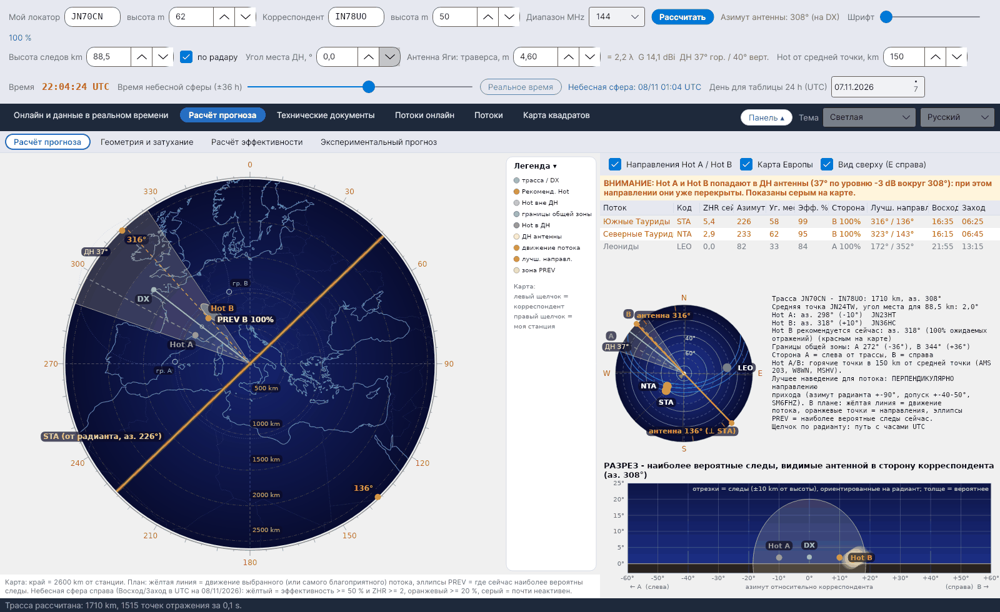
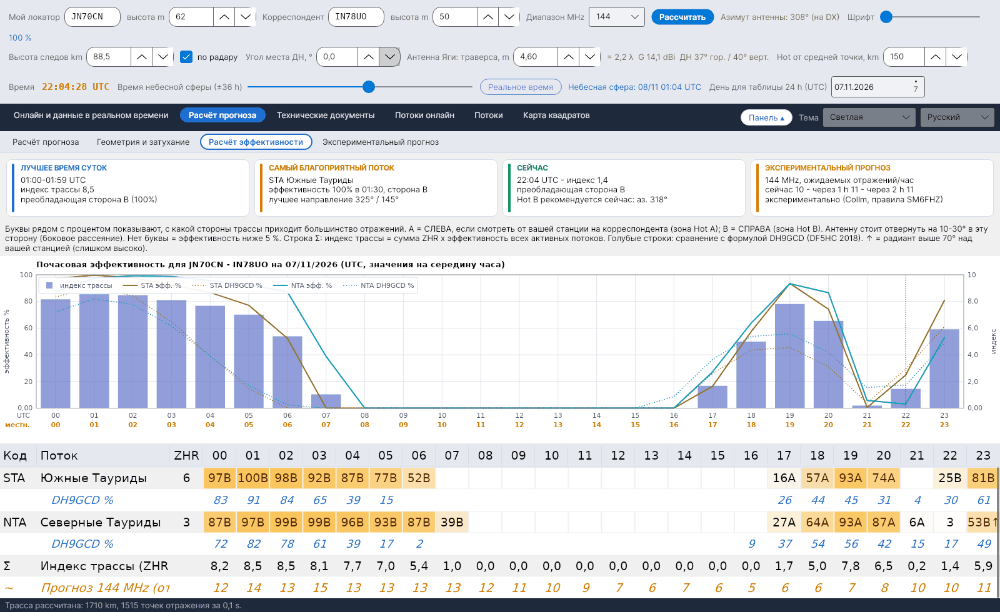
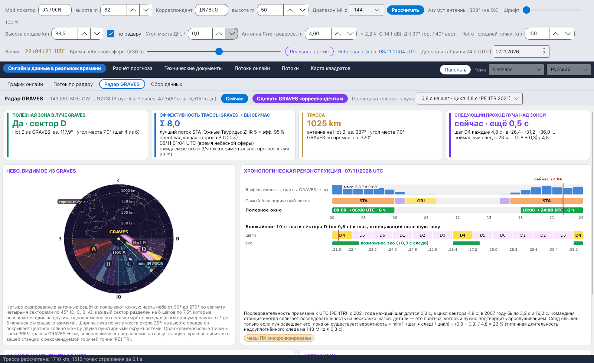

[English](Home) · **Русский** · [Deutsch](Home-de) · [日本語](Home-ja)

# YA-MS – прогнозы метеорного рассеяния и эффективность потоков в реальном времени

*автор Costantino Cerrotta IC8TEM*

**YA-MS** – бесплатная программа для радиолюбителей, работающих **метеорным рассеянием (MS) на 50, 70, 144, 222 и 432 MHz**. Для реальной трассы между вашим локатором и локатором корреспондента она по часам рассчитывает, насколько каждый активный метеорный поток помогает трассе (его **эффективность**), с какой стороны трассы приходят отражения (**Hot A / Hot B**), куда направить антенну, а также даёт экспериментальный прогноз числа отражений в час на основе данных **метеорного радара в реальном времени** (Collm, Германия). Работает в **Windows, Linux и macOS** (.NET 8 + Avalonia), интерфейс на 6 языках.

Основной источник – статья **C. Cerrotta IC8TEM и G. Sartori IV3GTH** *«METEOR-SCATTER. Ovvero come collegare l'Europa in VHF tutto l'anno senza tante pretese»* (версия 7). Для каждой формулы и каждого набора данных в программе указан источник; см. [Источники](Sources-ru).

<table><tr>
<td width="33%" align="center"> Небесная сфера</td>
<td width="33%" align="center"> Расчёт эффективности</td>
<td width="33%" align="center"> Радар GRAVES</td>
</tr></table>

## Для кого эта программа

- Для операторов, которые хотят знать, **когда** открыта трасса метеорного рассеяния и **куда** направлять антенну, – точнее, чем общее «сегодня ночью максимум потока».
- Для станций, работающих на **дальних трассах на 144 и 432 MHz**, где положение радианта решает, полезен поток или бесполезен.
- Для всех, кто хочет **проверить расчёты**: руководство по расчётам и пояснение в программе приводят каждый шаг с его происхождением – опубликованный источник, проверка, выполненная в программе, или собственный выбор программы.

## Вкладки

Начиная с версии 1.6 у основных вкладок есть **подвкладки** (более светлый ряд под основным). При запуске на 5 секунд появляется заставка с Персеидами над телескопом VLT обсерватории ESO (фото ESO/S. Guisard, CC BY 4.0).

| Вкладка | Подвкладка | Что показывает |
|---|---|---|
| **Онлайн и данные в реальном времени** | [Трафик онлайн](Live-Traffic-ru) | Азимутальная карта всего собранного трафика MS с облаком наиболее вероятных следов для каждой связи, цветами диапазонов и мигающими новыми спотами |
| | [Поток по радару](Radar-Flux-ru) | Почасовое число метеоров и высоты следов по радару SKiYMET в Collm, изображение радара Sodankylä, оценка для вашего диапазона |
| | [Радар GRAVES](GRAVES-Radar-ru) | Трасса рассеяния вперёд GRAVES → вы: полезная зона в луче, сектор и шаг, следующий проход луча, как слушать |
| | [Сбор данных](Data-Collection-ru) | Три telnet-подключения к кластерам (DX-кластер, RBN, DM4X/PSKReporter) и фильтр спотов MS |
| **Расчёт прогноза** | [Расчёт прогноза](Sky-View-ru) | План трассы с Hot A / Hot B, ДН антенны, зонами PREV и движением потока; список потоков; малая небесная сфера с радиантами и правильными направлениями антенны; разрез, видимый от антенны |
| | [Геометрия и затухание](Geometry-and-Path-Loss-ru) | Расстояние, средняя точка, угол места, Hot A / Hot B, границы общей зоны, затухание на трассе 28–432 MHz, энергетический баланс, антенна |
| | [Расчёт эффективности](Efficiency-Calculation-ru) | Сводные карточки, почасовая эффективность каждого потока со стороной A/B, индекс трассы, сравнение с DH9GCD, график |
| | [Экспериментальный прогноз](Experimental-Forecasts-ru) | Поток Collm, пересчитанный на 144 MHz (или любую частоту) по λ^k и коэффициенту станции K, прогноз на 24 часа, сравнение с RMOB |
| **Технические документы** | [Источники](Sources-ru) | Все источники; основной – статья Cerrotta–Sartori |
| | [Карта европейских радаров](European-Radar-Map-ru) | Где находятся Collm, Sodankylä, GRAVES и CMOR относительно вашей станции |
| | [Эффективность - пояснение](Efficiency-Explanation-ru) | Пошаговый документ о том, как рассчитывается эффективность, с экспортом в Word |
| [Потоки онлайн](Live-Showers-ru) | – | Измеренные ZHR Global Meteor Network и карты радиантов CMOR |
| [Потоки](Showers-ru) | – | Каталог IMO со следующим максимумом (дата и время IMO или расчётные) |
| [Карта квадратов](Grid-Square-Map-ru) | – | Сработанные и подтверждённые квадраты Maidenhead из файла ADIF, по вкладке на диапазон |

Над вкладками находятся три ряда элементов управления (ваш локатор, корреспондент, диапазон, антенна, высота следов, время); см. [Начало работы](Getting-Started-ru). Кнопка **Панель** сворачивает их, а язык и цветовая схема выбираются справа вверху; см. [Настройки и папка данных](Settings-and-Data-Folder-ru).

## Коротко

- **Реальная трасса, а не фиксированные направления**: эффективность рассчитывается для трассы по дуге большого круга между двумя локаторами (старые программы использовали четыре фиксированных направления).
- **Модель зеркального отражения** (McKinley) в точках слоя E через каждые 15 km, с высотой следов, считываемой в реальном времени с радара Collm.
- **Hot A / Hot B** в 150 km по обе стороны от средней точки (настраивается от 30 до 400 km), рекомендуемая – красным, уже попадающие в ДН вашей антенны – серым.
- **Радар в реальном времени**: Collm проверяется каждые 5 минут, повторно загружаются только изменившиеся источники; без сети программа продолжает работать с последними сохранёнными данными.
- **Экспериментальный** прогноз на 50/144/432 MHz по правилу λ³ SM6FHZ, сопоставимый с наблюдателями RMOB.
- Всё в одной папке **`data`** рядом с программой: никакого AppData и системных папок.

> Эффективность – экспериментальная модель (зеркальное отражение + ненасыщенные следы). Сравнивайте её с MCG_MS, MS-Soft и собственным опытом работы в эфире.

## С чего начать

1. [Установка](Installation-ru)
2. [Начало работы](Getting-Started-ru)
3. [Неполадки и FAQ](Troubleshooting-FAQ-ru), если что-то не работает.

Загрузка: **[Releases](https://github.com/ic8tem/YA-MS/releases)** на GitHub.
