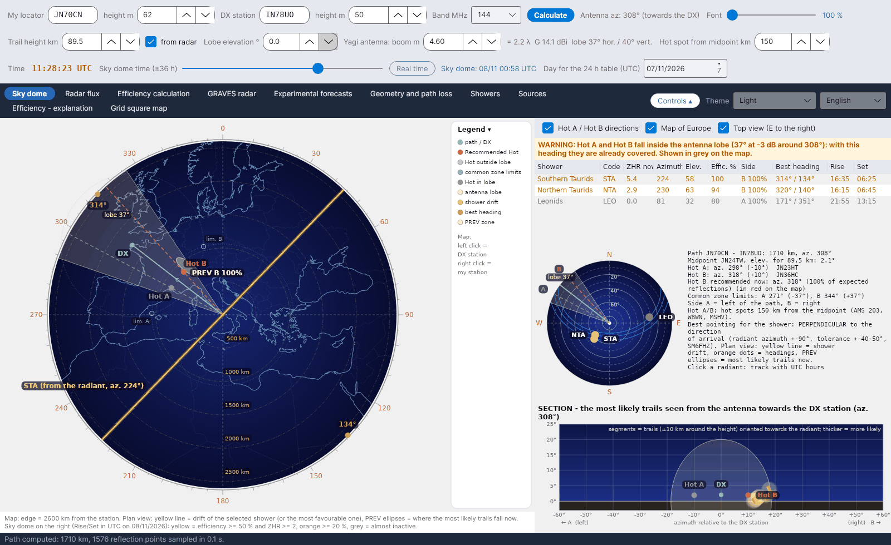
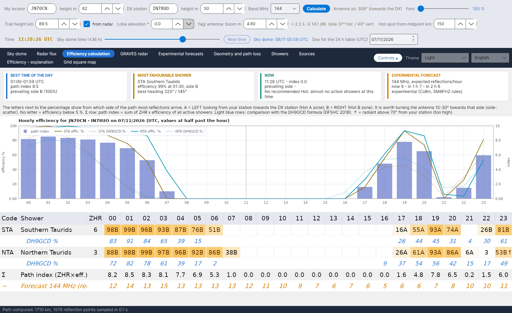

**English** · [Русский](Home-ru) · [Deutsch](Home-de) · [日本語](Home-ja)

# YA-MS – meteor-scatter forecasts and live shower efficiency

*by Costantino Cerrotta IC8TEM*

**YA-MS** is a free program for radio amateurs who work **meteor scatter (MS) on 50, 70, 144, 222 and 432 MHz**. For the real path between your locator and the DX station's, it computes hour by hour how much each active meteor shower helps the path (its **efficiency**), which side of the path the reflections come from (**Hot A / Hot B**), where to point the antenna, and an experimental forecast of the reflections per hour derived from a **live meteor radar** (Collm, Germany). It runs on **Windows, Linux and macOS** (.NET 8 + Avalonia), in 6 interface languages.

The main source is the article by **C. Cerrotta IC8TEM and G. Sartori IV3GTH**, *"METEOR-SCATTER. Ovvero come collegare l'Europa in VHF tutto l'anno senza tante pretese"* (version 7). Every formula and data item in the program cites its source; see [Sources](Sources).

<table><tr>
<td width="33%" align="center"> Sky dome</td>
<td width="33%" align="center"> Efficiency calculation</td>
<td width="33%" align="center"> GRAVES radar</td>
</tr></table>

## Who it is for

- Operators who want to know **when** a meteor-scatter path is open and **where** to point, beyond the generic "the shower peaks tonight".
- Stations working **long paths on 144 and 432 MHz**, where the radiant position decides whether a shower is useful or useless.
- Anyone who wants to **check the numbers**: the calculation manual and the in-program explanation give every step with its origin: a published source, a check made on the program, or a choice of the program.

## The tabs

The tabs are in a single row of pill buttons at the top, in this order:

| # | Tab | What it shows |
|---|---|---|
| 1 | [Sky dome](Sky-View) | Plan map of the path with Hot A / Hot B, antenna lobe, PREV zones and shower drift; shower list; small sky dome with radiants; section seen from the antenna |
| 2 | [Radar flux](Radar-Flux) | Hourly meteor counts and trail heights read from the Collm SKiYMET radar, Sodankylä image, estimate at your band |
| 3 | [Efficiency calculation](Efficiency-Calculation) | Glance cards, hourly efficiency of each shower with side A/B, path index, DH9GCD comparison, chart |
| 4 | [GRAVES radar](GRAVES-Radar) | The GRAVES → you forward-scatter path: useful zone in the beam, sector and step, next beam pass, how to listen |
| 5 | [Experimental forecasts](Experimental-Forecasts) | Collm flux scaled to 144 MHz (or any frequency) with λ^k and station factor K, 24-hour forecast, RMOB comparison |
| 6 | [Geometry and path loss](Geometry-and-Path-Loss) | Distance, midpoint, elevation, Hot A / Hot B, common zone limits, path loss 28–432 MHz, link budget, antenna |
| 7 | [Showers](Showers) | IMO catalogue with the next peak (IMO date and time or calculated) |
| 8 | [Sources](Sources) | All sources; the main one is the Cerrotta–Sartori article |
| 9 | [Efficiency - explanation](Efficiency-Explanation) | Step-by-step document on how the efficiency is computed, exportable to Word |
| 10 | [Grid square map](Grid-Square-Map) | Worked and confirmed Maidenhead squares from an ADIF file, one tab per band |

Above the tabs there are three rows of controls (your locator, DX station, band, antenna, trail height, time); see [Getting started](Getting-Started). The **Controls** button folds them away, and the language and colour scheme are chosen at the top right; see [Settings and data folder](Settings-and-Data-Folder).

## In short

- **Real path, not fixed directions**: the efficiency is computed for the great-circle path between the two locators (older programs used four fixed directions).
- **Specular reflection model** (McKinley) on points of the E layer every 15 km, with the trail height read live from the Collm radar.
- **Hot A / Hot B** 150 km either side of the midpoint (adjustable 30–400 km), the recommended one in red, the ones already inside your antenna lobe in grey.
- **Live radar**: Collm checked every 5 minutes, only changed sources downloaded again; offline the program keeps working with the last saved data.
- **Experimental** forecast at 50/144/432 MHz with the λ³ rule of SM6FHZ, comparable with RMOB observers.
- Everything in one **`data`** folder next to the program: no AppData, no system folders.

> The efficiency is an experimental model (specular reflection + underdense trails). Compare it with MCG_MS, MS-Soft and your own experience on the air.

## Where to start

1. [Installation](Installation)
2. [Getting started](Getting-Started)
3. [Troubleshooting and FAQ](Troubleshooting-FAQ) if something does not work.

Downloads: **[Releases](https://github.com/ic8tem/YA-MS/releases)** on GitHub.
