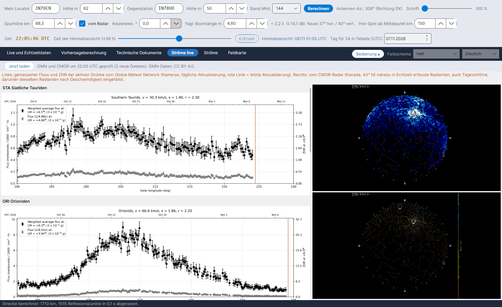

[English](Live-Showers) · [Italiano](Live-Showers-it) · **Deutsch** · [Nederlands](Live-Showers-nl) · [Français](Live-Showers-fr) · [Español](Live-Showers-es) · [Português](Live-Showers-pt) · [Português (Brasil)](Live-Showers-pt-br) · [Dansk](Live-Showers-da) · [Norsk](Live-Showers-nb) · [Svenska](Live-Showers-sv) · [Íslenska](Live-Showers-is) · [Eesti](Live-Showers-et) · [Lietuvių](Live-Showers-lt) · [Latviešu](Live-Showers-lv) · [Polski](Live-Showers-pl) · [Čeština](Live-Showers-cs) · [Magyar](Live-Showers-hu) · [Română](Live-Showers-ro) · [Ελληνικά](Live-Showers-el) · [Русский](Live-Showers-ru) · [Українська](Live-Showers-uk) · [Türkçe](Live-Showers-tr) · [Afrikaans](Live-Showers-af) · [العربية](Live-Showers-ar) · [עברית](Live-Showers-he) · [اردو](Live-Showers-ur) · [हिन्दी](Live-Showers-hi) · [বাংলা](Live-Showers-bn) · [Bahasa Indonesia](Live-Showers-id) · [Tagalog](Live-Showers-tl) · [日本語](Live-Showers-ja) · [한국어](Live-Showers-ko) · [中文](Live-Showers-zh)

# Ströme live

*Reiter: Ströme live.*

Zwei externe Quellen, als Bilder angezeigt (sie veröffentlichen keine auslesbaren Zahlen):

- **Global Meteor Network (GMN)** – [globalmeteornetwork.org/flux](https://globalmeteornetwork.org/flux/): gemessener Fluss und **ZHR** der aktiven Ströme aus einem weltweiten Netz von (meist Amateur-)Kameras, einmal täglich aktualisiert; die rote Linie markiert die letzte Aktualisierung. Das Programm liest die Seite, findet die aktiven Ströme und zeigt für jeden das Diagramm des laufenden Jahres sowie die Jahresübersicht der ZHR. Daten **CC BY 4.0**; zu zitieren sind Vida et al. 2021, MNRAS 506(4), und Vida et al. 2022, MNRAS 515(2).
- **CMOR**, Canadian Meteor Orbit Radar (University of Western Ontario, NASA Meteoroid Environment Office) – [fireballs.ndc.nasa.gov/cmor-radiants](https://fireballs.ndc.nasa.gov/cmor-radiants/): Himmelskarte der vom Radar nahezu in Echtzeit erfassten Radianten, einschließlich der **Tagesströme**, und dieselbe Karte nach Geschwindigkeit eingefärbt. CMOR liegt auf 43° N, etwa auf der Breite Südeuropas – sein Himmel ist also auch unserer.

Jede Datei wird nur dann neu geladen, wenn sie sich geändert hat, höchstens alle 30 Minuten oder mit **Jetzt laden**.
