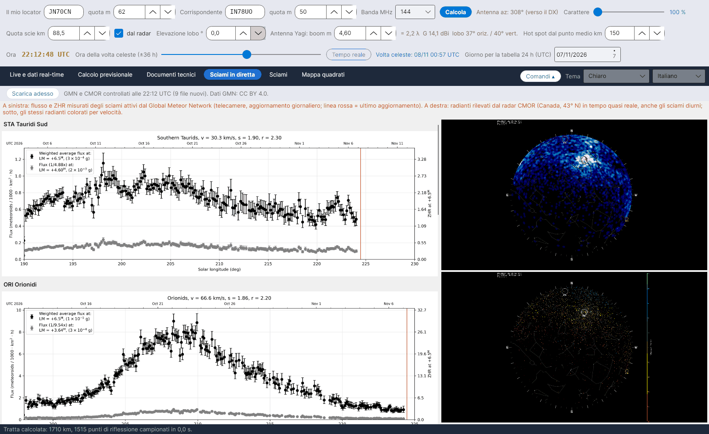

[English](Live-Showers) · **Italiano** · [Deutsch](Live-Showers-de) · [Nederlands](Live-Showers-nl) · [Français](Live-Showers-fr) · [Español](Live-Showers-es) · [Português](Live-Showers-pt) · [Português (Brasil)](Live-Showers-pt-br) · [Dansk](Live-Showers-da) · [Norsk](Live-Showers-nb) · [Svenska](Live-Showers-sv) · [Íslenska](Live-Showers-is) · [Eesti](Live-Showers-et) · [Lietuvių](Live-Showers-lt) · [Latviešu](Live-Showers-lv) · [Polski](Live-Showers-pl) · [Čeština](Live-Showers-cs) · [Magyar](Live-Showers-hu) · [Română](Live-Showers-ro) · [Ελληνικά](Live-Showers-el) · [Русский](Live-Showers-ru) · [Українська](Live-Showers-uk) · [Türkçe](Live-Showers-tr) · [Afrikaans](Live-Showers-af) · [العربية](Live-Showers-ar) · [עברית](Live-Showers-he) · [اردو](Live-Showers-ur) · [हिन्दी](Live-Showers-hi) · [বাংলা](Live-Showers-bn) · [Bahasa Indonesia](Live-Showers-id) · [Tagalog](Live-Showers-tl) · [ไทย](Live-Showers-th) · [日本語](Live-Showers-ja) · [한국어](Live-Showers-ko) · [中文](Live-Showers-zh) · [中文 (繁體)](Live-Showers-zh-tw)

# Sciami in diretta

*Linguetta: Sciami in diretta.*

Due fonti esterne, mostrate come immagini (non pubblicano numeri da leggere):

- **Global Meteor Network (GMN)** – [globalmeteornetwork.org/flux](https://globalmeteornetwork.org/flux/): flusso misurato e **ZHR** degli sciami attivi da una rete mondiale di telecamere (per lo più amatoriali), aggiornati una volta al giorno; la linea rossa segna l'ultimo aggiornamento. Il programma legge la pagina, trova gli sciami attivi e mostra per ciascuno il grafico dell'anno in corso, più il riepilogo annuale degli ZHR. Dati **CC BY 4.0**; citare Vida et al. 2021, MNRAS 506(4), e Vida et al. 2022, MNRAS 515(2).
- **CMOR**, Canadian Meteor Orbit Radar (University of Western Ontario, NASA Meteoroid Environment Office) – [fireballs.ndc.nasa.gov/cmor-radiants](https://fireballs.ndc.nasa.gov/cmor-radiants/): mappa del cielo con i radianti rilevati dal radar quasi in tempo reale, compresi gli **sciami diurni**, e la stessa mappa colorata per velocità. CMOR si trova a 43° N, circa la latitudine dell'Europa meridionale, quindi il suo cielo è anche il nostro.

Ogni file viene riscaricato solo se è cambiato, al massimo ogni 30 minuti oppure con **Scarica adesso**.
