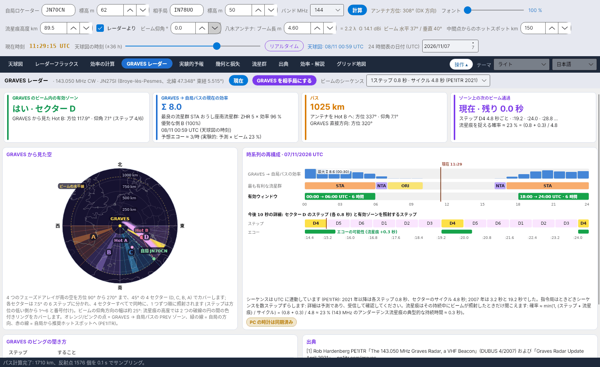

[English](Live-Showers) · [Italiano](Live-Showers-it) · [Deutsch](Live-Showers-de) · [Nederlands](Live-Showers-nl) · [Français](Live-Showers-fr) · [Español](Live-Showers-es) · [Português](Live-Showers-pt) · [Português (Brasil)](Live-Showers-pt-br) · [Dansk](Live-Showers-da) · [Norsk](Live-Showers-nb) · [Svenska](Live-Showers-sv) · [Íslenska](Live-Showers-is) · [Eesti](Live-Showers-et) · [Lietuvių](Live-Showers-lt) · [Latviešu](Live-Showers-lv) · [Polski](Live-Showers-pl) · [Čeština](Live-Showers-cs) · [Magyar](Live-Showers-hu) · [Română](Live-Showers-ro) · [Ελληνικά](Live-Showers-el) · [Русский](Live-Showers-ru) · [Українська](Live-Showers-uk) · [Türkçe](Live-Showers-tr) · [Afrikaans](Live-Showers-af) · [العربية](Live-Showers-ar) · [עברית](Live-Showers-he) · [اردو](Live-Showers-ur) · [हिन्दी](Live-Showers-hi) · [বাংলা](Live-Showers-bn) · [Bahasa Indonesia](Live-Showers-id) · [Tagalog](Live-Showers-tl) · **日本語** · [한국어](Live-Showers-ko) · [中文](Live-Showers-zh)

# 流星群ライブ

*タブ: 流星群ライブ。*

2 つの外部ソースを画像として表示します (どちらも読み取れる数値は公開していません):

- **Global Meteor Network (GMN)** – [globalmeteornetwork.org/flux](https://globalmeteornetwork.org/flux/): 世界中の (主にアマチュアの) カメラ網による、活動中の流星群の実測フラックスと **ZHR**。1 日 1 回更新され、赤線が最終更新を示します。プログラムはページを読み込んで活動中の流星群を見つけ、それぞれについて今年のグラフと、年間の ZHR の概要を表示します。データは **CC BY 4.0**。引用: Vida et al. 2021, MNRAS 506(4)、Vida et al. 2022, MNRAS 515(2)。
- **CMOR**、Canadian Meteor Orbit Radar (University of Western Ontario, NASA Meteoroid Environment Office) – [fireballs.ndc.nasa.gov/cmor-radiants](https://fireballs.ndc.nasa.gov/cmor-radiants/): レーダーがほぼリアルタイムで検出した放射点の天空図 (**昼間流星群**を含む) と、同じ図を速度で色分けしたもの。CMOR は北緯 43°、南ヨーロッパとほぼ同じ緯度にあるため、その空は私たちの空でもあります。

各ファイルは変更があった場合だけ再取得します。間隔は最短 30 分で、**今すぐ取得** でいつでも取得できます。
