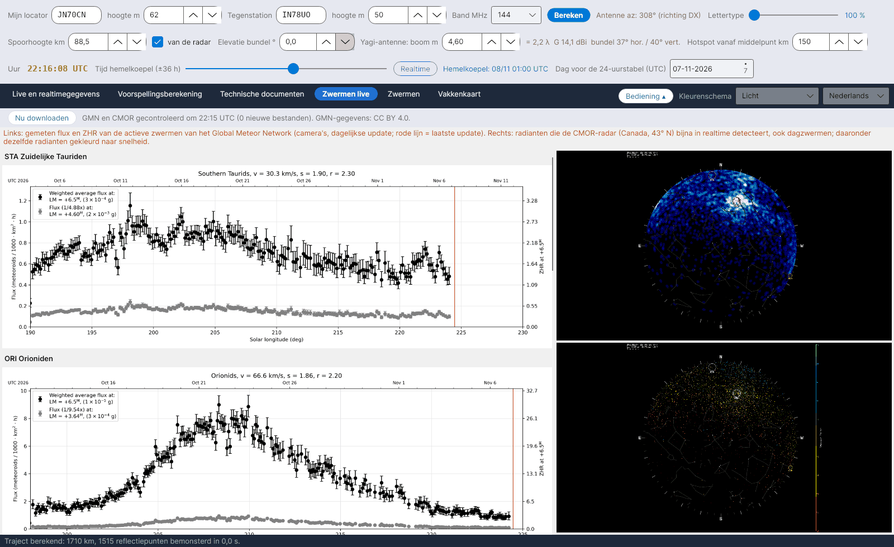

**English** · [Русский](Live-Showers-ru) · [Deutsch](Live-Showers-de) · [日本語](Live-Showers-ja)

# Zwermen live

*Tabblad: Zwermen live.*

Twee externe bronnen, getoond als afbeeldingen (ze publiceren geen uitleesbare getallen):

- **Global Meteor Network (GMN)** – [globalmeteornetwork.org/flux](https://globalmeteornetwork.org/flux/): gemeten flux en **ZHR** van de actieve zwermen uit een wereldwijd netwerk van (meest amateur)camera's, eenmaal per dag bijgewerkt; de rode lijn markeert de laatste update. Het programma leest de pagina, vindt de actieve zwermen en toont voor elk de grafiek van het lopende jaar, plus het jaaroverzicht van de ZHR. Gegevens **CC BY 4.0**; vermeld Vida et al. 2021, MNRAS 506(4), en Vida et al. 2022, MNRAS 515(2).
- **CMOR**, Canadian Meteor Orbit Radar (University of Western Ontario, NASA Meteoroid Environment Office) – [fireballs.ndc.nasa.gov/cmor-radiants](https://fireballs.ndc.nasa.gov/cmor-radiants/): hemelkaart van de radianten die de radar vrijwel in realtime detecteert, inclusief de **dagzwermen**, en dezelfde kaart gekleurd naar snelheid. CMOR ligt op 43° N, ongeveer de breedte van Zuid-Europa, dus zijn hemel is ook de onze.

Elk bestand wordt alleen opnieuw gedownload als het is gewijzigd, hooguit elke 30 minuten of met **Nu downloaden**.
