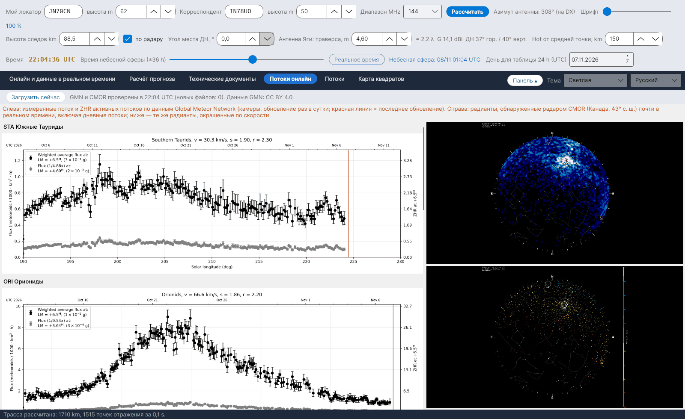

[English](Live-Showers) · **Русский** · [Deutsch](Live-Showers-de) · [日本語](Live-Showers-ja)

# Потоки онлайн

*Вкладка: Потоки онлайн.*

Два внешних источника, показываемые в виде изображений (числовых данных для считывания они не публикуют):

- **Global Meteor Network (GMN)** – [globalmeteornetwork.org/flux](https://globalmeteornetwork.org/flux/): измеренные поток и **ZHR** активных потоков по данным всемирной сети камер (в основном любительских), обновляются раз в сутки; красная линия отмечает последнее обновление. Программа читает страницу, находит активные потоки и показывает для каждого график текущего года, а также годовой обзор ZHR. Данные **CC BY 4.0**; ссылки: Vida et al. 2021, MNRAS 506(4), и Vida et al. 2022, MNRAS 515(2).
- **CMOR**, Canadian Meteor Orbit Radar (University of Western Ontario, NASA Meteoroid Environment Office) – [fireballs.ndc.nasa.gov/cmor-radiants](https://fireballs.ndc.nasa.gov/cmor-radiants/): карта неба с радиантами, обнаруженными радаром почти в реальном времени, включая **дневные потоки**, и та же карта с раскраской по скорости. CMOR находится на 43° с. ш., примерно на широте южной Европы, поэтому его небо – это и наше небо.

Каждый файл загружается заново, только если он изменился, не чаще одного раза в 30 минут или по кнопке **Загрузить сейчас**.
