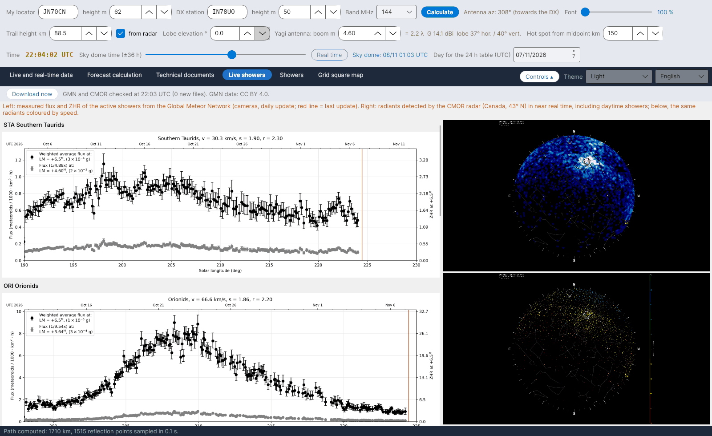

[English](Live-Showers) · [Italiano](Live-Showers-it) · [Deutsch](Live-Showers-de) · [Nederlands](Live-Showers-nl) · [Français](Live-Showers-fr) · [Español](Live-Showers-es) · [Português](Live-Showers-pt) · [Português (Brasil)](Live-Showers-pt-br) · [Dansk](Live-Showers-da) · [Norsk](Live-Showers-nb) · [Svenska](Live-Showers-sv) · [Íslenska](Live-Showers-is) · [Eesti](Live-Showers-et) · [Lietuvių](Live-Showers-lt) · [Latviešu](Live-Showers-lv) · [Polski](Live-Showers-pl) · [Čeština](Live-Showers-cs) · [Magyar](Live-Showers-hu) · [Română](Live-Showers-ro) · [Ελληνικά](Live-Showers-el) · [Русский](Live-Showers-ru) · [Українська](Live-Showers-uk) · [Türkçe](Live-Showers-tr) · [Afrikaans](Live-Showers-af) · [العربية](Live-Showers-ar) · [עברית](Live-Showers-he) · [اردو](Live-Showers-ur) · [हिन्दी](Live-Showers-hi) · [বাংলা](Live-Showers-bn) · [Bahasa Indonesia](Live-Showers-id) · [Tagalog](Live-Showers-tl) · [日本語](Live-Showers-ja) · [한국어](Live-Showers-ko) · **中文** · [中文 (繁體)](Live-Showers-zh-tw)

# 实时流星雨

*选项卡：实时流星雨。*

两个外部来源，以图像形式显示（它们不发布可供读取的数值）：

- **Global Meteor Network（GMN）** – [globalmeteornetwork.org/flux](https://globalmeteornetwork.org/flux/)：由遍布全球的摄像机网络（大多由业余爱好者运营）测得的活跃流星雨流量和 **ZHR**，每天更新一次；红线标出最近一次更新。程序读取该页面，找出活跃的流星雨，为每个流星雨显示当年的图表，并附上全年 ZHR 概览。数据采用 **CC BY 4.0** 许可；请引用 Vida et al. 2021, MNRAS 506(4) 和 Vida et al. 2022, MNRAS 515(2)。
- **CMOR**，Canadian Meteor Orbit Radar（University of Western Ontario，NASA Meteoroid Environment Office）– [fireballs.ndc.nasa.gov/cmor-radiants](https://fireballs.ndc.nasa.gov/cmor-radiants/)：雷达近实时探测到的辐射点天图，包括**白昼流星雨**，以及按速度着色的同一张图。CMOR 位于北纬 43°，与南欧纬度相近，因此它看到的天空也是我们的天空。

每个文件只有在发生变化时才会重新下载，最多每 30 分钟一次，或点击**立即下载**时下载。
