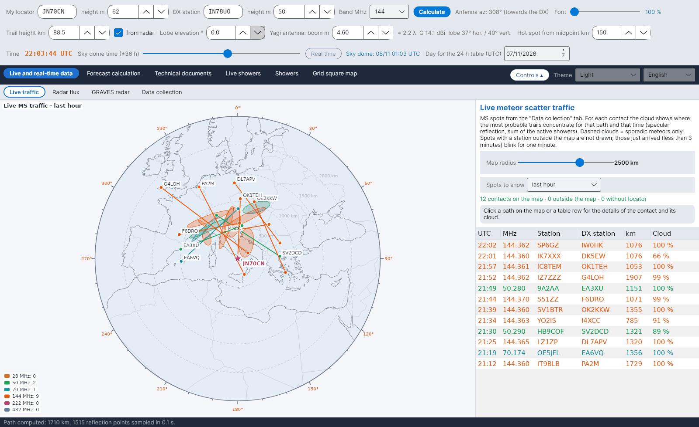

[English](Live-Traffic) · [Italiano](Live-Traffic-it) · [Deutsch](Live-Traffic-de) · [Nederlands](Live-Traffic-nl) · [Français](Live-Traffic-fr) · [Español](Live-Traffic-es) · [Português](Live-Traffic-pt) · [Português (Brasil)](Live-Traffic-pt-br) · [Dansk](Live-Traffic-da) · [Norsk](Live-Traffic-nb) · [Svenska](Live-Traffic-sv) · [Íslenska](Live-Traffic-is) · [Eesti](Live-Traffic-et) · [Lietuvių](Live-Traffic-lt) · [Latviešu](Live-Traffic-lv) · [Polski](Live-Traffic-pl) · [Čeština](Live-Traffic-cs) · [Magyar](Live-Traffic-hu) · [Română](Live-Traffic-ro) · [Ελληνικά](Live-Traffic-el) · [Русский](Live-Traffic-ru) · [Українська](Live-Traffic-uk) · [Türkçe](Live-Traffic-tr) · [Afrikaans](Live-Traffic-af) · [العربية](Live-Traffic-ar) · [עברית](Live-Traffic-he) · [اردو](Live-Traffic-ur) · [हिन्दी](Live-Traffic-hi) · **বাংলা** · [ไทย](Live-Traffic-th) · [Bahasa Indonesia](Live-Traffic-id) · [Tagalog](Live-Traffic-tl) · [日本語](Live-Traffic-ja) · [한국어](Live-Traffic-ko) · [中文](Live-Traffic-zh) · [中文 (繁體)](Live-Traffic-zh-tw)

# সরাসরি ট্রাফিক

*ট্যাব: লাইভ ও রিয়েল-টাইম তথ্য › সরাসরি ট্রাফিক।*

## কী দেখায়

আপনার স্টেশনকে কেন্দ্র করে একটি **অ্যাজিমুথাল সমদূরবর্তী মানচিত্র** (কেন্দ্র থেকে দূরত্ব = প্রকৃত দূরত্ব, কোণ = অ্যাজিমুথ), যাতে [ডেটা সংগ্রহ](Data-Collection-bn)-এ সংগৃহীত **সব মিটিওর স্ক্যাটার ট্রাফিক** থাকে। প্রতিটি যোগাযোগের জন্য প্রোগ্রামটি আঁকে:

- দুই স্টেশনের মধ্যকার **পথ**, তার ব্যান্ডের রঙে: 28 MHz বাদামি, 50 MHz সবুজ, 70 MHz সায়ান, 144 MHz কমলা, 222 MHz গোলাপি, 432 MHz বেগুনি;
- পথের দুই প্রান্তে দুটি **স্টেশন**;
- **বৃষ্টির অঞ্চল**: সেই পথ ও সেই সময়ের জন্য সম্ভাব্যতম উল্কা-রেখাগুলো যেখানে কেন্দ্রীভূত।

যে স্পটের কোনো স্টেশন **মানচিত্রের বাইরে**, সেগুলো বাদ দেওয়া হয়। কেবল আপনার WSJT-X (UDP)-এর সেই ডিকোডগুলো জ্বলে-নেভে, যেখানে কোনো সহকর্মী আপনাকে উত্তর দেন।

কে শুনছে দেখান: ব্যান্ডের রঙের ত্রিভুজ সেই স্টেশনগুলো চিহ্নিত করে, যেগুলো PSKReporter অনুযায়ী বেছে নেওয়া সময়ে 28, 50, 70, 144 ও 432 MHz-এ MSK144, FSK441, PSK2K বা JTMS গ্রহণ করছে। ত্রিভুজে ক্লিক করলে কল সাইন, লোকেটর, মোড ও শেষ স্পট দেখা যায়। তথ্য সংগ্রহ ট্যাবের MQTT প্রবাহ সংযুক্ত থাকতে হবে।

PSKReporter মানচিত্রের সক্রিয় মনিটরগুলিও: যে স্টেশনগুলো pskreporter.info-এর মানচিত্রে MSK144, FSK441, PSK2K বা JTMS-এ দেখা যায় কিন্তু এখনও কোনো স্পট পায়নি তাদের জন্য ফাঁকা ত্রিভুজ (MQTT শুধু সেই স্টেশন পাঠায় যারা কিছু পায়)। পরিষেবার নিয়ম অনুযায়ী YA-MS সব মোডের জন্য প্রতি 5 মিনিটে একবার PSKReporter-এর অনুসন্ধান পরিষেবায় জিজ্ঞাসা করে; একটি মনিটর মানচিত্রে অন্তত 11 মিনিট থাকে। ত্রিভুজে ক্লিক করলে কল সাইন, লোকেটর, ডিকোডিং প্রোগ্রাম ও মনিটর সক্রিয় থাকার সময় দেখা যায়। শুরু থেকে চালু।

সমান্তরাল পথ ছাড়া 1100 কিমির বেশি FT8: 1100 কিমির বেশি দূরের স্টেশনের মধ্যে একটি FT8 স্পট (PSKReporter MQTT, ক্লাস্টার বা UDP-র মাধ্যমে WSJT-X থেকে) যার আগে ও পরের 3 মিনিটে কোনো সমান্তরাল পথ নেই (একই ব্যান্ড, মধ্যবিন্দু 300 কিমির মধ্যে, দিক 15°-এর মধ্যে, অন্য এক জোড়া স্টেশন) হালকা সবুজে আঁকা হয়, নিচে ডানদিকের সারণিতে তার সারিও (জ্বলা-নেভা ছাড়া)। স্পোরাডিক E ও ট্রোপো অনেক কাছাকাছি, সমান্তরাল পথ দেয়; একক স্পট উল্কার রেখা হতে পারে। তাই YA-MS MQTT থেকে 6 m, 4 m, 2 m, 1.25 m ও 70 cm-এর FT8 স্পটও নেয় (28 MHz কখনো নয়)। এই স্পটগুলো MS সংরক্ষণাগারে যায় না। শুরু থেকে চালু। PSKReporter MQTT দিয়ে অতিরিক্ত যাচাই: গ্রাহক স্টেশন যদি MQTT-তে 3 মিনিটের মধ্যে একই ব্যান্ডে 1100 কিমির বেশি দূরের অন্য স্টেশন শোনে তবে স্পটটি একক নয় (ব্যান্ড খোলা); ক্লাস্টার ও RBN-এর স্পট তখনই গণ্য হয় যখন একই জোড়া MQTT থেকেও আসে; RBN স্কিমার («-#» যুক্ত কল সাইন) কখনো গণ্য হয় না।

UDP-এর মাধ্যমে আপনার WSJT-X-এর যে ডিকোডগুলোতে কোনো সহকর্মী আপনাকে উত্তর দেন (বার্তার প্রথম কলসাইন আপনার), সেগুলো যেকোনো মোডে ও যেকোনো দূরত্বে জ্বলে-নেভা ভাঙা রেখায় আঁকা হয়, আর সারণিতে তাদের সারি হলুদ পটভূমিতে জ্বলে-নেভে। কিছু জ্বলে-নেভার এটাই একমাত্র ক্ষেত্র।

YA-MS ব্যবহারকারীদের মধ্যে বিনিময়: অন্য কোনো YA-MS ব্যবহারকারী UDP-র মাধ্যমে আপনার স্টেশনের উদ্দেশে বার্তা ডিকোড করলে (MSK144, FSK441, PSK2K বা JTMS-এ, অথবা 1100 কিমির বেশি FT8-এ), তাঁর YA-MS সেটি তিনটি সর্বজনীন MQTT ব্রোকার (HiveMQ, Mosquitto, EMQX) দিয়ে এনক্রিপ্ট করে আপনাকে পাঠায়; আপনি সেটি স্থির বেগুনি ভাঙা রেখা ও UDP কনসোলের একটি লাইন হিসেবে দেখেন। শুধু আপনি পড়তে পারেন (ECDH P-256 কী, AES-256 ও HMAC-SHA256)। FT8 স্পট কেবল তখনই দেখানো হয় যখন 3 মিনিটে সমান্তরাল পথ থাকে না। শুরু থেকে চালু; data/config.ini-তে yams_scambio=0 এটি বন্ধ করে।

মানচিত্রে প্রতিটি স্পটের দুই স্টেশনের কলসাইন লেখা হয়, প্রতি স্টেশনে একবার। প্রক্ষেপণ বেছে নেওয়া যায়: দিগংশীয় (কেন্দ্রে আপনার স্টেশন) বা মার্কেটর। বৃষ্টির অঞ্চল কলামের টুলটিপ এর অর্থ ব্যাখ্যা করে।

সব ব্যান্ডের স্পট দেখানো হয়, ডেটা সংগ্রহে না বাছা ব্যান্ডেরও (সেগুলি সংরক্ষিত হয় না)। CW স্পট এবং খুব কাছের স্টেশনগুলির মধ্যে স্পট দেখানো হয় না, যদি ডেটা সংগ্রহে সেগুলি বাদ দেওয়া হয়।

## বৃষ্টির অঞ্চল কীভাবে হিসাব করা হয়

প্রতিটি স্পটের জন্য প্রোগ্রামটি দুই লোকেটরের মধ্যে পথ তৈরি করে (আপনার নিজের পথের মতো একই জ্যামিতি, দেখুন [জ্যামিতি ও পথ ক্ষয়](Geometry-and-Path-Loss-bn)) এবং স্পটের সময়ে E স্তরের বিন্দু ধরে ধরে **প্রতিটি সক্রিয় উল্কাবৃষ্টির দর্পণ-প্রতিফলন অবদান** যোগ করে, তার ZHR দিয়ে ভারযুক্ত করে – [আকাশ-গম্বুজ](Sky-View-bn)-এর **PREV অঞ্চলের** মতো একই হিসাব। পথের যে পাশে মোটের অন্তত 15 % থাকে, সেখানে বৃষ্টির অঞ্চলটি একটি **উপবৃত্ত**: কেন্দ্র বিন্দুগুলোর ভারযুক্ত গড়ে, অর্ধ-অক্ষ তাদের বিস্তারের আইগেনমানগুলোর বর্গমূলের 1.5 গুণ, প্রধান অক্ষ প্রধান আইগেনভেক্টর বরাবর। কোনো উল্কাবৃষ্টি অবদান না রাখলে (কেবল বিক্ষিপ্ত উল্কা) বৃষ্টির অঞ্চল দুটি হলো প্রচলিত দুটি **হট স্পট**, ড্যাশ দিয়ে আঁকা। সম্পূর্ণ সমীকরণ হিসাবের ম্যানুয়ালের অধ্যায় 10-এ আছে।

## নিয়ন্ত্রণ

| নিয়ন্ত্রণ | অর্থ |
|---|---|
| **মানচিত্রের ব্যাসার্ধ** | আপনার স্টেশন থেকে 600–3500 km। |
| **দেখানোর স্পট** | শেষ 15 বা 30 মিনিট, শেষ এক ঘণ্টা, শেষ 3 ঘণ্টা, শেষ 24 ঘণ্টা। |
| **টেবিল** | মানচিত্রে থাকা যোগাযোগ, নতুনগুলো আগে, ব্যান্ডের রঙে; *% বৃষ্টি* প্রধান পাশে প্রতিফলনের অংশ দেখায়, অথবা *বিক্ষিপ্ত*। |
| **ক্লিক** | কোনো পথে বা টেবিলের সারিতে: যোগাযোগটি হাইলাইট হয় এবং বাক্সে বৃষ্টির অঞ্চলের কেন্দ্রের লোকেটর, তার অংশ, আকার ও অক্ষ দেখায়। |
