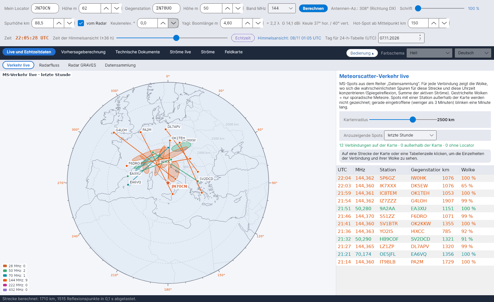

[English](Live-Traffic) · [Italiano](Live-Traffic-it) · **Deutsch** · [Nederlands](Live-Traffic-nl) · [Français](Live-Traffic-fr) · [Español](Live-Traffic-es) · [Português](Live-Traffic-pt) · [Português (Brasil)](Live-Traffic-pt-br) · [Dansk](Live-Traffic-da) · [Norsk](Live-Traffic-nb) · [Svenska](Live-Traffic-sv) · [Íslenska](Live-Traffic-is) · [Eesti](Live-Traffic-et) · [Lietuvių](Live-Traffic-lt) · [Latviešu](Live-Traffic-lv) · [Polski](Live-Traffic-pl) · [Čeština](Live-Traffic-cs) · [Magyar](Live-Traffic-hu) · [Română](Live-Traffic-ro) · [Ελληνικά](Live-Traffic-el) · [Русский](Live-Traffic-ru) · [Українська](Live-Traffic-uk) · [Türkçe](Live-Traffic-tr) · [Afrikaans](Live-Traffic-af) · [العربية](Live-Traffic-ar) · [עברית](Live-Traffic-he) · [اردو](Live-Traffic-ur) · [हिन्दी](Live-Traffic-hi) · [বাংলা](Live-Traffic-bn) · [ไทย](Live-Traffic-th) · [Bahasa Indonesia](Live-Traffic-id) · [Tagalog](Live-Traffic-tl) · [日本語](Live-Traffic-ja) · [한국어](Live-Traffic-ko) · [中文](Live-Traffic-zh) · [中文 (繁體)](Live-Traffic-zh-tw)

# Verkehr live

*Reiter: Live und Echtzeitdaten › Verkehr live.*

## Was er zeigt

Eine **mittabstandstreue Azimutalkarte** mit deiner Station im Mittelpunkt (Abstand vom Mittelpunkt = wahre Entfernung, Winkel = Azimut) mit **dem gesamten Meteorscatter-Verkehr**, den die [Datensammlung](Data-Collection-de) zusammengetragen hat. Für jede Verbindung zeichnet das Programm:

- die **Strecke** zwischen den beiden Stationen in der Farbe ihres Bandes: 28 MHz braun, 50 MHz grün, 70 MHz cyan, 144 MHz orange, 222 MHz rosa, 432 MHz violett;
- die beiden **Stationen** an den Enden der Strecke;
- die **Wolke**: wo sich die wahrscheinlichsten Meteorspuren für diese Strecke und diese Uhrzeit konzentrieren.

Spots mit einer Station **außerhalb der Karte** werden verworfen. Ein **gerade eingetroffener** Spot (nicht älter als 3 Minuten) **blinkt eine Minute lang**, damit neue Aktivität sofort ins Auge fällt.

Zeigen, wer hört: Dreiecke in der Bandfarbe markieren die Stationen, die laut PSKReporter im gewählten Zeitfenster MSK144, FSK441, PSK2K oder JTMS auf 28, 50, 70, 144 und 432 MHz empfangen. Ein Klick auf ein Dreieck zeigt Rufzeichen, Locator, Betriebsarten und letzten Spot. Der MQTT-Strom im Reiter Datensammlung muss verbunden sein.

Auch die aktiven Monitore der PSKReporter-Karte: leere Dreiecke für die Stationen, die auf der Karte von pskreporter.info in MSK144, FSK441, PSK2K oder JTMS erscheinen, aber noch keinen Spot empfangen haben (MQTT sendet nur Stationen, die etwas empfangen). YA-MS fragt den Abfragedienst von PSKReporter alle 5 Minuten einmal für alle Betriebsarten ab, wie es die Regeln des Dienstes verlangen; ein Monitor bleibt mindestens 11 Minuten auf der Karte. Ein Klick auf das Dreieck zeigt Rufzeichen, Locator, Dekodierprogramm und die Uhrzeit, zu der der Monitor aktiv war. Standardmäßig eingeschaltet.

FT8 über 1100 km ohne parallele Strecken: ein FT8-Spot (aus PSKReporter MQTT, den Clustern oder WSJT-X über UDP) zwischen Stationen, die mehr als 1100 km auseinander liegen, ohne parallele Strecken in den 3 Minuten davor und danach (gleiches Band, Mittelpunkt innerhalb 300 km, Richtung innerhalb 15°, ein anderes Stationspaar), wird hellgrün gezeichnet und seine Zeile in der Tabelle unten rechts blinkt immer. Sporadic-E und Tropo ergeben viele nahe, parallele Strecken; ein einzelner Spot kann eine Meteorspur sein. Dafür empfängt YA-MS über MQTT auch die FT8-Spots von 6 m, 4 m, 2 m, 1,25 m und 70 cm (nicht die von 10 m, zu viele). Diese Spots kommen nicht ins MS-Archiv. Standardmäßig eingeschaltet.

WSJT-X-Spots über UDP, die deine Station betreffen (die Dekodierung enthält dein Rufzeichen: wer dich ruft oder dir antwortet), werden mit einer gestrichelten Linie gezeichnet, die immer blinkt, in jeder Betriebsart und auf jede Entfernung.

Die Karte zeigt die Rufzeichen beider Stationen jedes Spots, einmal pro Station. Die Projektion ist wählbar: azimutal (auf deine Station zentriert) oder Mercator. Der Tooltip auf der Spalte Wolke erklärt ihre Bedeutung.

Es werden die Spots aller Bänder angezeigt, auch der in der Datensammlung nicht gewählten (diese werden nicht gespeichert). CW-Spots und Spots zwischen zu nahe liegenden Stationen werden nicht angezeigt, wenn sie in der Datensammlung verworfen werden.

## Wie die Wolke berechnet wird

Für jeden Spot bildet das Programm die Strecke zwischen den beiden Locatoren (dieselbe Geometrie wie für deine eigene Strecke, siehe [Geometrie und Dämpfung](Geometry-and-Path-Loss-de)) und summiert zur Zeit des Spots Punkt für Punkt der E-Schicht die **Beiträge der spiegelnden Reflexion aller aktiven Ströme**, gewichtet mit ihrer ZHR – dieselbe Berechnung wie für die **PREV-Zonen** der [Himmelsansicht](Sky-View-de). Für jede Seite der Strecke, auf die mindestens 15 % der Summe entfallen, ist die Wolke eine **Ellipse**: Mittelpunkt im gewichteten Mittel der Punkte, Halbachsen gleich dem 1,5-Fachen der Quadratwurzeln der Eigenwerte ihrer Streuung, große Achse entlang des Haupteigenvektors. Trägt kein Strom bei (nur sporadische Meteore), sind die Wolken die beiden klassischen **Hot Spots**, gestrichelt gezeichnet. Die vollständigen Gleichungen stehen in Kapitel 10 des Berechnungshandbuchs.

## Bedienelemente

| Element | Bedeutung |
|---|---|
| **Kartenradius** | 600–3500 km um deine Station. |
| **Anzuzeigende Spots** | Letzte 15 oder 30 Minuten, letzte Stunde, letzte 3 Stunden, letzte 24 Stunden. |
| **Tabelle** | Verbindungen auf der Karte, neueste oben, in der Bandfarbe; *Wolke* gibt den Anteil der Reflexionen auf der Hauptseite an, oder *sporadische*. |
| **Klick** | Auf eine Strecke oder eine Tabellenzeile: Die Verbindung wird hervorgehoben, und das Feld zeigt den Locator der Wolkenmitte, ihren Anteil, ihre Größe und ihre Achse. |
