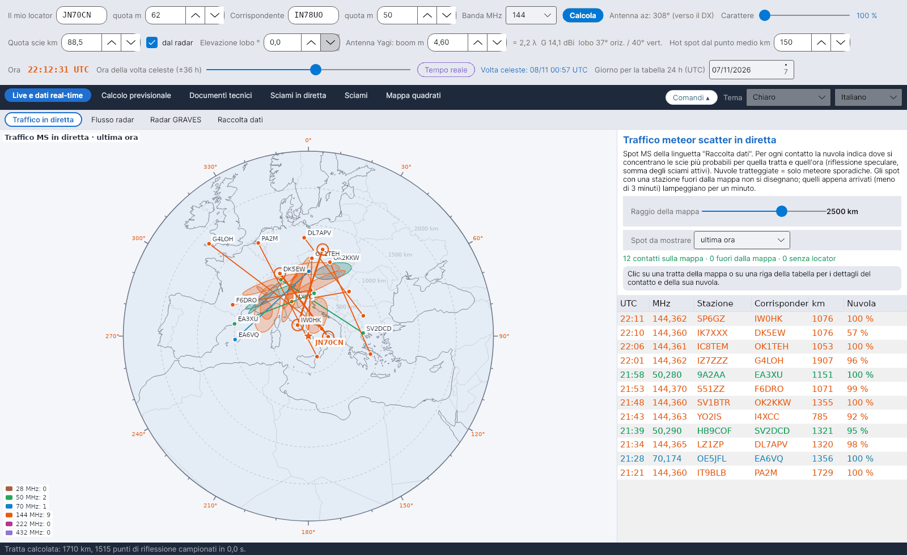

[English](Live-Traffic) · **Italiano** · [Deutsch](Live-Traffic-de) · [Nederlands](Live-Traffic-nl) · [Français](Live-Traffic-fr) · [Español](Live-Traffic-es) · [Português](Live-Traffic-pt) · [Português (Brasil)](Live-Traffic-pt-br) · [Dansk](Live-Traffic-da) · [Norsk](Live-Traffic-nb) · [Svenska](Live-Traffic-sv) · [Íslenska](Live-Traffic-is) · [Eesti](Live-Traffic-et) · [Lietuvių](Live-Traffic-lt) · [Latviešu](Live-Traffic-lv) · [Polski](Live-Traffic-pl) · [Čeština](Live-Traffic-cs) · [Magyar](Live-Traffic-hu) · [Română](Live-Traffic-ro) · [Ελληνικά](Live-Traffic-el) · [Русский](Live-Traffic-ru) · [Українська](Live-Traffic-uk) · [Türkçe](Live-Traffic-tr) · [Afrikaans](Live-Traffic-af) · [العربية](Live-Traffic-ar) · [עברית](Live-Traffic-he) · [اردو](Live-Traffic-ur) · [हिन्दी](Live-Traffic-hi) · [বাংলা](Live-Traffic-bn) · [ไทย](Live-Traffic-th) · [Bahasa Indonesia](Live-Traffic-id) · [Tagalog](Live-Traffic-tl) · [日本語](Live-Traffic-ja) · [한국어](Live-Traffic-ko) · [中文](Live-Traffic-zh) · [中文 (繁體)](Live-Traffic-zh-tw)

# Traffico in diretta

*Linguetta: Live e dati real-time › Traffico in diretta.*

## Che cosa mostra

Una **mappa azimutale equidistante** centrata sulla tua stazione (distanza dal centro = distanza vera, angolo = azimut) con **tutto il traffico meteor scatter** raccolto dalla [Raccolta dati](Data-Collection-it). Per ogni collegamento il programma disegna:

- la **tratta** tra le due stazioni, nel colore della sua banda: 28 MHz marrone, 50 MHz verde, 70 MHz ciano, 144 MHz arancione, 222 MHz rosa, 432 MHz viola;
- le due **stazioni** agli estremi della tratta;
- la **nuvola**: dove si concentrano le scie meteoriche più probabili per quella tratta e per quell'ora.

Gli spot con una stazione **fuori dalla mappa** vengono scartati. Uno spot **appena arrivato** (non più vecchio di 3 minuti) **lampeggia per un minuto**, così la nuova attività salta all'occhio.

Mostra chi è in ascolto: triangoli del colore della banda segnano le stazioni che, secondo PSKReporter, ricevono in MSK144, FSK441, PSK2K o JTMS su 28, 50, 70, 144 e 432 MHz nella finestra di tempo scelta. Un clic sul triangolo mostra nominativo, locator, modi e ultimo spot. Serve il flusso MQTT della linguetta Raccolta dati connesso.

Sulla mappa si scrivono i nominativi di entrambe le stazioni di ogni spot, una volta sola per stazione. La proiezione si sceglie tra azimutale (centrata sulla tua stazione) e Mercatore. Il fumetto sulla colonna Nuvola ne spiega il significato.

Si vedono gli spot di tutte le bande, anche di quelle non scelte nella Raccolta dati (quelli non si memorizzano). Gli spot CW e quelli tra stazioni troppo vicine non si vedono, se sono scartati nella Raccolta dati.

## Come si calcola la nuvola

Per ogni spot il programma costruisce la tratta tra i due locator (la stessa geometria della tua tratta, vedi [Geometria e attenuazione](Geometry-and-Path-Loss-it)) e, all'ora dello spot, somma punto per punto dello strato E i **contributi di riflessione speculare di ogni sciame attivo**, pesati con il suo ZHR – lo stesso calcolo delle **zone PREV** della [volta celeste](Sky-View-it). Per ogni lato della tratta che raccoglie almeno il 15 % del totale, la nuvola è un'**ellisse**: centro nella media pesata dei punti, semiassi pari a 1,5 volte le radici quadrate degli autovalori della loro dispersione, asse maggiore lungo l'autovettore principale. Quando nessuno sciame contribuisce (solo meteore sporadiche) le nuvole sono i due **hot spot** classici, disegnati tratteggiati. Le equazioni complete sono nel capitolo 10 del manuale dei calcoli.

## Comandi

| Comando | Significato |
|---|---|
| **Raggio della mappa** | 600–3500 km dalla tua stazione. |
| **Spot da mostrare** | Ultimi 15 o 30 minuti, ultima ora, ultime 3 ore, ultime 24 ore. |
| **Tabella** | Collegamenti sulla mappa, i più recenti in alto, nel colore della banda; *Nuvola* dà la quota di riflessioni sul lato principale, oppure *sporadiche*. |
| **Clic** | Su una tratta o su una riga della tabella: il collegamento viene evidenziato e il riquadro mostra il locator del centro della nuvola, la sua quota, le dimensioni e l'asse. |
