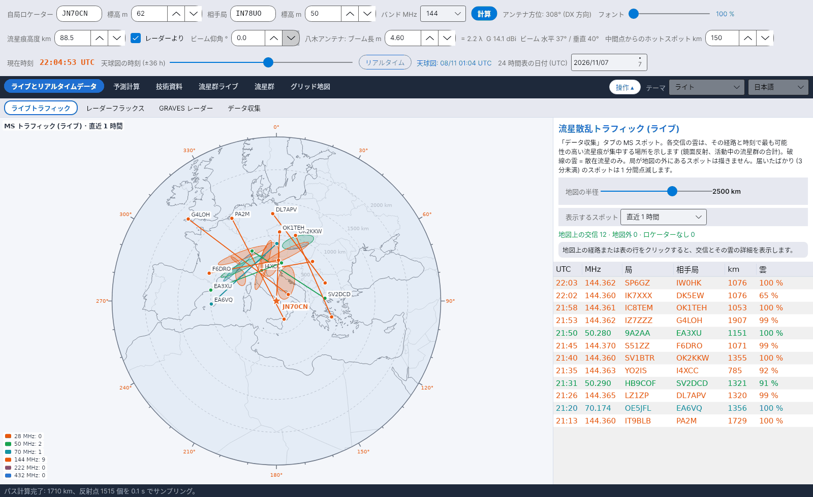

[English](Live-Traffic) · [Italiano](Live-Traffic-it) · [Deutsch](Live-Traffic-de) · [Nederlands](Live-Traffic-nl) · [Français](Live-Traffic-fr) · [Español](Live-Traffic-es) · [Português](Live-Traffic-pt) · [Português (Brasil)](Live-Traffic-pt-br) · [Dansk](Live-Traffic-da) · [Norsk](Live-Traffic-nb) · [Svenska](Live-Traffic-sv) · [Íslenska](Live-Traffic-is) · [Eesti](Live-Traffic-et) · [Lietuvių](Live-Traffic-lt) · [Latviešu](Live-Traffic-lv) · [Polski](Live-Traffic-pl) · [Čeština](Live-Traffic-cs) · [Magyar](Live-Traffic-hu) · [Română](Live-Traffic-ro) · [Ελληνικά](Live-Traffic-el) · [Русский](Live-Traffic-ru) · [Українська](Live-Traffic-uk) · [Türkçe](Live-Traffic-tr) · [Afrikaans](Live-Traffic-af) · [العربية](Live-Traffic-ar) · [עברית](Live-Traffic-he) · [اردو](Live-Traffic-ur) · [हिन्दी](Live-Traffic-hi) · [বাংলা](Live-Traffic-bn) · [ไทย](Live-Traffic-th) · [Bahasa Indonesia](Live-Traffic-id) · [Tagalog](Live-Traffic-tl) · **日本語** · [한국어](Live-Traffic-ko) · [中文](Live-Traffic-zh) · [中文 (繁體)](Live-Traffic-zh-tw)

# ライブトラフィック

*タブ: ライブとリアルタイムデータ › ライブトラフィック。*

## 表示内容

自局を中心とする**正距方位図法の地図** (中心からの距離 = 実際の距離、角度 = 方位) に、[データ収集](Data-Collection-ja) で集めた**すべての流星散乱通信のトラフィック**を表示します。交信ごとに次のものを描きます:

- 2 局間の**パス**。色はバンドごとに、28 MHz 茶、50 MHz 緑、70 MHz シアン、144 MHz 橙、222 MHz ピンク、432 MHz 紫です;
- パスの両端の 2 つの**局**;
- **流星群ゾーン**: そのパスとその時刻で最も可能性の高い流星痕が集中する場所。

**地図の外**にある局を含むスポットは破棄します。**届いたばかり**のスポット (3 分以内) は **1 分間点滅**するので、新しい活動がひと目でわかります。

受信中の局を表示：バンドの色の三角形は、PSKReporter によると選んだ時間帯に 28、50、70、144、432 MHz で MSK144、FSK441、PSK2K、JTMS を受信している局です。三角形をクリックすると、コールサイン、ロケーター、モード、最後のスポットが表示されます。「データ収集」タブの MQTT を接続しておく必要があります。

PSKReporter マップのアクティブなモニターも表示: pskreporter.info の地図に MSK144、FSK441、PSK2K、JTMS で表示されているが、まだスポットを受信していない局を白抜きの三角で示します (MQTT は何かを受信した局だけを送ります)。YA-MS はサービスの規則どおり、全モードについて 5 分ごとに 1 回 PSKReporter の検索サービスに問い合わせます。モニターは地図上に少なくとも 11 分間残ります。三角をクリックすると、コールサイン、ロケーター、デコードソフト、モニターがアクティブだった時刻が表示されます。初期設定でオン。

平行パスのない 1100 km 超の FT8: 1100 km 以上離れた局間の FT8 スポット (PSKReporter MQTT、クラスター、または UDP 経由の WSJT-X から) で、前後 3 分以内に平行パス (同じバンド、中点が 300 km 以内、方向差 15° 以内、別の局の組) がないものは薄い緑で描かれ、右下の表のその行は常に点滅します。スポラディック E や対流圏伝搬では近接した平行パスが多数現れます。孤立したスポットは流星痕の可能性があります。このため YA-MS は MQTT から 6 m、4 m、2 m、1.25 m、70 cm の FT8 スポットも受信します (28 MHz はいかなる場合も除外)。これらのスポットは MS アーカイブには入りません。初期設定でオン。PSKReporter MQTT による追加チェック: 受信局が MQTT で 3 分以内に同じバンドで 1100 km 超の他局を受信していれば、そのスポットは孤立ではありません (バンドが開いている)。クラスターと RBN のスポットは同じ組が MQTT からも届いた場合のみ有効です。RBN スキマー (「-#」付きコールサイン) は対象外です。

UDP 経由で受けた WSJT-X スポットのうち自局に関係するもの (デコードに自局のコールサインを含む: 自局を呼ぶ局や応答する局) は、モードや距離にかかわらず常に点滅する破線で描かれます。

YA-MS 利用者間の交換: 別の YA-MS 利用者が UDP で自局宛てのメッセージをデコードすると (MSK144、FSK441、PSK2K、JTMS、または 1100 km 超の FT8)、その YA-MS が 3 つの公開 MQTT ブローカー (HiveMQ、Mosquitto、EMQX) を通じて暗号化して送ってきます。常に点滅する紫の破線と UDP コンソールの 1 行で表示されます。読めるのは自局だけです (ECDH P-256 鍵、AES-256、HMAC-SHA256)。FT8 は 3 分以内に平行パスがない場合のみ表示します。初期設定でオン、data/config.ini の yams_scambio=0 でオフ。

地図には各スポットの両局のコールサインが、局ごとに 1 回だけ書かれます。投影法は正距方位 (自局が中心) とメルカトルから選べます。「流星群ゾーン」列のツールチップがその意味を説明します。

すべてのバンドのスポットが表示されます。データ収集で選んでいないバンドのものも表示されます（これらは保存されません）。CW のスポットと近すぎる局どうしのスポットは、データ収集で破棄する設定なら表示されません。

## 流星群ゾーンの計算方法

スポットごとに 2 つのロケーター間のパスを作り (自局のパスと同じ幾何。[幾何と損失](Geometry-and-Path-Loss-ja) を参照)、スポットの時刻について、E 層の点ごとに**活動中のすべての流星群の鏡面反射の寄与**を ZHR で重み付けして合計します。これは [天球図](Sky-View-ja) の **PREV 領域**と同じ計算です。合計の 15 % 以上を占めるパスの側ごとに、流星群ゾーンは**楕円**になります: 中心は点の加重平均、半軸はその広がりの固有値の平方根の 1.5 倍、長軸は主固有ベクトルの方向です。寄与する流星群がない場合 (散在流星のみ)、流星群ゾーンは従来の 2 つの**ホットスポット**となり、破線で描かれます。式の詳細は計算マニュアルの第 10 章にあります。

## 操作

| 操作 | 意味 |
|---|---|
| **地図の半径** | 自局から 600–3500 km。 |
| **表示するスポット** | 直近 15 分または 30 分、直近 1 時間、直近 3 時間、直近 24 時間。 |
| **表** | 地図上の交信。新しいものが上で、バンドの色で表示します。*% 流星群* はメイン側の反射の割合、または *散在流星* を示します。 |
| **クリック** | パスまたは表の行をクリックすると、その交信が強調表示され、ボックスに流星群ゾーンの中心のロケーター、割合、大きさ、軸が表示されます。 |
