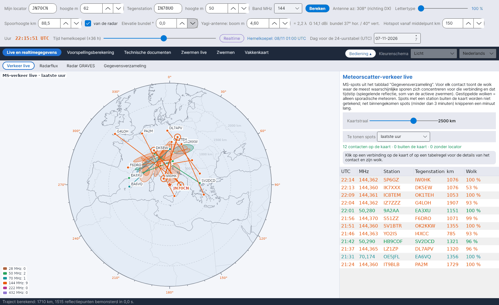

[English](Live-Traffic) · [Italiano](Live-Traffic-it) · [Deutsch](Live-Traffic-de) · **Nederlands** · [Français](Live-Traffic-fr) · [Español](Live-Traffic-es) · [Português](Live-Traffic-pt) · [Português (Brasil)](Live-Traffic-pt-br) · [Dansk](Live-Traffic-da) · [Norsk](Live-Traffic-nb) · [Svenska](Live-Traffic-sv) · [Íslenska](Live-Traffic-is) · [Eesti](Live-Traffic-et) · [Lietuvių](Live-Traffic-lt) · [Latviešu](Live-Traffic-lv) · [Polski](Live-Traffic-pl) · [Čeština](Live-Traffic-cs) · [Magyar](Live-Traffic-hu) · [Română](Live-Traffic-ro) · [Ελληνικά](Live-Traffic-el) · [Русский](Live-Traffic-ru) · [Українська](Live-Traffic-uk) · [Türkçe](Live-Traffic-tr) · [Afrikaans](Live-Traffic-af) · [العربية](Live-Traffic-ar) · [עברית](Live-Traffic-he) · [اردو](Live-Traffic-ur) · [हिन्दी](Live-Traffic-hi) · [বাংলা](Live-Traffic-bn) · [ไทย](Live-Traffic-th) · [Bahasa Indonesia](Live-Traffic-id) · [Tagalog](Live-Traffic-tl) · [日本語](Live-Traffic-ja) · [한국어](Live-Traffic-ko) · [中文](Live-Traffic-zh) · [中文 (繁體)](Live-Traffic-zh-tw)

# Verkeer live

*Tabblad: Live en realtimegegevens › Verkeer live.*

## Wat het toont

Een **azimutale equidistante kaart** gecentreerd op jouw station (afstand tot het midden = werkelijke afstand, hoek = azimut) met **al het meteorscatter-verkeer** dat door [Gegevensverzameling](Data-Collection-nl) is verzameld. Voor elk contact tekent het programma:

- het **traject** tussen de twee stations, in de kleur van zijn band: 28 MHz bruin, 50 MHz groen, 70 MHz cyaan, 144 MHz oranje, 222 MHz roze, 432 MHz violet;
- de twee **stations** aan de uiteinden van het traject;
- de **wolk**: waar de meest waarschijnlijke meteorensporen voor dat traject en dat tijdstip geconcentreerd zijn.

Spots met een station **buiten de kaart** worden genegeerd. Alleen de decoderingen van jouw WSJT-X (UDP) waarin een tegenstation je antwoordt, knipperen.

Tonen wie luistert: driehoeken in de bandkleur markeren de stations die volgens PSKReporter in het gekozen tijdvenster MSK144, FSK441, PSK2K of JTMS ontvangen op 28, 50, 70, 144 en 432 MHz. Een klik op een driehoek toont roepnaam, locator, modes en laatste spot. De MQTT-stroom in het tabblad Gegevensverzameling moet verbonden zijn.

Ook de actieve monitors van de PSKReporter-kaart: lege driehoeken voor de stations die op de kaart van pskreporter.info in MSK144, FSK441, PSK2K of JTMS staan maar nog geen spot hebben ontvangen (MQTT stuurt alleen stations die iets ontvangen). YA-MS bevraagt de opvraagdienst van PSKReporter eens per 5 minuten voor alle modi, zoals de regels van de dienst vragen; een monitor blijft minstens 11 minuten op de kaart. Een klik op de driehoek toont roepnaam, locator, decodeerprogramma en het tijdstip waarop de monitor actief was. Standaard aan.

FT8 boven 1100 km zonder parallelle paden: een FT8-spot (uit PSKReporter MQTT, de clusters of WSJT-X via UDP) tussen stations die meer dan 1100 km uit elkaar liggen en die in de 3 minuten ervoor en erna geen parallelle paden heeft (zelfde band, middelpunt binnen 300 km, richting binnen 15°, een ander stationspaar) wordt lichtgroen getekend, net als zijn regel in de tabel rechtsonder (zonder knipperen). Sporadische E en tropo geven veel nabije, parallelle paden; een losse spot kan een meteoorspoor zijn. Daarom ontvangt YA-MS via MQTT ook de FT8-spots van 6 m, 4 m, 2 m, 1,25 m en 70 cm (nooit 28 MHz, in geen geval). Deze spots gaan niet in het MS-archief. Standaard aan. Extra controles met PSKReporter MQTT: de spot is niet geïsoleerd als het ontvangende station in MQTT binnen 3 minuten andere stations boven 1100 km op dezelfde band hoort (open band); spots van clusters en RBN tellen alleen als hetzelfde paar ook via MQTT binnenkomt; RBN-skimmers (roepnamen met «-#») tellen nooit.

Decoderingen van jouw WSJT-X via UDP waarin een tegenstation je antwoordt (de eerste roepnaam van het bericht is de jouwe) worden getekend met een knipperende stippellijn, in elke modus en op elke afstand, en hun regel in de tabel knippert op een gele achtergrond. Dit is het enige geval waarin iets knippert.

Uitwisseling tussen YA-MS-gebruikers: als een andere YA-MS-gebruiker via UDP een bericht aan jouw station decodeert (in MSK144, FSK441, PSK2K of JTMS, of in FT8 boven 1100 km), stuurt zijn YA-MS het versleuteld naar jou via drie openbare MQTT-brokers (HiveMQ, Mosquitto, EMQX); je ziet het als een vaste violette stippellijn en als een regel in de UDP-console. Alleen jij kunt het lezen (ECDH P-256-sleutels, AES-256 en HMAC-SHA256). FT8-spots worden alleen getoond als ze binnen 3 minuten geen parallelle paden hebben. Standaard aan; yams_scambio=0 in data/config.ini zet het uit.

De kaart toont de roepletters van beide stations van elke spot, één keer per station. De projectie is azimutaal (gecentreerd op je station) of Mercator. De tooltip op de kolom Wolk legt de betekenis uit.

Spots van alle banden worden getoond, ook van banden die niet in Gegevensverzameling zijn gekozen (die worden niet opgeslagen). CW-spots en spots tussen te dicht bij elkaar liggende stations worden niet getoond als ze in Gegevensverzameling worden weggegooid.

## Hoe de wolk wordt berekend

Voor elke spot bouwt het programma het traject tussen de twee locators op (dezelfde geometrie als voor je eigen traject, zie [Geometrie en demping](Geometry-and-Path-Loss-nl)) en telt op het tijdstip van de spot, punt voor punt in de E-laag, de **bijdragen van spiegelende reflectie van elke actieve zwerm** op, gewogen met zijn ZHR – dezelfde berekening als de **PREV-zones** van de [hemelkoepel](Sky-View-nl). Voor elke zijde van het traject die minstens 15 % van het totaal bevat, is de wolk een **ellips**: middelpunt in het gewogen gemiddelde van de punten, halve assen 1,5 keer de vierkantswortels van de eigenwaarden van hun spreiding, lange as langs de hoofdeigenvector. Als geen enkele zwerm bijdraagt (alleen sporadische meteoren), zijn de zwermzone de twee klassieke **hotspots**, gestippeld getekend. De volledige vergelijkingen staan in hoofdstuk 10 van de rekenhandleiding.

## Bediening

| Element | Betekenis |
|---|---|
| **Kaartstraal** | 600–3500 km vanaf jouw station. |
| **Te tonen spots** | Laatste 15 of 30 minuten, laatste uur, laatste 3 uur, laatste 24 uur. |
| **Tabel** | Contacten op de kaart, nieuwste bovenaan, in de kleur van de band; *Wolk* geeft het aandeel reflecties aan de hoofdzijde, of *sporadische*. |
| **Klik** | Op een traject of een tabelregel: het contact wordt gemarkeerd en het vak toont de locator van het midden van de wolk, het aandeel, de afmetingen en de as. |
