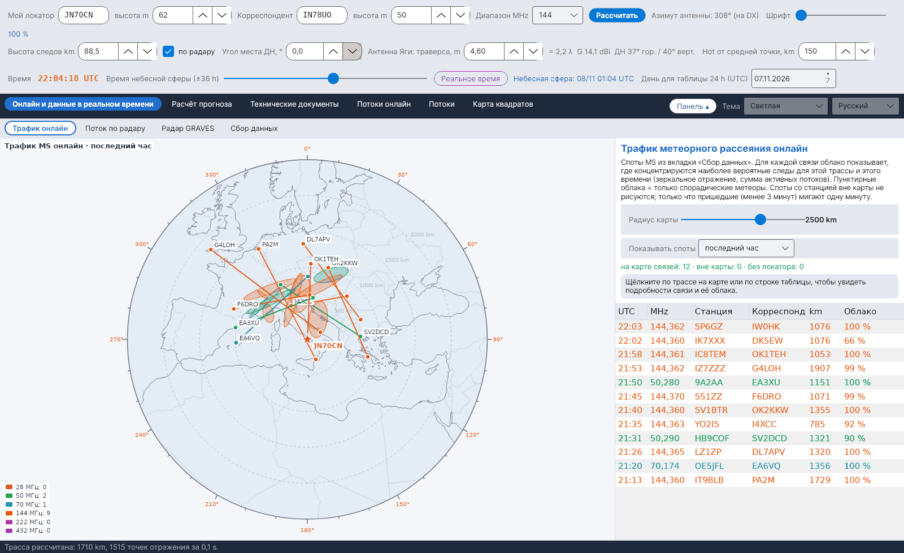

[English](Live-Traffic) · [Italiano](Live-Traffic-it) · [Deutsch](Live-Traffic-de) · [Nederlands](Live-Traffic-nl) · [Français](Live-Traffic-fr) · [Español](Live-Traffic-es) · [Português](Live-Traffic-pt) · [Português (Brasil)](Live-Traffic-pt-br) · [Dansk](Live-Traffic-da) · [Norsk](Live-Traffic-nb) · [Svenska](Live-Traffic-sv) · [Íslenska](Live-Traffic-is) · [Eesti](Live-Traffic-et) · [Lietuvių](Live-Traffic-lt) · [Latviešu](Live-Traffic-lv) · [Polski](Live-Traffic-pl) · [Čeština](Live-Traffic-cs) · [Magyar](Live-Traffic-hu) · [Română](Live-Traffic-ro) · [Ελληνικά](Live-Traffic-el) · **Русский** · [Українська](Live-Traffic-uk) · [Türkçe](Live-Traffic-tr) · [Afrikaans](Live-Traffic-af) · [العربية](Live-Traffic-ar) · [עברית](Live-Traffic-he) · [اردو](Live-Traffic-ur) · [हिन्दी](Live-Traffic-hi) · [বাংলা](Live-Traffic-bn) · [ไทย](Live-Traffic-th) · [Bahasa Indonesia](Live-Traffic-id) · [Tagalog](Live-Traffic-tl) · [日本語](Live-Traffic-ja) · [한국어](Live-Traffic-ko) · [中文](Live-Traffic-zh) · [中文 (繁體)](Live-Traffic-zh-tw)

# Трафик онлайн

*Вкладка: Онлайн и данные в реальном времени › Трафик онлайн.*

## Что показывает

**Азимутальная равнопромежуточная карта** с центром на вашей станции (расстояние от центра = истинное расстояние, угол = азимут), на которой показан **весь трафик метеорного рассеяния**, собранный на вкладке [Сбор данных](Data-Collection-ru). Для каждой связи программа рисует:

- **трассу** между двумя станциями цветом её диапазона: 28 MHz – коричневый, 50 MHz – зелёный, 70 MHz – голубой, 144 MHz – оранжевый, 222 MHz – розовый, 432 MHz – фиолетовый;
- две **станции** на концах трассы;
- **облако**: где сосредоточены наиболее вероятные метеорные следы для этой трассы в это время.

Споты, у которых одна из станций находится **вне карты**, отбрасываются. **Только что пришедший** спот (не старше 3 минут) **мигает в течение минуты**, чтобы новая активность сразу бросалась в глаза.

Показать, кто слушает: треугольники цвета диапазона отмечают станции, которые, по данным PSKReporter, принимают MSK144, FSK441, PSK2K или JTMS на 28, 50, 70, 144 и 432 МГц в выбранном окне времени. Щелчок по треугольнику показывает позывной, локатор, виды связи и последний спот. Поток MQTT на вкладке «Сбор данных» должен быть подключён.

Также активные мониторы с карты PSKReporter: пустые треугольники для станций, которые видны на карте pskreporter.info в MSK144, FSK441, PSK2K или JTMS, но ещё не приняли ни одного спота (MQTT передаёт только станции, которые что-то принимают). YA-MS опрашивает справочный сервис PSKReporter раз в 5 минут для всех видов связи, как требуют правила сервиса; монитор остаётся на карте не менее 11 минут. Щелчок по треугольнику показывает позывной, локатор, программу декодирования и время, когда монитор был активен. Включено по умолчанию.

FT8 дальше 1100 км без параллельных трасс: спот FT8 (из PSKReporter MQTT, кластеров или WSJT-X по UDP) между станциями, удалёнными более чем на 1100 км, у которого в течение 3 минут до и после нет параллельных трасс (тот же диапазон, середина в пределах 300 км, направление в пределах 15°, другая пара станций), рисуется светло-зелёным, а его строка в таблице справа внизу всегда мигает. Спорадический E и тропо дают много близких параллельных трасс; одиночный спот может быть метеорным следом. Поэтому YA-MS принимает по MQTT и споты FT8 на 6 м, 4 м, 2 м, 1,25 м и 70 см (не на 10 м — их слишком много). Эти споты не попадают в архив MS. Включено по умолчанию.

Споты WSJT-X по UDP, касающиеся вашей станции (в декодировании есть ваш позывной: кто вас зовёт или вам отвечает), рисуются всегда мигающей пунктирной линией, в любом виде связи и на любом расстоянии.

На карте пишутся позывные обеих станций каждого спота, по одному разу на станцию. Проекция выбирается: азимутальная (в центре ваша станция) или Меркатора. Подсказка на столбце «Облако» объясняет его смысл.

Показываются споты всех диапазонов, в том числе не выбранных в Сборе данных (они не сохраняются). Споты CW и споты между слишком близкими станциями не показываются, если они отбрасываются в Сборе данных.

## Как рассчитывается облако

Для каждого спота программа строит трассу между двумя локаторами (та же геометрия, что и для вашей трассы, см. [Геометрия и затухание](Geometry-and-Path-Loss-ru)) и на момент спота суммирует в каждой точке слоя E **вклады зеркального отражения всех активных потоков**, взвешенные по их ZHR, – тот же расчёт, что и для **зон PREV** на [небесной сфере](Sky-View-ru). Для каждой стороны трассы, на которую приходится не менее 15 % суммы, облако – это **эллипс**: центр во взвешенном среднем точек, полуоси равны квадратным корням из собственных значений их разброса, умноженным на 1,5, большая ось направлена вдоль главного собственного вектора. Если ни один поток не даёт вклада (только спорадические метеоры), облаками служат две классические **горячие точки**, нарисованные пунктиром. Полные уравнения приведены в главе 10 руководства по расчётам.

## Элементы управления

| Элемент | Значение |
|---|---|
| **Радиус карты** | 600–3500 km от вашей станции. |
| **Показывать споты** | За последние 15 или 30 минут, последний час, последние 3 часа, последние 24 часа. |
| **Таблица** | Связи на карте, новые вверху, цветом диапазона; *Облако* показывает долю отражений на основной стороне или *спорадические*. |
| **Щелчок** | По трассе или строке таблицы: связь выделяется, а в поле показываются локатор центра облака, его доля, размер и ось. |
