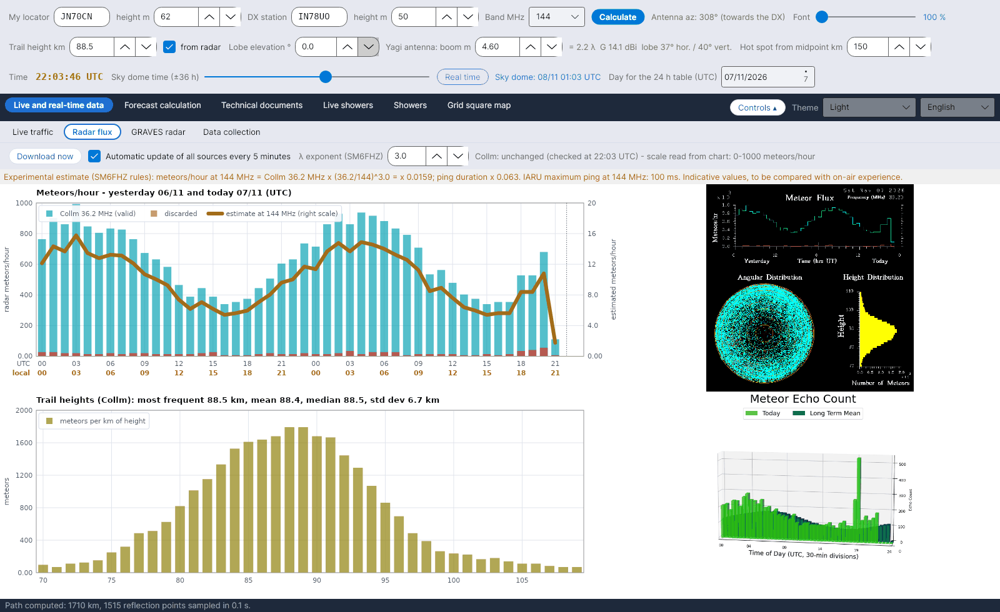

[English](Radar-Flux) · [Italiano](Radar-Flux-it) · [Deutsch](Radar-Flux-de) · [Nederlands](Radar-Flux-nl) · [Français](Radar-Flux-fr) · [Español](Radar-Flux-es) · [Português](Radar-Flux-pt) · [Português (Brasil)](Radar-Flux-pt-br) · [Dansk](Radar-Flux-da) · [Norsk](Radar-Flux-nb) · [Svenska](Radar-Flux-sv) · [Íslenska](Radar-Flux-is) · [Eesti](Radar-Flux-et) · [Lietuvių](Radar-Flux-lt) · [Latviešu](Radar-Flux-lv) · [Polski](Radar-Flux-pl) · [Čeština](Radar-Flux-cs) · [Magyar](Radar-Flux-hu) · [Română](Radar-Flux-ro) · [Ελληνικά](Radar-Flux-el) · [Русский](Radar-Flux-ru) · [Українська](Radar-Flux-uk) · [Türkçe](Radar-Flux-tr) · **Afrikaans** · [العربية](Radar-Flux-ar) · [עברית](Radar-Flux-he) · [اردو](Radar-Flux-ur) · [हिन्दी](Radar-Flux-hi) · [বাংলা](Radar-Flux-bn) · [ไทย](Radar-Flux-th) · [Bahasa Indonesia](Radar-Flux-id) · [Tagalog](Radar-Flux-tl) · [日本語](Radar-Flux-ja) · [한국어](Radar-Flux-ko) · [中文](Radar-Flux-zh) · [中文 (繁體)](Radar-Flux-zh-tw)

# Radarvloed

*Oortjie: Regstreeks en intydse data › Radarvloed.*

[](https://raw.githubusercontent.com/ic8tem/YA-MS/main/docs/screenshots/en-1_2.png)

Hierdie oortjie wys wat professionele meteoorradars **nou** tel: die uurlikse meteoortellings en die spoorhoogtes van die **Collm** SKiYMET-radar (Universiteit van Leipzig / IAP Kühlungsborn, Duitsland, 36,2 MHz), en die jongste beeld van die **Sodankylä**-radar (SGO, Finland). Die Collm-tellings voed die skatting op jou band en die [Eksperimentele voorspellings](Experimental-Forecasts-af); die gemete spoorhoogte voed die hele geometrie.

## Kontroles

| Kontrole | Wat dit doen |
|---|---|
| **Laai nou af** | Gaan al die eksterne bronne dadelik na. |
| **Outomatiese bywerking van alle bronne elke 5 minute** | By verstek aan. Elke 5 minute word al die bronne nagegaan en **slegs dié wat verander het** word weer afgelaai (*onveranderd (nagegaan om … UTC)* / *nuwe data om … UTC*). |
| **λ-eksponent (SM6FHZ)** | Eksponent k van die frekwensiereël, verstek 3 (1–4). |

## Wat gewys word

| Paneel | Inhoud |
|---|---|
| **Meteore/uur – gister en vandag (UTC)** | Siaan stawe = Collm-tellings (geldig), rooi stawe = verwerp, dik oranje lyn = *skatting by … MHz* op die regterskaal |
| **Spoorhoogtes (Collm)** | Meteore per km hoogte tussen 70 en 110 km, met die mees algemene hoogte (modus), gemiddeld, mediaan en standaardafwyking |
| Collm-beeld | Die oorspronklike SKiYMET-grafiek, soos afgelaai |
| Sodankylä-beeld | Die jongste meteoortellingsbeeld van die Sodankylä-radar (slegs gewys; die formaat daarvan word nie gelees nie) |

Die reël bo die grafieke sê wanneer die Collm-grafiek gelees is en watter vertikale skaal gevind is (*skaal van grafiek gelees: 0-… meteore/uur*).

## Hoe die Collm-grafiek gelees word

Die Collm-grafiek (720 × 720 piksels, suiwer kleure) het vaste asposisies, maar die radar **pas die vertikale skaal elke dag aan** by die gemete waardes (bv. 0–1,2·10³ op 5/11/2026 en 0–1,0·10³ op 6/11/2026, met verskuifde maatstreepies). YA-MS doen dus die volgende:

1. vind die lang maatstreepies van die as;
2. **lees die etikette** van die hoogste maatstreep en van die nul deur elke karakter met die puntmatriks-lettertipe van die grafiek te vergelyk;
3. neem vir elke uur i (0–47, gister en vandag) die middelste kolom en die eerste siaan piksel van bo af, y:

```math
x_i = 101 + (i+0{.}5)\,\frac{676-101}{48},\qquad N = (y_0-y)\,\frac{N_{top}}{y_0-y_{top}}
```

y_top en y0 is die rye van die hoogste maatstreep en van die nul, N_top die waarde wat op die hoogste etiket gelees is (×1000). Resolusie: ongeveer 7–8 meteore/uur per piksel. *Keuse van die program (handleiding vgl. 42).*

As 'n etiket nie gelees kan word nie, val die program terug op die kalibrasie van 5/11/2026 (**gekalibreerde skaal 0-1200 meteore/uur**) en sê dit in oranje: *Kan nie die vertikale vloedskaal lees nie (boonste etiket: …): waardes moet nagegaan word.* As die grafiekformaat self verander (*Grafiekformaat het verander (…x…): kan nie gelees word nie* of *Vloed-asse nie op die verwagte plek gevind nie*), moet die lesing herkalibreer word: rapporteer dit asseblief (sien [Bydra](Contributing-and-Contacts-af)).

### Spoorhoogtes

Uit die hoogtehistogram (n_k meteore in km k, gemiddelde hoogte h_k):

```math
\hat{h} = h_{k^*},\ k^* = \arg\max_k n_k,\qquad \bar{h} = \frac{\sum_k n_k h_k}{\sum_k n_k},\qquad s = \sqrt{\frac{\sum_k n_k (h_k-\bar{h})^2}{\sum_k n_k}}
```

*Handleiding vgl. 43.* Met **van radar** gemerk (ry 2 van die kontroles) word die **modus** die spoorhoogte van al die berekeninge. Kontrole: grafiek van 5/11/2026 – modus 89,5 km, gemiddeld 88,6 km, standaardafwyking 6,8 km, wat die ~90 km van die Cerrotta–Sartori-artikel bevestig (SKiYMET-gemiddelde).

As die skaal van die hoogtegrafiek verander, waarsku die program: *hoogtestatistieke (modus, gemiddeld, mediaan) bly geldig, absolute tellings nie.*

## Skatting op jou band

```math
N(f) = N_{Collm}(36{.}2\ \mathrm{MHz})\left(\frac{36{.}2}{f}\right)^{k},\quad k = 3,\qquad \tau(f) = \tau(36{.}2\ \mathrm{MHz})\left(\frac{36{.}2}{f}\right)^{2}
```

Eksperimentele reëls van **SM6FHZ** (VUSHF 2025): aantal en intensiteit van refleksies skaal met λ³, duur met λ² (by McKinley is λ³ die drywing van een spoor; die aantal spore skaal ongeveer met λ^1,5, en in voorwaartse verstrooiing groei duurtes ook met sec²φ: sien [Eksperimentele voorspellings](Experimental-Forecasts-af)). Die IARU Streek 1 se maksimum pingduur word ook gewys (1000 ms op 50 MHz, 500 ms op 70 MHz, 100 ms op 144 MHz, 13 ms op 432 MHz). Waardes is aanduidend, om met ervaring op die lug te vergelyk. Die stasiefaktor K en die vergelyking met RMOB is in [Eksperimentele voorspellings](Experimental-Forecasts-af).

## Vanlyn

As geen bron bereik kan word nie, verskyn 'n boodskap **een keer**: *Geen internetverbinding nie. Radar- en RMOB-data kan nie bygewerk word nie: die program gebruik die laaste gestoorde data en probeer self elke 5 minute weer.* Die statusbalk onderaan word rooi (*GEEN INTERNETVERBINDING NIE …*) totdat die verbinding terugkeer (*Verbinding herstel.*).

## Argiewe en bronne

| Lêer (in `data/`) | Inhoud |
|---|---|
| `flusso_collm.csv` | Uurlikse argief van die vloed wat van Collm gelees is (ure wat reeds teenwoordig is, word bygewerk) |
| `quote_collm.csv` | Argief van die spoorhoogtes |
| `radar/` | Jongste afgelaaide beelde (en RMOB-lêers) |
| `fonti_radar.csv` | Adresse van die radarbronne, `attivo=1/0` om elkeen aan/af te skakel |

| Bron | Frekwensie | Opmerkings |
|---|---|---|
| Collm-meteoorradar, Universiteit van Leipzig (LIM) en IAP Kühlungsborn – wetterdaten.meteo.uni-leipzig.de/radar_flux.php | 36,2 MHz | elke uur op minuut 10 UTC bygewerk; vloed gister + vandag, hoogteverspreiding |
| Sodankylä Geophysical Observatory – sgo.fi/Data/RealTime/meteorRadar.php | 36,9 MHz | slegs beeld (radar word opgegradeer, DECC-projek) |
| swan.ms (kopie van Collm) | 36,2 MHz | by verstek af; gebruik slegs met DL1DBC se toestemming |

> Radardata behoort aan hul instellings (Universiteit van Leipzig / IAP Kühlungsborn, Sodankylä Geophysical Observatory).
