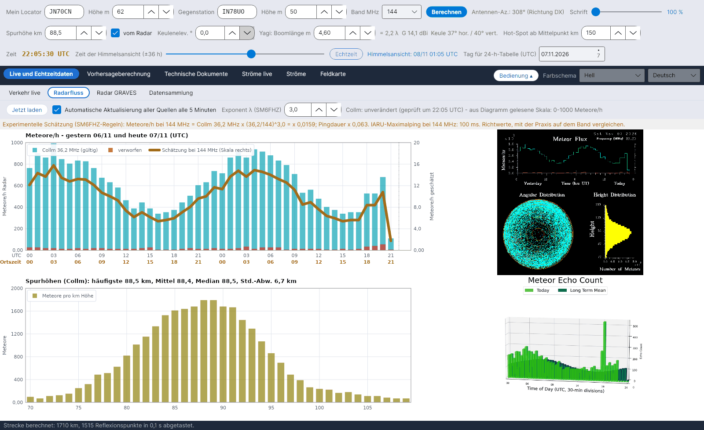

[English](Radar-Flux) · [Italiano](Radar-Flux-it) · **Deutsch** · [Nederlands](Radar-Flux-nl) · [Français](Radar-Flux-fr) · [Español](Radar-Flux-es) · [Português](Radar-Flux-pt) · [Português (Brasil)](Radar-Flux-pt-br) · [Dansk](Radar-Flux-da) · [Norsk](Radar-Flux-nb) · [Svenska](Radar-Flux-sv) · [Íslenska](Radar-Flux-is) · [Eesti](Radar-Flux-et) · [Lietuvių](Radar-Flux-lt) · [Latviešu](Radar-Flux-lv) · [Polski](Radar-Flux-pl) · [Čeština](Radar-Flux-cs) · [Magyar](Radar-Flux-hu) · [Română](Radar-Flux-ro) · [Ελληνικά](Radar-Flux-el) · [Русский](Radar-Flux-ru) · [Українська](Radar-Flux-uk) · [Türkçe](Radar-Flux-tr) · [Afrikaans](Radar-Flux-af) · [العربية](Radar-Flux-ar) · [עברית](Radar-Flux-he) · [اردو](Radar-Flux-ur) · [हिन्दी](Radar-Flux-hi) · [বাংলা](Radar-Flux-bn) · [ไทย](Radar-Flux-th) · [Bahasa Indonesia](Radar-Flux-id) · [Tagalog](Radar-Flux-tl) · [日本語](Radar-Flux-ja) · [한국어](Radar-Flux-ko) · [中文](Radar-Flux-zh) · [中文 (繁體)](Radar-Flux-zh-tw)

# Radarfluss

*Reiter: Live und Echtzeitdaten › Radarfluss.*

[](https://raw.githubusercontent.com/ic8tem/YA-MS/main/docs/screenshots/de-1_2.png)

Dieser Reiter zeigt, was professionelle Meteorradare **jetzt** zählen: die stündlichen Meteorzählungen und die Spurhöhen des SKiYMET-Radars **Collm** (Universität Leipzig / IAP Kühlungsborn, Deutschland, 36,2 MHz) und das neueste Bild des Radars **Sodankylä** (SGO, Finnland). Die Zählungen aus Collm speisen die Schätzung für dein Band und die [Experimentelle Vorhersage](Experimental-Forecasts-de); die gemessene Spurhöhe geht in die gesamte Geometrie ein.

## Bedienelemente

| Bedienelement | Was es tut |
|---|---|
| **Jetzt laden** | Prüft sofort alle externen Quellen. |
| **Automatische Aktualisierung aller Quellen alle 5 Minuten** | Standardmäßig eingeschaltet. Alle 5 Minuten werden alle Quellen geprüft und **nur die geänderten** neu geladen (*unverändert (geprüft um … UTC)* / *neuer Wert um … UTC*). |
| **Exponent λ (SM6FHZ)** | Exponent k der Frequenzregel, Standard 3 (1–4). |

## Was angezeigt wird

| Feld | Inhalt |
|---|---|
| **Meteore/h - gestern und heute (UTC)** | Cyan Balken = Zählungen aus Collm (gültig), rote Balken = verworfen, dicke orange Linie = *Schätzung bei … MHz* auf der rechten Skala |
| **Spurhöhen (Collm)** | Meteore pro km Höhe zwischen 70 und 110 km, mit häufigster Höhe (Modalwert), Mittel, Median und Standardabweichung |
| Bild Collm | Das originale SKiYMET-Diagramm, wie geladen |
| Bild Sodankylä | Das neueste Bild der Meteorzählung des Radars Sodankylä (nur angezeigt; sein Format wird nicht ausgelesen) |

Die Zeile über den Diagrammen sagt, wann das Collm-Diagramm gelesen wurde und welche vertikale Skala gefunden wurde (*aus Diagramm gelesene Skala: 0-… Meteore/h*).

## Wie das Collm-Diagramm gelesen wird

Das Collm-Diagramm (720 × 720 Pixel, reine Farben) hat feste Achsenpositionen, aber das Radar **passt die vertikale Skala jeden Tag** an die gemessenen Werte an (z. B. 0–1,2·10³ am 5.11.2026 und 0–1,0·10³ am 6.11.2026, mit verschobenen Teilstrichen). YA-MS deshalb:

1. sucht die langen Teilstriche der Achse;
2. **liest die Beschriftungen** des obersten Teilstrichs und der Null, indem jedes Zeichen mit der Punktmatrix-Schrift des Diagramms verglichen wird;
3. nimmt für jede Stunde i (0–47, gestern und heute) die mittlere Spalte und das erste cyanfarbene Pixel von oben, y:

```math
x_i = 101 + (i+0{.}5)\,\frac{676-101}{48},\qquad N = (y_0-y)\,\frac{N_{top}}{y_0-y_{top}}
```

y_top und y0 sind die Zeilen des obersten Teilstrichs und der Null, N_top der auf der obersten Beschriftung gelesene Wert (×1000). Auflösung: etwa 7–8 Meteore/h pro Pixel. *Entscheidung des Programms (Handbuch Gl. 42).*

Lässt sich eine Beschriftung nicht lesen, greift das Programm auf die Kalibrierung vom 5.11.2026 zurück (**kalibrierte Skala 0-1200 Meteore/h**) und meldet dies in Orange: *Vertikale Flussskala nicht lesbar (Beschriftung oben: …): Werte prüfen.* Ändert sich das Format des Diagramms selbst (*Diagrammformat geändert (…x…): Ablesen nicht möglich* oder *Flussachsen nicht an der erwarteten Position gefunden*), muss das Ablesen neu kalibriert werden: Bitte melde es (siehe [Mitarbeit](Contributing-and-Contacts-de)).

### Spurhöhen

Aus dem Höhenhistogramm (n_k Meteore im km k, mittlere Höhe h_k):

```math
\hat{h} = h_{k^*},\ k^* = \arg\max_k n_k,\qquad \bar{h} = \frac{\sum_k n_k h_k}{\sum_k n_k},\qquad s = \sqrt{\frac{\sum_k n_k (h_k-\bar{h})^2}{\sum_k n_k}}
```

*Handbuch Gl. 43.* Mit angekreuztem **vom Radar** (Zeile 2 der Bedienung) wird der **Modalwert** zur Spurhöhe aller Berechnungen. Prüfung: Diagramm vom 5.11.2026 – Modalwert 89,5 km, Mittel 88,6 km, Standardabweichung 6,8 km, was die ~90 km des Artikels Cerrotta–Sartori (SKiYMET-Mittelwert) bestätigt.

Ändert sich die Skala des Höhendiagramms, warnt das Programm: *die Höhenstatistik (Modalwert, Mittel, Median) bleibt gültig, die absoluten Zählwerte nicht.*

## Schätzung für dein Band

```math
N(f) = N_{Collm}(36{.}2\ \mathrm{MHz})\left(\frac{36{.}2}{f}\right)^{k},\quad k = 3,\qquad \tau(f) = \tau(36{.}2\ \mathrm{MHz})\left(\frac{36{.}2}{f}\right)^{2}
```

Experimentelle Regeln von **SM6FHZ** (VUSHF 2025): Anzahl und Intensität der Reflexionen skalieren mit λ³, die Dauer mit λ² (bei McKinley ist λ³ die Leistung einer Spur; die Zahl der Spuren skaliert etwa mit λ^1,5, und im Vorwärtsscatter wachsen die Dauern außerdem mit sec²φ: siehe [Experimentelle Vorhersage](Experimental-Forecasts-de)). Angezeigt wird auch die maximale Pingdauer nach IARU Region 1 (1000 ms auf 50 MHz, 500 ms auf 70 MHz, 100 ms auf 144 MHz, 13 ms auf 432 MHz). Die Werte sind Richtwerte, mit der Praxis auf dem Band zu vergleichen. Der Stationsfaktor K und der Vergleich mit RMOB stehen in [Experimentelle Vorhersage](Experimental-Forecasts-de).

## Offline

Ist keine Quelle erreichbar, erscheint **einmal** eine Meldung: *Keine Internetverbindung. Radar- und RMOB-Daten können nicht aktualisiert werden: das Programm nutzt die zuletzt gespeicherten Daten und versucht es alle 5 Minuten erneut.* Die Statusleiste unten wird rot (*KEINE INTERNETVERBINDUNG …*), bis die Verbindung zurückkehrt (*Verbindung wiederhergestellt.*).

## Archive und Quellen

| Datei (in `data/`) | Inhalt |
|---|---|
| `flusso_collm.csv` | Stündliches Archiv des aus Collm gelesenen Flusses (bereits vorhandene Stunden werden aktualisiert) |
| `quote_collm.csv` | Archiv der Spurhöhen |
| `radar/` | Zuletzt geladene Bilder (und RMOB-Dateien) |
| `fonti_radar.csv` | Adressen der Radarquellen, `attivo=1/0` zum Ein-/Ausschalten jeder Quelle |

| Quelle | Frequenz | Hinweise |
|---|---|---|
| Meteorradar Collm, Universität Leipzig (LIM) und IAP Kühlungsborn – wetterdaten.meteo.uni-leipzig.de/radar_flux.php | 36,2 MHz | stündlich zur Minute 10 UTC aktualisiert; Fluss gestern + heute, Höhenverteilung |
| Sodankylä Geophysical Observatory – sgo.fi/Data/RealTime/meteorRadar.php | 36,9 MHz | nur Bild (Radar wird modernisiert, Projekt DECC) |
| swan.ms (Kopie von Collm) | 36,2 MHz | standardmäßig ausgeschaltet; nur mit Erlaubnis von DL1DBC verwenden |

> Die Radardaten gehören ihren Einrichtungen (Universität Leipzig / IAP Kühlungsborn, Sodankylä Geophysical Observatory).
