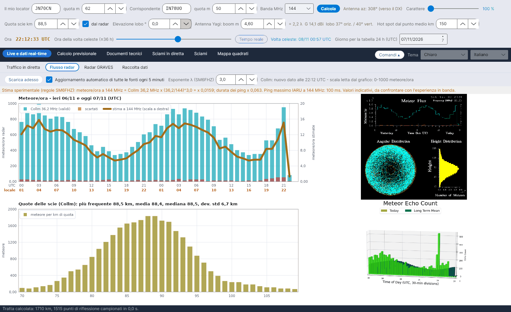

[English](Radar-Flux) · **Italiano** · [Deutsch](Radar-Flux-de) · [Nederlands](Radar-Flux-nl) · [Français](Radar-Flux-fr) · [Español](Radar-Flux-es) · [Português](Radar-Flux-pt) · [Português (Brasil)](Radar-Flux-pt-br) · [Dansk](Radar-Flux-da) · [Norsk](Radar-Flux-nb) · [Svenska](Radar-Flux-sv) · [Íslenska](Radar-Flux-is) · [Eesti](Radar-Flux-et) · [Lietuvių](Radar-Flux-lt) · [Latviešu](Radar-Flux-lv) · [Polski](Radar-Flux-pl) · [Čeština](Radar-Flux-cs) · [Magyar](Radar-Flux-hu) · [Română](Radar-Flux-ro) · [Ελληνικά](Radar-Flux-el) · [Русский](Radar-Flux-ru) · [Українська](Radar-Flux-uk) · [Türkçe](Radar-Flux-tr) · [Afrikaans](Radar-Flux-af) · [العربية](Radar-Flux-ar) · [עברית](Radar-Flux-he) · [اردو](Radar-Flux-ur) · [हिन्दी](Radar-Flux-hi) · [বাংলা](Radar-Flux-bn) · [Bahasa Indonesia](Radar-Flux-id) · [Tagalog](Radar-Flux-tl) · [ไทย](Radar-Flux-th) · [日本語](Radar-Flux-ja) · [한국어](Radar-Flux-ko) · [中文](Radar-Flux-zh) · [中文 (繁體)](Radar-Flux-zh-tw)

# Flusso radar

*Linguetta: Live e dati real-time › Flusso radar.*

[](https://raw.githubusercontent.com/ic8tem/YA-MS/main/docs/screenshots/it-1_2.png)

Questa linguetta mostra che cosa stanno contando **adesso** i radar meteorici professionali: i conteggi orari delle meteore e le quote delle scie del radar SKiYMET di **Collm** (Università di Lipsia / IAP Kühlungsborn, Germania, 36,2 MHz) e l'ultima immagine del radar di **Sodankylä** (SGO, Finlandia). I conteggi di Collm alimentano la stima sulla tua banda e l'[Attuazione sperimentale previsioni](Experimental-Forecasts-it); la quota delle scie misurata alimenta tutta la geometria.

## Comandi

| Comando | Che cosa fa |
|---|---|
| **Scarica adesso** | Controlla subito tutte le fonti esterne. |
| **Aggiornamento automatico di tutte le fonti ogni 5 minuti** | Attivo per impostazione predefinita. Ogni 5 minuti si controllano tutte le fonti e si riscaricano **solo quelle cambiate** (*invariato (controllato alle … UTC)* / *nuovo dato alle … UTC*). |
| **Esponente λ (SM6FHZ)** | Esponente k della regola sulla frequenza, predefinito 3 (1–4). |

## Che cosa viene mostrato

| Riquadro | Contenuto |
|---|---|
| **Meteore/ora – ieri e oggi (UTC)** | Barre ciano = conteggi di Collm (validi), barre rosse = scartati, linea arancione spessa = *stima a … MHz* sulla scala a destra |
| **Quote delle scie (Collm)** | Meteore per km di quota tra 70 e 110 km, con quota più frequente (moda), media, mediana e deviazione standard |
| Immagine di Collm | Il grafico SKiYMET originale, così come scaricato |
| Immagine di Sodankylä | L'ultima immagine dei conteggi del radar di Sodankylä (solo mostrata; il suo formato non viene letto) |

La riga sopra i grafici dice quando è stato letto il grafico di Collm e quale scala verticale è stata trovata (*scala letta dal grafico: 0-… meteore/ora*).

## Come si legge il grafico di Collm

Il grafico di Collm (720 × 720 pixel, colori puri) ha gli assi in posizione fissa, ma il radar **adatta la scala verticale ogni giorno** ai valori misurati (per esempio 0–1,2·10³ il 5/11/2026 e 0–1,0·10³ il 6/11/2026, con le tacche spostate). YA-MS quindi:

1. trova le tacche lunghe dell'asse;
2. **legge le etichette** della tacca più alta e dello zero confrontando ogni carattere con il font a matrice di punti del grafico;
3. per ogni ora i (0–47, ieri e oggi) prende la colonna centrale e il primo pixel ciano dall'alto, y:

```
x_i = 101 + (i + 0.5)·(676 − 101)/48        N = (y0 − y)·N_top / (y0 − y_top)   meteore/ora
```

y_top e y0 sono le righe della tacca più alta e dello zero, N_top il valore letto sull'etichetta più alta (×1000). Risoluzione: circa 7–8 meteore/ora per pixel. *Scelta del programma (eq. 42 del manuale).*

Se un'etichetta non si riesce a leggere, il programma ripiega sulla taratura del 5/11/2026 (**scala tarata 0-1200 meteore/ora**) e lo segnala in arancione: *Non riesco a leggere la scala verticale del flusso (etichetta in cima: …): valori da verificare.* Se cambia il formato stesso del grafico (*Formato del grafico cambiato (…x…): lettura non possibile* oppure *Assi del flusso non trovati nella posizione attesa*), la lettura va ritarata: per favore segnalalo (vedi [Contribuire e contatti](Contributing-and-Contacts-it)).

### Quote delle scie

Dall'istogramma delle quote (n_k meteore nel km k, quota media h_k):

```
h_mode = h_k*  with k* = argmax n_k      mean = Σ n_k·h_k / Σ n_k      s = sqrt( Σ n_k·(h_k − mean)² / Σ n_k )
```

*Eq. 43 del manuale.* Con **dal radar** spuntato (riga 2 dei comandi) la **moda** diventa la quota delle scie di tutti i calcoli. Verifica: grafico del 5/11/2026 – moda 89,5 km, media 88,6 km, deviazione standard 6,8 km, a conferma dei ~90 km dell'articolo Cerrotta–Sartori (media SKiYMET).

Se cambia la scala del grafico delle quote, il programma avvisa: *le statistiche delle quote (moda, media, mediana) restano valide, i conteggi assoluti no.*

## Stima sulla tua banda

```
meteore/ora a f = Collm(36.2 MHz) · (36.2 / f)^k          durata ping · (36.2 / f)²          k = 3
```

Regole sperimentali di **SM6FHZ** (VUSHF 2025): numero e intensità delle riflessioni scalano con λ³, la durata con λ²; la dipendenza da λ³ è la stessa dell'equazione delle scie sottodense di McKinley. Viene mostrata anche la durata massima del ping secondo la IARU Regione 1 (1000 ms a 50 MHz, 500 ms a 70 MHz, 100 ms a 144 MHz, 13 ms a 432 MHz). I valori sono indicativi, da confrontare con l'esperienza in aria. Il fattore di stazione K e il confronto con RMOB sono in [Attuazione sperimentale previsioni](Experimental-Forecasts-it).

## Senza connessione

Se nessuna fonte è raggiungibile, compare **una sola volta** il messaggio: *Connessione internet assente. I dati dei radar e di RMOB non possono essere aggiornati: il programma usa gli ultimi dati salvati e riprova da solo ogni 5 minuti.* La barra di stato in basso diventa rossa (*CONNESSIONE INTERNET ASSENTE …*) finché la connessione non torna (*Connessione ripristinata.*).

## Archivi e fonti

| File (in `data/`) | Contenuto |
|---|---|
| `flusso_collm.csv` | Archivio orario del flusso letto da Collm (le ore già presenti vengono aggiornate) |
| `quote_collm.csv` | Archivio delle quote delle scie |
| `radar/` | Ultime immagini scaricate (e file RMOB) |
| `fonti_radar.csv` | Indirizzi delle fonti radar, `attivo=1/0` per abilitare/disabilitare ciascuna |

| Fonte | Frequenza | Note |
|---|---|---|
| Radar meteorico di Collm, Università di Lipsia (LIM) e IAP Kühlungsborn – wetterdaten.meteo.uni-leipzig.de/radar_flux.php | 36,2 MHz | aggiornato ogni ora al minuto 10 UTC; flusso di ieri + oggi, distribuzione delle quote |
| Sodankylä Geophysical Observatory – sgo.fi/Data/RealTime/meteorRadar.php | 36,9 MHz | solo immagine (radar in aggiornamento, progetto DECC) |
| swan.ms (copia di Collm) | 36,2 MHz | disattivato per impostazione predefinita; usarlo solo con il permesso di DL1DBC |

> I dati radar appartengono ai rispettivi istituti (Università di Lipsia / IAP Kühlungsborn, Sodankylä Geophysical Observatory).
