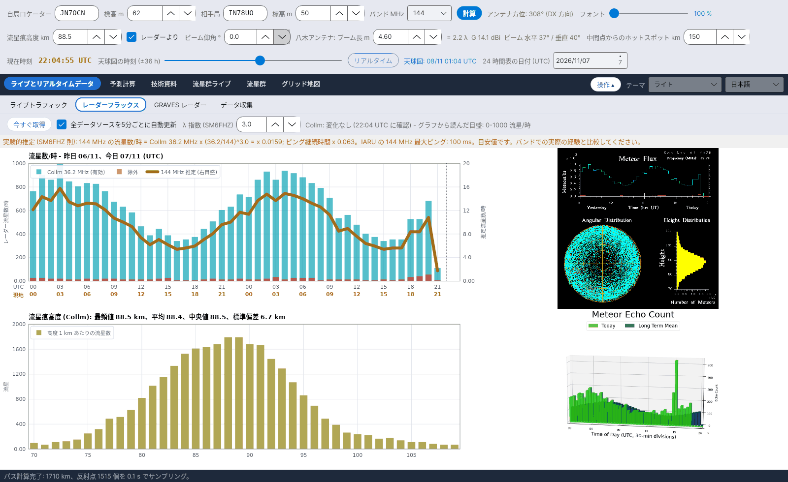

[English](Radar-Flux) · [Italiano](Radar-Flux-it) · [Deutsch](Radar-Flux-de) · [Nederlands](Radar-Flux-nl) · [Français](Radar-Flux-fr) · [Español](Radar-Flux-es) · [Português](Radar-Flux-pt) · [Português (Brasil)](Radar-Flux-pt-BR) · [Dansk](Radar-Flux-da) · [Norsk](Radar-Flux-nb) · [Svenska](Radar-Flux-sv) · [Íslenska](Radar-Flux-is) · [Eesti](Radar-Flux-et) · [Lietuvių](Radar-Flux-lt) · [Latviešu](Radar-Flux-lv) · [Polski](Radar-Flux-pl) · [Čeština](Radar-Flux-cs) · [Magyar](Radar-Flux-hu) · [Română](Radar-Flux-ro) · [Ελληνικά](Radar-Flux-el) · [Русский](Radar-Flux-ru) · [Українська](Radar-Flux-uk) · [Türkçe](Radar-Flux-tr) · [Afrikaans](Radar-Flux-af) · [العربية](Radar-Flux-ar) · [עברית](Radar-Flux-he) · [اردو](Radar-Flux-ur) · [हिन्दी](Radar-Flux-hi) · [বাংলা](Radar-Flux-bn) · [ไทย](Radar-Flux-th) · [Bahasa Indonesia](Radar-Flux-id) · [Tagalog](Radar-Flux-tl) · **日本語** · [한국어](Radar-Flux-ko) · [中文](Radar-Flux-zh) · [中文 (繁體)](Radar-Flux-zh-TW)

# レーダーフラックス

*タブ: ライブとリアルタイムデータ › レーダーフラックス。*

[](https://raw.githubusercontent.com/ic8tem/YA-MS/main/docs/screenshots/ja-1_2.png)

このタブは、専門の流星レーダーが**今**数えているものを表示します: **Collm** SKiYMET レーダー (ドイツ、ライプツィヒ大学 / IAP キュールングスボルン、36.2 MHz) の時間別流星数と流星痕高度、そして **Sodankylä** レーダー (フィンランド SGO) の最新画像です。Collm の流星数は自局バンドでの推定と [実験的予報](Experimental-Forecasts-ja) に使われ、測定された流星痕高度は幾何計算全体に使われます。

## 操作

| 操作 | 機能 |
|---|---|
| **今すぐ取得** | すべての外部ソースを直ちに確認します。 |
| **全データソースを5分ごとに自動更新** | 既定でオン。5 分ごとに全ソースを確認し、**変化したものだけ**を再取得します (*変化なし (… UTC に確認)* / *… UTC に新データ*)。 |
| **λ 指数 (SM6FHZ)** | 周波数則の指数 k。既定 3 (1–4)。 |

## 表示内容

| パネル | 内容 |
|---|---|
| **流星数/時 - 昨日 …、今日 … (UTC)** | シアンの棒 = Collm の流星数 (有効)、赤の棒 = 除外、太い橙の線 = 右目盛の *… MHz 推定* |
| **流星痕高度 (Collm)** | 70–110 km の高度 1 km あたりの流星数と、最も多い高度 (最頻値)、平均、中央値、標準偏差 |
| Collm の画像 | ダウンロードしたままの SKiYMET のオリジナルグラフ |
| Sodankylä の画像 | Sodankylä レーダーの最新の流星数画像 (表示のみ。形式は読み取りません) |

グラフの上の行には、Collm のグラフをいつ読み取ったか、どの縦軸目盛が見つかったかが表示されます (*グラフから読んだ目盛: 0-… 流星/時*)。

## Collm のグラフの読み取り方

Collm のグラフ (720 × 720 ピクセル、純色) の軸の位置は固定ですが、レーダーは測定値に合わせて**縦軸目盛を毎日変えます** (例: 2026/11/5 は 0–1.2·10³、2026/11/6 は 0–1.0·10³ で、目盛線の位置も移動)。そこで YA-MS は次のようにします:

1. 軸の長い目盛線を見つけます;
2. 最上部の目盛とゼロの**ラベルを読み取ります**。各文字をグラフのドットマトリクス フォントと比較します;
3. 各時間 i (0–47、昨日と今日) について、中央の列と上から最初のシアンのピクセル y を取ります:

```math
x_i = 101 + (i+0{.}5)\,\frac{676-101}{48},\qquad N = (y_0-y)\,\frac{N_{top}}{y_0-y_{top}}
```

y_top と y0 は最上部の目盛とゼロの行、N_top は最上部のラベルから読んだ値 (×1000) です。分解能: 1 ピクセルあたり約 7–8 流星/時。*プログラム独自の選択 (マニュアル式 42)。*

ラベルを読み取れない場合、プログラムは 2026/11/5 の校正値 (**校正済み目盛 0-1200 流星/時**) に戻り、そのことを橙で表示します: *フラックスの縦軸目盛を読み取れません (上端ラベル: …): 値は要確認。* グラフの形式そのものが変わった場合 (*グラフの形式が変更されました (…x…): 読み取れません。* または *フラックスグラフの軸が想定位置に見つかりません。*) は読み取りの再校正が必要です。報告してください ([貢献](Contributing-and-Contacts-ja) を参照)。

### 流星痕高度

高度ヒストグラム (高度 k km の流星数 n_k、平均高度 h_k) から:

```math
\hat{h} = h_{k^*},\ k^* = \arg\max_k n_k,\qquad \bar{h} = \frac{\sum_k n_k h_k}{\sum_k n_k},\qquad s = \sqrt{\frac{\sum_k n_k (h_k-\bar{h})^2}{\sum_k n_k}}
```

*マニュアル式 43。* **レーダーより** にチェックを入れると (操作部の 2 段目)、**最頻値**がすべての計算の流星痕高度になります。検証: 2026/11/5 のグラフ – 最頻値 89.5 km、平均 88.6 km、標準偏差 6.8 km。Cerrotta–Sartori の記事の約 90 km (SKiYMET の平均) を裏付けます。

高度グラフの目盛が変わると、プログラムは次の注意を表示します: *高度の統計 (最頻値・平均・中央値) は有効ですが、絶対数は無効です。*

## 自局バンドでの推定

```math
N(f) = N_{Collm}(36{.}2\ \mathrm{MHz})\left(\frac{36{.}2}{f}\right)^{k},\quad k = 3,\qquad \tau(f) = \tau(36{.}2\ \mathrm{MHz})\left(\frac{36{.}2}{f}\right)^{2}
```

**SM6FHZ** の経験則 (VUSHF 2025): 反射の数と強度は λ³ に、継続時間は λ² に比例します (McKinley では λ³ は 1 本の流星痕の電力です。流星痕の数はおよそ λ^1.5 に比例し、前方散乱では継続時間も sec²φ とともに増えます: [実験的予報](Experimental-Forecasts-ja) を参照)。IARU Region 1 の最大ピング継続時間も表示されます (50 MHz で 1000 ms、70 MHz で 500 ms、144 MHz で 100 ms、432 MHz で 13 ms)。値は目安であり、実際の運用経験と比較してください。局係数 K と RMOB との比較は [実験的予報](Experimental-Forecasts-ja) にあります。

## オフライン

どのソースにも接続できない場合、メッセージが **1 度だけ** 表示されます: *インターネット接続がありません。レーダーと RMOB のデータを更新できません: 最後に保存したデータを使用し、5分ごとに自動で再試行します。* 下部のステータスバーは接続が戻るまで赤くなり (*インターネット接続なし …*)、戻ると *接続が回復しました。* と表示されます。

## アーカイブとソース

| ファイル (`data/` 内) | 内容 |
|---|---|
| `flusso_collm.csv` | Collm から読んだフラックスの時間別アーカイブ (既存の時間は更新) |
| `quote_collm.csv` | 流星痕高度のアーカイブ |
| `radar/` | 最後にダウンロードした画像 (と RMOB ファイル) |
| `fonti_radar.csv` | レーダーソースのアドレス。`attivo=1/0` で各ソースを有効/無効にします |

| ソース | 周波数 | 備考 |
|---|---|---|
| Collm 流星レーダー、ライプツィヒ大学 (LIM) および IAP キュールングスボルン – wetterdaten.meteo.uni-leipzig.de/radar_flux.php | 36.2 MHz | 毎時 10 分 (UTC) に更新; 昨日 + 今日のフラックス、高度分布 |
| Sodankylä Geophysical Observatory – sgo.fi/Data/RealTime/meteorRadar.php | 36.9 MHz | 画像のみ (レーダー更新中、DECC プロジェクト) |
| swan.ms (Collm のコピー) | 36.2 MHz | 既定で無効; DL1DBC の許可がある場合のみ使用 |

> レーダーデータの権利は各機関 (ライプツィヒ大学 / IAP キュールングスボルン、Sodankylä Geophysical Observatory) に属します。
