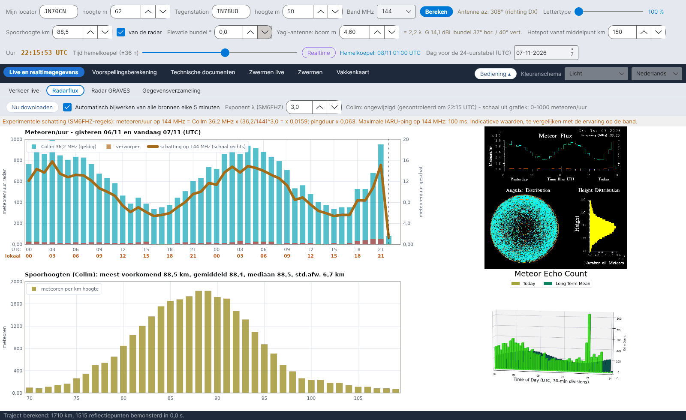

[English](Radar-Flux) · [Italiano](Radar-Flux-it) · [Deutsch](Radar-Flux-de) · **Nederlands** · [Français](Radar-Flux-fr) · [Español](Radar-Flux-es) · [Português](Radar-Flux-pt) · [Dansk](Radar-Flux-da) · [Norsk](Radar-Flux-nb) · [Svenska](Radar-Flux-sv) · [Íslenska](Radar-Flux-is) · [Eesti](Radar-Flux-et) · [Lietuvių](Radar-Flux-lt) · [Latviešu](Radar-Flux-lv) · [Русский](Radar-Flux-ru) · [Українська](Radar-Flux-uk) · [Türkçe](Radar-Flux-tr) · [Afrikaans](Radar-Flux-af) · [العربية](Radar-Flux-ar) · [עברית](Radar-Flux-he) · [اردو](Radar-Flux-ur) · [हिन्दी](Radar-Flux-hi) · [বাংলা](Radar-Flux-bn) · [Bahasa Indonesia](Radar-Flux-id) · [Tagalog](Radar-Flux-tl) · [日本語](Radar-Flux-ja) · [한국어](Radar-Flux-ko) · [中文](Radar-Flux-zh)

# Radarflux

*Tabblad: Live en realtimegegevens › Radarflux.*

[](https://raw.githubusercontent.com/ic8tem/YA-MS/main/docs/screenshots/nl-1_2.png)

Dit tabblad toont wat professionele meteorradars **nu** tellen: de uurtellingen van meteoren en de spoorhoogtes van de SKiYMET-radar in **Collm** (Universiteit Leipzig / IAP Kühlungsborn, Duitsland, 36,2 MHz), en het laatste beeld van de radar in **Sodankylä** (SGO, Finland). De tellingen van Collm voeden de schatting op jouw band en de [Experimentele voorspelling](Experimental-Forecasts-nl); de gemeten spoorhoogte voedt de hele geometrie.

## Bediening

| Element | Wat het doet |
|---|---|
| **Nu downloaden** | Controleert meteen alle externe bronnen. |
| **Automatisch bijwerken van alle bronnen elke 5 minuten** | Standaard aan. Elke 5 minuten worden alle bronnen gecontroleerd en worden **alleen de gewijzigde** opnieuw gedownload (*ongewijzigd (gecontroleerd om … UTC)* / *nieuwe gegevens om … UTC*). |
| **Exponent λ (SM6FHZ)** | Exponent k van de frequentieregel, standaard 3 (1–4). |

## Wat wordt getoond

| Paneel | Inhoud |
|---|---|
| **Meteoren/uur – gisteren en vandaag (UTC)** | Cyaan balken = tellingen van Collm (geldig), rode balken = verworpen, dikke oranje lijn = *schatting op … MHz* op de rechterschaal |
| **Spoorhoogten (Collm)** | Meteoren per km hoogte tussen 70 en 110 km, met de meest voorkomende hoogte (modus), gemiddelde, mediaan en standaardafwijking |
| Beeld van Collm | De originele SKiYMET-grafiek, zoals gedownload |
| Beeld van Sodankylä | Het laatste beeld met meteortellingen van de radar in Sodankylä (alleen getoond; het formaat wordt niet uitgelezen) |

De regel boven de grafieken zegt wanneer de grafiek van Collm is uitgelezen en welke verticale schaal is gevonden (*schaal uit grafiek: 0-… meteoren/uur*).

## Hoe de grafiek van Collm wordt uitgelezen

De grafiek van Collm (720 × 720 pixels, zuivere kleuren) heeft vaste asposities, maar de radar **past de verticale schaal elke dag aan** aan de gemeten waarden (bijv. 0–1,2·10³ op 5/11/2026 en 0–1,0·10³ op 6/11/2026, met verschoven maatstreepjes). YA-MS doet daarom het volgende:

1. het zoekt de lange maatstreepjes van de as;
2. het **leest de labels** van het hoogste streepje en van de nul door elk teken te vergelijken met het dotmatrix-lettertype van de grafiek;
3. voor elk uur i (0–47, gisteren en vandaag) neemt het de middelste kolom en de eerste cyaan pixel van boven, y:

```math
x_i = 101 + (i+0{.}5)\,\frac{676-101}{48},\qquad N = (y_0-y)\,\frac{N_{top}}{y_0-y_{top}}
```

y_top en y0 zijn de rijen van het hoogste streepje en van de nul, N_top is de waarde op het hoogste label (×1000). Resolutie: ongeveer 7–8 meteoren/uur per pixel. *Keuze van het programma (vgl. 42 van de handleiding).*

Als een label niet leesbaar is, valt het programma terug op de kalibratie van 5/11/2026 (**geijkte schaal 0-1200 meteoren/uur**) en meldt dat in het oranje: *Kan de verticale schaal van de flux niet lezen (label bovenaan: …): waarden controleren.* Als het formaat van de grafiek zelf verandert (*Grafiekformaat gewijzigd (…x…): uitlezen niet mogelijk* of *Fluxassen niet op de verwachte positie gevonden*), moet het uitlezen opnieuw worden gekalibreerd: meld het alsjeblieft (zie [Bijdragen en contact](Contributing-and-Contacts-nl)).

### Spoorhoogten

Uit het hoogtehistogram (n_k meteoren in km k, gemiddelde hoogte h_k):

```math
\hat{h} = h_{k^*},\ k^* = \arg\max_k n_k,\qquad \bar{h} = \frac{\sum_k n_k h_k}{\sum_k n_k},\qquad s = \sqrt{\frac{\sum_k n_k (h_k-\bar{h})^2}{\sum_k n_k}}
```

*Vgl. 43 van de handleiding.* Met **van de radar** aangevinkt (rij 2 van de bediening) wordt de **modus** de spoorhoogte voor alle berekeningen. Controle: grafiek van 5/11/2026 – modus 89,5 km, gemiddelde 88,6 km, standaardafwijking 6,8 km, wat de ~90 km uit het artikel van Cerrotta–Sartori bevestigt (SKiYMET-gemiddelde).

Als de schaal van de hoogtegrafiek verandert, waarschuwt het programma: *de hoogtestatistieken (modus, gemiddelde, mediaan) blijven geldig, de absolute aantallen niet.*

## Schatting op jouw band

```math
N(f) = N_{Collm}(36{.}2\ \mathrm{MHz})\left(\frac{36{.}2}{f}\right)^{k},\quad k = 3,\qquad \tau(f) = \tau(36{.}2\ \mathrm{MHz})\left(\frac{36{.}2}{f}\right)^{2}
```

Experimentele regels van **SM6FHZ** (VUSHF 2025): aantal en intensiteit van de reflecties schalen met λ³, de duur met λ²; de λ³-afhankelijkheid is dezelfde als in de vergelijking van McKinley voor onderdichte sporen. Ook de maximale pingduur volgens IARU Regio 1 wordt getoond (1000 ms op 50 MHz, 500 ms op 70 MHz, 100 ms op 144 MHz, 13 ms op 432 MHz). De waarden zijn indicatief, te vergelijken met de ervaring in de lucht. De stationsfactor K en de vergelijking met RMOB staan in [Experimentele voorspelling](Experimental-Forecasts-nl).

## Zonder verbinding

Als geen enkele bron bereikbaar is, verschijnt **eenmalig** een melding: *Geen internetverbinding. De gegevens van de radars en van RMOB kunnen niet worden bijgewerkt: het programma gebruikt de laatst opgeslagen gegevens en probeert het zelf elke 5 minuten opnieuw.* De statusbalk onderaan wordt rood (*GEEN INTERNETVERBINDING …*) totdat de verbinding terug is (*Verbinding hersteld.*).

## Archieven en bronnen

| Bestand (in `data/`) | Inhoud |
|---|---|
| `flusso_collm.csv` | Uurarchief van de flux uitgelezen van Collm (al aanwezige uren worden bijgewerkt) |
| `quote_collm.csv` | Archief van de spoorhoogtes |
| `radar/` | Laatst gedownloade beelden (en RMOB-bestanden) |
| `fonti_radar.csv` | Adressen van de radarbronnen, `attivo=1/0` om elke bron in of uit te schakelen |

| Bron | Frequentie | Opmerkingen |
|---|---|---|
| Meteorradar Collm, Universiteit Leipzig (LIM) en IAP Kühlungsborn – wetterdaten.meteo.uni-leipzig.de/radar_flux.php | 36,2 MHz | elk uur bijgewerkt op minuut 10 UTC; flux gisteren + vandaag, hoogteverdeling |
| Sodankylä Geophysical Observatory – sgo.fi/Data/RealTime/meteorRadar.php | 36,9 MHz | alleen beeld (radar wordt vernieuwd, DECC-project) |
| swan.ms (kopie van Collm) | 36,2 MHz | standaard uitgeschakeld; alleen gebruiken met toestemming van DL1DBC |

> De radargegevens behoren toe aan hun instituten (Universiteit Leipzig / IAP Kühlungsborn, Sodankylä Geophysical Observatory).
