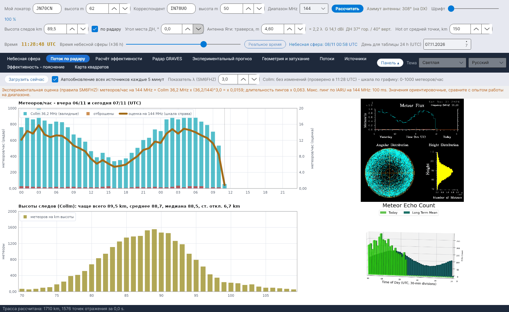

[English](Radar-Flux) · **Русский** · [Deutsch](Radar-Flux-de) · [日本語](Radar-Flux-ja)

# Поток по радару

*Вкладка 2.*

[](https://raw.githubusercontent.com/ic8tem/YA-MS/main/docs/screenshots/ru-2.png)

Эта вкладка показывает, что **сейчас** регистрируют профессиональные метеорные радары: почасовое число метеоров и высоты следов по радару SKiYMET в **Collm** (Лейпцигский университет / IAP Kühlungsborn, Германия, 36,2 MHz) и последнее изображение радара **Sodankylä** (SGO, Финляндия). Данные Collm используются для оценки на вашем диапазоне и в [Экспериментальном прогнозе](Experimental-Forecasts-ru); измеренная высота следов используется во всей геометрии.

## Элементы управления

| Элемент | Что делает |
|---|---|
| **Загрузить сейчас** | Сразу проверяет все внешние источники. |
| **Автообновление всех источников каждые 5 минут** | Включено по умолчанию. Каждые 5 минут проверяются все источники, и повторно загружаются **только изменившиеся** (*без изменений (проверено в … UTC)* / *новые данные в … UTC*). |
| **Показатель λ (SM6FHZ)** | Показатель k частотного правила, по умолчанию 3 (1–4). |

## Что показывается

| Панель | Содержание |
|---|---|
| **Метеоров/час - вчера и сегодня (UTC)** | Голубые столбцы = данные Collm (валидные), красные столбцы = отброшенные, толстая оранжевая линия = *оценка на … MHz* по правой шкале |
| **Высоты следов (Collm)** | Число метеоров на km высоты в диапазоне от 70 до 110 km, с наиболее частой высотой (мода), средним, медианой и стандартным отклонением |
| Изображение Collm | Оригинальный график SKiYMET в загруженном виде |
| Изображение Sodankylä | Последнее изображение с числом метеоров радара Sodankylä (только отображается; его формат не считывается) |

Строка над графиками сообщает, когда был прочитан график Collm и какая вертикальная шкала обнаружена (*шкала по графику: 0-… метеоров/час*).

## Как считывается график Collm

График Collm (720 × 720 пикселей, чистые цвета) имеет фиксированное положение осей, но радар **каждый день подстраивает вертикальную шкалу** под измеренные значения (например, 0–1,2·10³ 5/11/2026 и 0–1,0·10³ 6/11/2026, со смещёнными делениями). Поэтому YA-MS:

1. находит длинные деления оси;
2. **считывает подписи** верхнего деления и нуля, сравнивая каждый символ с матричным шрифтом графика;
3. для каждого часа i (0–47, вчера и сегодня) берёт центральный столбец пикселей и первый сверху голубой пиксель, y:

```
x_i = 101 + (i + 0.5)·(676 − 101)/48        N = (y0 − y)·N_top / (y0 − y_top)   meteors/hour
```

y_top и y0 – строки верхнего деления и нуля, N_top – значение, прочитанное на верхней подписи (×1000). Разрешение: около 7–8 метеоров/час на пиксель. *Выбор программы (руководство, ур. 42).*

Если подпись прочитать не удаётся, программа возвращается к калибровке от 5/11/2026 (**калиброванная шкала 0-1200 метеоров/час**) и сообщает об этом оранжевым: *Не удаётся прочитать вертикальную шкалу потока (метка вверху: …): значения требуют проверки.* Если изменился сам формат графика (*Формат графика изменился (…x…): чтение невозможно* или *Оси графика потока не найдены в ожидаемом месте*), считывание нужно перекалибровать: пожалуйста, сообщите об этом (см. [Участие](Contributing-and-Contacts-ru)).

### Высоты следов

По гистограмме высот (n_k метеоров в километре k, средняя высота h_k):

```
h_mode = h_k*  with k* = argmax n_k      mean = Σ n_k·h_k / Σ n_k      s = sqrt( Σ n_k·(h_k − mean)² / Σ n_k )
```

*Руководство, ур. 43.* При отмеченном **по радару** (ряд 2 элементов управления) **мода** становится высотой следов во всех расчётах. Проверка: график от 5/11/2026 – мода 89,5 km, среднее 88,6 km, стандартное отклонение 6,8 km, что подтверждает ~90 km из статьи Cerrotta–Sartori (среднее по SKiYMET).

Если меняется масштаб графика высот, программа предупреждает: *статистика высот (мода, среднее, медиана) верна, абсолютные подсчёты - нет.*

## Оценка для вашего диапазона

```
meteors/hour at f = Collm(36.2 MHz) · (36.2 / f)^k          ping duration · (36.2 / f)²          k = 3
```

Экспериментальные правила **SM6FHZ** (VUSHF 2025): число и интенсивность отражений масштабируются как λ³, длительность – как λ²; зависимость λ³ та же, что и в уравнении McKinley для ненасыщенных следов. Показывается также максимальная длительность пинга по IARU Region 1 (1000 ms на 50 MHz, 500 ms на 70 MHz, 100 ms на 144 MHz, 13 ms на 432 MHz). Значения ориентировочные, для сравнения с опытом работы в эфире. Коэффициент станции K и сравнение с RMOB – в [Экспериментальном прогнозе](Experimental-Forecasts-ru).

## Без сети

Если ни один источник недоступен, **один раз** появляется сообщение: *Нет подключения к интернету. Данные радаров и RMOB не могут быть обновлены: программа использует последние сохранённые данные и сама повторяет попытку каждые 5 минут.* Строка состояния внизу становится красной (*НЕТ ПОДКЛЮЧЕНИЯ К ИНТЕРНЕТУ …*), пока связь не восстановится (*Подключение восстановлено.*).

## Архивы и источники

| Файл (в `data/`) | Содержание |
|---|---|
| `flusso_collm.csv` | Почасовой архив потока, прочитанного с Collm (уже имеющиеся часы обновляются) |
| `quote_collm.csv` | Архив высот следов |
| `radar/` | Последние загруженные изображения (и файлы RMOB) |
| `fonti_radar.csv` | Адреса источников радарных данных, `attivo=1/0` включает/отключает каждый |

| Источник | Частота | Примечания |
|---|---|---|
| Метеорный радар Collm, Лейпцигский университет (LIM) и IAP Kühlungsborn – wetterdaten.meteo.uni-leipzig.de/radar_flux.php | 36,2 MHz | обновляется каждый час в 10 минут UTC; поток вчера + сегодня, распределение по высоте |
| Sodankylä Geophysical Observatory – sgo.fi/Data/RealTime/meteorRadar.php | 36,9 MHz | только изображение (радар модернизируется, проект DECC) |
| swan.ms (копия Collm) | 36,2 MHz | отключён по умолчанию; использовать только с разрешения DL1DBC |

> Данные радаров принадлежат соответствующим организациям (Лейпцигский университет / IAP Kühlungsborn, Sodankylä Geophysical Observatory).
