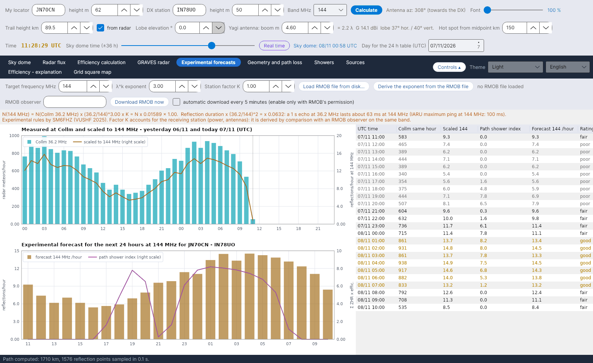

[English](Showers) · [Italiano](Showers-it) · [Deutsch](Showers-de) · [Nederlands](Showers-nl) · [Français](Showers-fr) · [Español](Showers-es) · [Português](Showers-pt) · [Português (Brasil)](Showers-pt-br) · [Dansk](Showers-da) · [Norsk](Showers-nb) · [Svenska](Showers-sv) · [Íslenska](Showers-is) · [Eesti](Showers-et) · [Lietuvių](Showers-lt) · [Latviešu](Showers-lv) · [Polski](Showers-pl) · [Čeština](Showers-cs) · [Magyar](Showers-hu) · [Română](Showers-ro) · [Ελληνικά](Showers-el) · [Русский](Showers-ru) · [Українська](Showers-uk) · [Türkçe](Showers-tr) · [Afrikaans](Showers-af) · **العربية** · [עברית](Showers-he) · [اردو](Showers-ur) · [हिन्दी](Showers-hi) · [বাংলা](Showers-bn) · [Bahasa Indonesia](Showers-id) · [Tagalog](Showers-tl) · [ไทย](Showers-th) · [日本語](Showers-ja) · [한국어](Showers-ko) · [中文](Showers-zh) · [中文 (繁體)](Showers-zh-tw)

# الزخات

*علامة التبويب: الزخات.*

[](https://raw.githubusercontent.com/ic8tem/YA-MS/main/docs/screenshots/en-5.png)

فهرس الزخات المستخدم في جميع الحسابات: **45 زخة** من **IMO Meteor Shower Calendar 2026 و2027** (الجدولان 5 و7) إضافة إلى **مصدر مقابل الشمس (Antihelion Source)** (الجدول 6)، لكل منها **ذروتها التالية**.

## الأعمدة

| العمود | المعنى |
|---|---|
| الرمز | رمز IMO ‏(QUA، PER، GEM، …) |
| الزخة | الاسم |
| النشاط | فترة النشاط (يوم/شهر – يوم/شهر) |
| λ max | خط الطول الشمسي للذروة (J2000)، من IMO |
| **الذروة التالية (UTC)** | تاريخ الذروة التالية ووقتها (انظر أدناه) |
| **مصدر الذروة** | *IMO 2026* / *IMO 2027* = التاريخ والوقت المنشوران من IMO؛ *IMO 2026 (يوم)* = يعطي IMO اليوم فقط، والوقت المعروض محسوب (*~hh:mm محسوب*)؛ *محسوب من λ* = لا توجد قيمة من IMO لتلك السنة |
| المطلع المستقيم، الميل | نقطة الإشعاع عند الذروة (*متحرك* لمصدر مقابل الشمس) |
| v km/s، r | السرعة المركزية الأرضية ومؤشر المجموعة (population index) |
| ZHR | ZHR الذروة (*متغير* = متغير) |
| النوع | *بصري* أو *راديوي، نهاري* |
| نشطة اليوم | *نعم* عندما تكون الزخة نشطة الآن |

## الذروة التالية

يعرض البرنامج دائماً الذروة **التالية**. عندما يكون IMO قد نشر تقويم تلك السنة يستخدم **تاريخ IMO ووقته** من `data/massimi_imo.csv` (السنتان 2026 و2027 مضمّنتان)؛ وإلا فإنه يحسب اللحظة التي تبلغ فيها الشمس خط الطول الشمسي للذروة (Meeus، *Astronomical Algorithms*، الفصل 25، بالحل بطريقة نيوتن).

**التحقق:** يتفق الحساب مع تقويمي IMO لعامي 2026 و2027 في حدود بضع دقائق حيث يعطي IMO الوقت (مثلاً الربعيات 3/1/2026 21:13 مقابل 21:00؛ التوأميات 14/12/2027 19:51 مقابل 20:00). الاستثناءات: كابا الأسديات النهارية 2026 بفارق يوم لاحق (26/9 بدلاً من 25/9) ووقت إيتا الدلويات 2027 (15:10 مقابل 09:00 وفق IMO) – في هذه الحالات تُستخدم قيمة IMO.

**إضافة سنة:** عندما ينشر IMO تقويماً جديداً، أضف صفوفه إلى `data/massimi_imo.csv` (`year;code;MM-DD;hh:mm`، والوقت فارغ إذا كان IMO يعطي اليوم فقط). وحتى ذلك الحين تُحسب الذروة.

## الزخات الثانوية والنهارية

يتضمن الفهرس **الزخات الثانوية** من قائمة IMO – مثل الزرافيات لشهر أكتوبر (OCT، ‏ZHR 5، نشطة 5–6 أكتوبر)، والأندروميديات، وغاما الدببيات الصغرى – و**الزخات الراديوية النهارية** من أبريل إلى أكتوبر (الحوتيات النهارية لشهر أبريل، والحمليات النهارية، وزيتا البرشاويات النهارية، وبيتا الثوريات النهارية، وكابا الأسديات النهارية، والسدسيات النهارية، …). حتى مع قيم ZHR صغيرة فإنها تساهم في [مؤشر المسار](Efficiency-Calculation-ar#النموذج) وفي [Hot الموصى به](Sky-View-ar#hot-الموصى-به). لا يعطي IMO قيمة ZHR للزخات الراديوية النهارية: وحيث لا تتوفر قيمة يستخدم البرنامج قيمة عمل قدرها 5.

## منحنى النشاط وانجراف نقطة الإشعاع

```
ZHR(λ☉) = ZHR_max · 10^( −B± · |λ☉ − λ_max| )
α = α0 + (dα/dλ)·Δλ      δ = δ0 + (dδ/dλ)·Δλ      Δλ = λ☉ − λ_max
```

تؤخذ ZHR_max وα0 وδ0 وλ_max من تقويم IMO؛ أما الميلان B (المختلفان قبل الذروة وبعدها) والانجرافان اليوميان dα/dλ وdδ/dλ فهي **قيم عمل** مكتوبة في `data/sciami.csv` (لم يُدخل جدول الانجراف الخاص بـ IMO بعد). *المعادلتان 9 و13 في الدليل.* يُستوفى موضع مصدر مقابل الشمس خطياً بين تواريخ الجدول 6 من IMO (`data/ant_radiante.csv`؛ نشط من 10 ديسمبر إلى 20 سبتمبر، ZHR نحو 4).

## تعديل الفهرس

الملف `data/sciami.csv` ملف نصي بسيط (الفاصل `;`) يمكنك تعديله: الرمز، الاسم، البداية والنهاية (MM-DD)، λ max، المطلع المستقيم، الميل، الانجرافات، v، ‏r، ‏ZHR، ‏B قبل/بعد، النوع (V بصري، R راديوي نهاري). إذا كان أحد الأسطر خاطئاً يعرض البرنامج رسالة عند بدء التشغيل ويتجاهله.

المصادر: International Meteor Organization – Meteor Shower Calendar 2026 و2027، [www.imo.net](https://www.imo.net) (الجداول 5 و6 و7)؛ Philip G0ISW (المعدلات الساعية الراديوية القصوى)؛ Rossano IZ5TEK ‏(scattertek).
