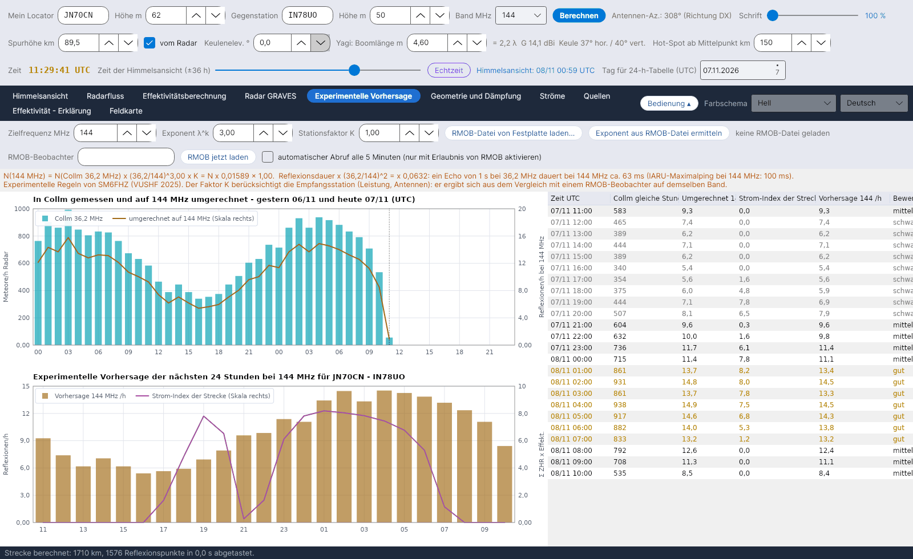

[English](Showers) · [Italiano](Showers-it) · **Deutsch** · [Nederlands](Showers-nl) · [Français](Showers-fr) · [Español](Showers-es) · [Português](Showers-pt) · [Dansk](Showers-da) · [Norsk](Showers-nb) · [Svenska](Showers-sv) · [Íslenska](Showers-is) · [Eesti](Showers-et) · [Lietuvių](Showers-lt) · [Latviešu](Showers-lv) · [Русский](Showers-ru) · [Українська](Showers-uk) · [Türkçe](Showers-tr) · [Afrikaans](Showers-af) · [العربية](Showers-ar) · [עברית](Showers-he) · [اردو](Showers-ur) · [हिन्दी](Showers-hi) · [বাংলা](Showers-bn) · [Bahasa Indonesia](Showers-id) · [Tagalog](Showers-tl) · [日本語](Showers-ja) · [한국어](Showers-ko) · [中文](Showers-zh)

# Ströme

*Reiter: Ströme.*

[](https://raw.githubusercontent.com/ic8tem/YA-MS/main/docs/screenshots/de-5.png)

Der Meteorstrom-Katalog, den alle Berechnungen verwenden: **45 Meteorströme** aus dem **IMO Meteor Shower Calendar 2026 und 2027** (Tabellen 5 und 7) plus die **Antihelion-Quelle** (Tabelle 6), jeweils mit dem **nächsten Maximum**.

## Spalten

| Spalte | Bedeutung |
|---|---|
| Kürzel | IMO-Kürzel (QUA, PER, GEM, …) |
| Strom | Name |
| Aktivität | Aktivitätszeitraum (Tag/Monat – Tag/Monat) |
| λ max | Sonnenlänge des Maximums (J2000), laut IMO |
| **Nächstes Maximum (UTC)** | Datum und Uhrzeit des nächsten Maximums (siehe unten) |
| **Quelle des Maximums** | *IMO 2026* / *IMO 2027* = von der IMO veröffentlichtes Datum und Uhrzeit; *IMO 2026 (Tag)* = die IMO nennt nur den Tag, die angezeigte Uhrzeit ist berechnet (*~hh:mm ber.*); *aus λ berechnet* = kein IMO-Wert für dieses Jahr |
| RA, Dekl. | Radiant im Maximum (*wandernd* bei der Antihelion-Quelle) |
| v km/s, r | Geozentrische Geschwindigkeit und Populationsindex |
| ZHR | ZHR im Maximum (*var.* = variabel) |
| Typ | *visuell* oder *Radio, Tag* |

Die **heute (UTC) aktiven** Ströme sind mit einem gelben Schleier und fetter Schrift hervorgehoben.

## Nächstes Maximum

Das Programm zeigt immer das **nächste** Maximum. Hat die IMO den Kalender des betreffenden Jahres veröffentlicht, verwendet es **Datum und Uhrzeit der IMO** aus `data/massimi_imo.csv` (2026 und 2027 sind enthalten); sonst berechnet es den Zeitpunkt, an dem die Sonne die Sonnenlänge des Maximums erreicht (Meeus, *Astronomical Algorithms*, Kap. 25, gelöst mit dem Newton-Verfahren).

**Prüfung:** Die Berechnung stimmt mit den IMO-Kalendern 2026 und 2027 auf wenige Minuten überein, wo die IMO die Uhrzeit angibt (z. B. Quadrantiden 3.1.2026 21:13 gegenüber 21:00; Geminiden 14.12.2027 19:51 gegenüber 20:00). Ausnahmen: Tages-kappa-Leoniden 2026 einen Tag später (26.9. statt 25.9.) und die Uhrzeit der eta-Aquariiden 2027 (15:10 gegenüber 09:00 IMO) – in diesen Fällen wird der IMO-Wert verwendet.

**Ein Jahr hinzufügen:** Wenn die IMO einen neuen Kalender veröffentlicht, füge seine Zeilen in `data/massimi_imo.csv` ein (`year;code;MM-DD;hh:mm`, Uhrzeit leer, wenn die IMO nur den Tag angibt). Bis dahin wird das Maximum berechnet.

## Kleine Ströme und Tagesströme

Der Katalog enthält die **kleinen Ströme** der IMO-Liste – zum Beispiel die Oktober-Camelopardaliden (OCT, ZHR 5, aktiv 5.–6. Oktober), die Andromediden, die gamma-Ursae-Minoriden – und die **Radio-Tagesströme** von April bis Oktober (April-Pisciden (Tag), Tages-Arietiden, Tages-zeta-Perseiden, Tages-beta-Tauriden, Tages-kappa-Leoniden, Tages-Sextantiden, …). Auch mit kleinen ZHR tragen sie zum [Streckenindex](Efficiency-Calculation-de#das-modell) und zum [empfohlenen Hot](Sky-View-de#empfohlener-hot) bei. Für die Radio-Tagesströme gibt die IMO keine ZHR an: Wo keine angegeben ist, verwendet das Programm einen Arbeitswert von 5.

## Aktivitätsprofil und Radiantenwanderung

```math
ZHR(\lambda_\odot) = ZHR_{max}\,10^{-B_\pm |\lambda_\odot - \lambda_{max}|},\qquad \alpha = \alpha_0 + \frac{d\alpha}{d\lambda}\Delta\lambda,\quad \delta = \delta_0 + \frac{d\delta}{d\lambda}\Delta\lambda,\quad \Delta\lambda = \lambda_\odot - \lambda_{max}
```

ZHR_max, α0, δ0 und λ_max aus dem IMO-Kalender; die Steigungen B (vor und nach dem Maximum verschieden) und die täglichen Wanderungen dα/dλ, dδ/dλ sind **Arbeitswerte** in `data/sciami.csv` (die IMO-Tabelle der Radiantenwanderung ist noch nicht eingepflegt). *Handbuch Gl. 9 und 13.* Die Position der Antihelion-Quelle wird linear zwischen den Daten der IMO-Tabelle 6 interpoliert (`data/ant_radiante.csv`; aktiv 10. Dezember – 20. September, ZHR etwa 4).

## Katalog bearbeiten

`data/sciami.csv` ist eine einfache Textdatei (Trennzeichen `;`), die du bearbeiten kannst: Kürzel, Name, Beginn und Ende (MM-DD), λ max, RA, Dekl., Wanderungen, v, r, ZHR, B vor/nach, Typ (V visuell, R Radio Tag). Ist eine Zeile fehlerhaft, zeigt das Programm beim Start eine Meldung und ignoriert sie.

Quellen: International Meteor Organization – Meteor Shower Calendar 2026 und 2027, [www.imo.net](https://www.imo.net) (Tabellen 5, 6 und 7); Rossano IZ5TEK (scattertek).
