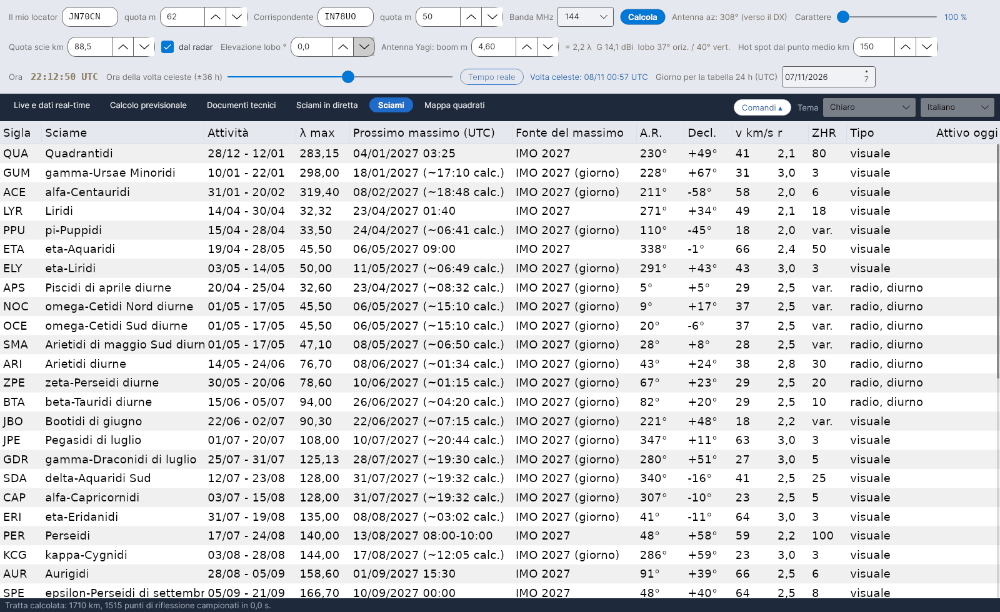

[English](Showers) · **Italiano** · [Deutsch](Showers-de) · [Nederlands](Showers-nl) · [Français](Showers-fr) · [Español](Showers-es) · [Português](Showers-pt) · [Dansk](Showers-da) · [Norsk](Showers-nb) · [Svenska](Showers-sv) · [Íslenska](Showers-is) · [Eesti](Showers-et) · [Lietuvių](Showers-lt) · [Latviešu](Showers-lv) · [Русский](Showers-ru) · [Українська](Showers-uk) · [Türkçe](Showers-tr) · [Afrikaans](Showers-af) · [العربية](Showers-ar) · [עברית](Showers-he) · [اردو](Showers-ur) · [हिन्दी](Showers-hi) · [বাংলা](Showers-bn) · [Bahasa Indonesia](Showers-id) · [Tagalog](Showers-tl) · [日本語](Showers-ja) · [한국어](Showers-ko) · [中文](Showers-zh)

# Sciami

*Linguetta: Sciami.*

[](https://raw.githubusercontent.com/ic8tem/YA-MS/main/docs/screenshots/it-5.png)

Il catalogo degli sciami usato da tutti i calcoli: **45 sciami** dall'**IMO Meteor Shower Calendar 2026 e 2027** (tabelle 5 e 7) più la **Sorgente Antielio** (tabella 6), ciascuno con il suo **prossimo massimo**.

## Colonne

| Colonna | Significato |
|---|---|
| Sigla | Codice IMO (QUA, PER, GEM, …) |
| Sciame | Nome |
| Attività | Periodo di attività (giorno/mese – giorno/mese) |
| λ max | Longitudine solare del massimo (J2000), dall'IMO |
| **Prossimo massimo (UTC)** | Data e ora del prossimo massimo (vedi sotto) |
| **Fonte del massimo** | *IMO 2026* / *IMO 2027* = data e ora pubblicate dall'IMO; *IMO 2026 (giorno)* = l'IMO dà solo il giorno, l'ora mostrata è calcolata (*~hh:mm calc.*); *calcolato da λ* = nessun valore IMO per quell'anno |
| A.R., Decl. | Radiante al massimo (*mobile* per la Sorgente Antielio) |
| v km/s, r | Velocità geocentrica e indice di popolazione |
| ZHR | ZHR al massimo (*var.* = variabile) |
| Tipo | *visuale* oppure *radio, diurno* |

Gli sciami **attivi oggi (UTC)** sono evidenziati con un velo giallo e testo in grassetto.

## Prossimo massimo

Il programma mostra sempre il **prossimo** massimo. Quando l'IMO ha pubblicato il calendario di quell'anno usa la **data e l'ora IMO** da `data/massimi_imo.csv` (sono inclusi il 2026 e il 2027); altrimenti calcola l'istante in cui il Sole raggiunge la longitudine solare del massimo (Meeus, *Astronomical Algorithms*, cap. 25, risolto con il metodo di Newton).

**Verifica:** il calcolo concorda con i calendari IMO 2026 e 2027 entro pochi minuti dove l'IMO dà l'ora (per esempio Quadrantidi 3/1/2026 21:13 contro 21:00; Geminidi 14/12/2027 19:51 contro 20:00). Eccezioni: kappa-Leonidi diurne 2026 un giorno dopo (26/9 invece di 25/9) e l'ora delle eta-Aquaridi 2027 (15:10 contro 09:00 IMO) – in questi casi si usa il valore IMO.

**Aggiungere un anno:** quando l'IMO pubblica un nuovo calendario, aggiungi le sue righe a `data/massimi_imo.csv` (`anno;sigla;MM-GG;hh:mm`, ora vuota se l'IMO dà solo il giorno). Fino ad allora il massimo viene calcolato.

## Sciami minori e diurni

Il catalogo comprende gli **sciami minori** dell'elenco IMO – per esempio le Camelopardalidi di ottobre (OCT, ZHR 5, attive il 5–6 ottobre), le Andromedidi, le gamma-Ursae Minoridi – e gli **sciami radio diurni** da aprile a ottobre (Piscidi di aprile diurne, Arietidi diurne, zeta-Perseidi diurne, beta-Tauridi diurne, kappa-Leonidi diurne, Sextantidi diurne, …). Anche con ZHR piccoli contribuiscono all'[indice della tratta](Efficiency-Calculation-it#il-modello) e all'[Hot consigliato](Sky-View-it#hot-consigliato). Per gli sciami radio diurni l'IMO non dà lo ZHR: dove manca, il programma usa un valore di lavoro pari a 5.

## Profilo di attività e spostamento del radiante

```math
ZHR(\lambda_\odot) = ZHR_{max}\,10^{-B_\pm |\lambda_\odot - \lambda_{max}|},\qquad \alpha = \alpha_0 + \frac{d\alpha}{d\lambda}\Delta\lambda,\quad \delta = \delta_0 + \frac{d\delta}{d\lambda}\Delta\lambda,\quad \Delta\lambda = \lambda_\odot - \lambda_{max}
```

ZHR_max, α0, δ0 e λ_max dal calendario IMO; le pendenze B (diverse prima e dopo il massimo) e gli spostamenti giornalieri dα/dλ, dδ/dλ sono **valori di lavoro** scritti in `data/sciami.csv` (la tabella degli spostamenti dell'IMO non è ancora stata inserita). *Eq. 9 e 13 del manuale.* La posizione della Sorgente Antielio è interpolata linearmente tra le date della tabella 6 dell'IMO (`data/ant_radiante.csv`; attiva dal 10 dicembre al 20 settembre, ZHR circa 4).

## Modificare il catalogo

`data/sciami.csv` è un semplice file di testo (separatore `;`) che puoi modificare: sigla, nome, inizio e fine (MM-GG), λ max, A.R., Decl., spostamenti, v, r, ZHR, B prima/dopo, tipo (V visuale, R radio diurno). Se una riga è sbagliata il programma mostra un messaggio all'avvio e la ignora.

Fonti: International Meteor Organization – Meteor Shower Calendar 2026 e 2027, [www.imo.net](https://www.imo.net) (tabelle 5, 6 e 7); Rossano IZ5TEK (scattertek).
