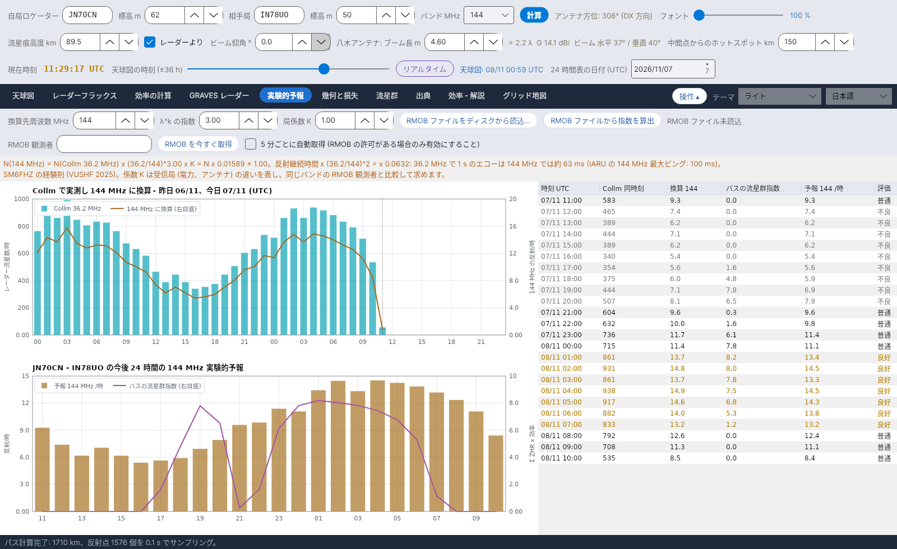

[English](Showers) · [Italiano](Showers-it) · [Deutsch](Showers-de) · [Nederlands](Showers-nl) · [Français](Showers-fr) · [Español](Showers-es) · [Português](Showers-pt) · [Dansk](Showers-da) · [Norsk](Showers-nb) · [Svenska](Showers-sv) · [Íslenska](Showers-is) · [Eesti](Showers-et) · [Lietuvių](Showers-lt) · [Latviešu](Showers-lv) · [Русский](Showers-ru) · [Українська](Showers-uk) · [Türkçe](Showers-tr) · [Afrikaans](Showers-af) · [العربية](Showers-ar) · [עברית](Showers-he) · [اردو](Showers-ur) · [हिन्दी](Showers-hi) · [বাংলা](Showers-bn) · [Bahasa Indonesia](Showers-id) · [Tagalog](Showers-tl) · **日本語** · [한국어](Showers-ko) · [中文](Showers-zh)

# 流星群

*タブ: 流星群。*

[](https://raw.githubusercontent.com/ic8tem/YA-MS/main/docs/screenshots/ja-5.png)

すべての計算に使う流星群カタログです: **IMO Meteor Shower Calendar 2026 および 2027** (表 5 と 7) の **45 の流星群**と **反太陽源** (表 6)。それぞれに**次の極大**が示されます。

## 列

| 列 | 意味 |
|---|---|
| 略号 | IMO 略号 (QUA、PER、GEM、…) |
| 流星群 | 名称 |
| 活動期間 | 活動期間 (日/月 – 日/月) |
| λ max | 極大の太陽黄経 (J2000)、IMO より |
| **次の極大 (UTC)** | 次の極大の日時 (下記参照) |
| **極大の出典** | *IMO 2026* / *IMO 2027* = IMO が公表した日時; *IMO 2026 (日)* = IMO は日付のみを示し、表示の時刻は計算値 (*(計算 ~hh:mm)*); *λ から計算* = その年の IMO の値なし |
| 赤経、赤緯 | 極大時の放射点 (反太陽源は *移動*) |
| v km/s、r | 対地速度と光度比 |
| ZHR | 極大 ZHR (*変動* = 変化する) |
| 種類 | *眼視* または *電波・昼間* |
| 本日活動 | 流星群が現在活動中なら *○* |

## 次の極大

プログラムは常に**次の**極大を表示します。IMO がその年のカレンダーを公表していれば、`data/massimi_imo.csv` の **IMO の日時**を使います (2026 年と 2027 年を収録)。そうでなければ、太陽が極大の太陽黄経に達する瞬間を計算します (Meeus、*Astronomical Algorithms*、第 25 章、ニュートン法で解く)。

**検証:** IMO が時刻を示している場合、計算は IMO の 2026 年と 2027 年のカレンダーと数分以内で一致します (例: しぶんぎ座流星群 2026/1/3 21:13 に対し 21:00; ふたご座流星群 2027/12/14 19:51 に対し 20:00)。例外: しし座κ昼間流星群 2026 は 1 日遅く (9/25 ではなく 9/26)、みずがめ座η流星群 2027 の時刻 (IMO の 09:00 に対し 15:10) – これらの場合は IMO の値を使います。

**年の追加:** IMO が新しいカレンダーを公表したら、その行を `data/massimi_imo.csv` に追加します (`year;code;MM-DD;hh:mm`。IMO が日付のみを示す場合は時刻を空欄に)。それまでは極大は計算値になります。

## 小流星群と昼間流星群

カタログには IMO リストの**小流星群** – 例えば 10月きりん座流星群 (OCT、ZHR 5、10 月 5–6 日に活動)、アンドロメダ座流星群、こぐま座γ流星群 – と、4–10 月の**昼間の電波流星群** (4月うお座昼間流星群、おひつじ座昼間流星群、ペルセウス座ζ昼間流星群、おうし座β昼間流星群、しし座κ昼間流星群、ろくぶんぎ座昼間流星群、…) が含まれます。ZHR が小さくても、[パス指数](Efficiency-Calculation-ja#モデル) と [推奨 Hot](Sky-View-ja#推奨-hot) に寄与します。昼間の電波流星群については IMO は ZHR を示していないため、値がない場合プログラムは作業値 5 を使います。

## 活動プロファイルと放射点の移動

```
ZHR(λ☉) = ZHR_max · 10^( −B± · |λ☉ − λ_max| )
α = α0 + (dα/dλ)·Δλ      δ = δ0 + (dδ/dλ)·Δλ      Δλ = λ☉ − λ_max
```

ZHR_max、α0、δ0、λ_max は IMO のカレンダーから取ります。勾配 B (極大の前後で異なる) と日々の移動 dα/dλ、dδ/dλ は `data/sciami.csv` に書かれた**作業値**です (IMO の放射点移動表はまだ入力されていません)。*マニュアル式 9 と 13。* 反太陽源の位置は IMO 表 6 の日付間で線形補間します (`data/ant_radiante.csv`; 12 月 10 日 – 9 月 20 日に活動、ZHR 約 4)。

## カタログの編集

`data/sciami.csv` は編集可能なプレーンテキストファイル (区切り文字 `;`) です: 略号、名称、開始と終了 (MM-DD)、λ max、赤経、赤緯、移動量、v、r、ZHR、前/後の B、種類 (V 眼視、R 昼間電波)。行に誤りがあると、プログラムは起動時にメッセージを表示してその行を無視します。

出典: International Meteor Organization – Meteor Shower Calendar 2026 および 2027、[www.imo.net](https://www.imo.net) (表 5、6、7); Philip G0ISW (電波観測の最大時間流星数); Rossano IZ5TEK (scattertek)。
