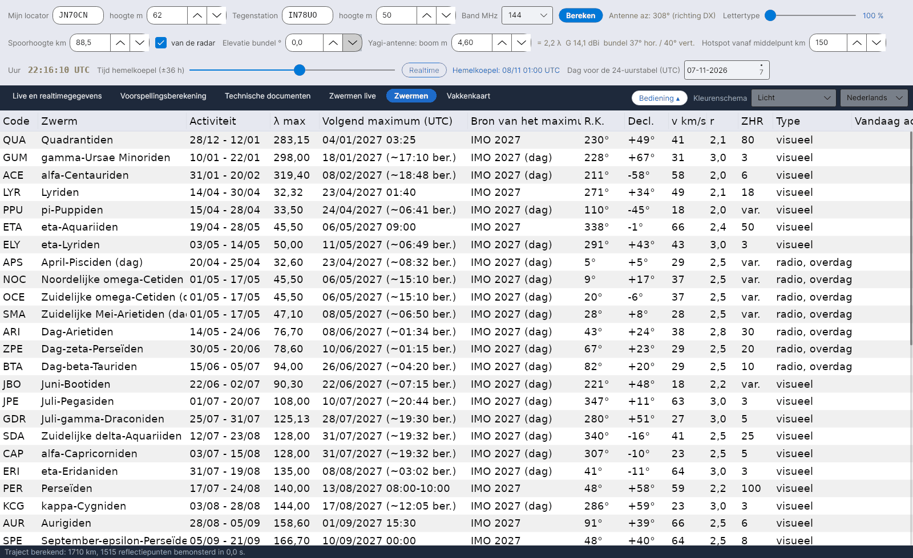

[English](Showers) · [Italiano](Showers-it) · [Deutsch](Showers-de) · **Nederlands** · [Français](Showers-fr) · [Español](Showers-es) · [Português](Showers-pt) · [Dansk](Showers-da) · [Norsk](Showers-nb) · [Svenska](Showers-sv) · [Íslenska](Showers-is) · [Eesti](Showers-et) · [Lietuvių](Showers-lt) · [Latviešu](Showers-lv) · [Русский](Showers-ru) · [Українська](Showers-uk) · [Türkçe](Showers-tr) · [Afrikaans](Showers-af) · [العربية](Showers-ar) · [עברית](Showers-he) · [اردو](Showers-ur) · [हिन्दी](Showers-hi) · [বাংলা](Showers-bn) · [Bahasa Indonesia](Showers-id) · [Tagalog](Showers-tl) · [日本語](Showers-ja) · [한국어](Showers-ko) · [中文](Showers-zh)

# Zwermen

*Tabblad: Zwermen.*

[](https://raw.githubusercontent.com/ic8tem/YA-MS/main/docs/screenshots/nl-5.png)

De zwermcatalogus die alle berekeningen gebruiken: **45 zwermen** uit de **IMO Meteor Shower Calendar 2026 en 2027** (tabellen 5 en 7) plus de **Antihelion-bron** (tabel 6), elk met zijn **volgende maximum**.

## Kolommen

| Kolom | Betekenis |
|---|---|
| Code | IMO-code (QUA, PER, GEM, …) |
| Zwerm | Naam |
| Activiteit | Activiteitsperiode (dag/maand – dag/maand) |
| λ max | Zonnelengte van het maximum (J2000), volgens IMO |
| **Volgend maximum (UTC)** | Datum en tijd van het volgende maximum (zie hieronder) |
| **Bron van het maximum** | *IMO 2026* / *IMO 2027* = datum en tijd gepubliceerd door de IMO; *IMO 2026 (dag)* = de IMO geeft alleen de dag, de getoonde tijd is berekend (*~hh:mm ber.*); *berekend uit λ* = geen IMO-waarde voor dat jaar |
| R.K., Decl. | Radiant op het maximum (*bewegend* voor de Antihelion-bron) |
| v km/s, r | Geocentrische snelheid en populatie-index |
| ZHR | ZHR op het maximum (*var.* = variabel) |
| Type | *visueel* of *radio, overdag* |
| Vandaag actief | *ja* als de zwerm nu actief is |

## Volgend maximum

Het programma toont altijd het **volgende** maximum. Als de IMO de kalender van dat jaar heeft gepubliceerd, gebruikt het de **datum en tijd van de IMO** uit `data/massimi_imo.csv` (2026 en 2027 zijn opgenomen); anders berekent het het moment waarop de zon de zonnelengte van het maximum bereikt (Meeus, *Astronomical Algorithms*, hfst. 25, opgelost met de methode van Newton).

**Controle:** de berekening komt binnen enkele minuten overeen met de IMO-kalenders 2026 en 2027 waar de IMO de tijd geeft (bijv. Quadrantiden 3/1/2026 21:13 tegenover 21:00; Geminiden 14/12/2027 19:51 tegenover 20:00). Uitzonderingen: kappa-Leoniden (dag) 2026 een dag later (26/9 in plaats van 25/9) en de tijd van de eta-Aquariiden 2027 (15:10 tegenover 09:00 IMO) – in deze gevallen wordt de IMO-waarde gebruikt.

**Een jaar toevoegen:** als de IMO een nieuwe kalender publiceert, voeg je de regels toe aan `data/massimi_imo.csv` (`jaar;code;MM-DD;hh:mm`, tijd leeg als de IMO alleen de dag geeft). Tot die tijd wordt het maximum berekend.

## Kleine zwermen en dagzwermen

De catalogus bevat de **kleine zwermen** uit de IMO-lijst – bijvoorbeeld de Oktober-Camelopardaliden (OCT, ZHR 5, actief 5–6 oktober), de Andromediden, de gamma-Ursae Minoriden – en de **radio-dagzwermen** van april tot oktober (April-Pisciden (dag), Dag-Arietiden, Dag-zeta-Perseïden, Dag-beta-Tauriden, kappa-Leoniden (dag), Dag-Sextantiden, …). Ook met kleine ZHR dragen ze bij aan de [trajectindex](Efficiency-Calculation-nl#het-model) en aan de [aanbevolen hot](Sky-View-nl#aanbevolen-hot). Voor de radio-dagzwermen geeft de IMO geen ZHR: waar die ontbreekt, gebruikt het programma een werkwaarde van 5.

## Activiteitsprofiel en verschuiving van de radiant

```
ZHR(λ☉) = ZHR_max · 10^( −B± · |λ☉ − λ_max| )
α = α0 + (dα/dλ)·Δλ      δ = δ0 + (dδ/dλ)·Δλ      Δλ = λ☉ − λ_max
```

ZHR_max, α0, δ0 en λ_max uit de IMO-kalender; de hellingen B (verschillend voor en na het maximum) en de dagelijkse verschuivingen dα/dλ, dδ/dλ zijn **werkwaarden** die in `data/sciami.csv` staan (de IMO-tabel met radiantverschuivingen is nog niet ingevoerd). *Vgl. 9 en 13 van de handleiding.* De positie van de Antihelion-bron wordt lineair geïnterpoleerd tussen de data van IMO-tabel 6 (`data/ant_radiante.csv`; actief van 10 december tot 20 september, ZHR ongeveer 4).

## De catalogus bewerken

`data/sciami.csv` is een gewoon tekstbestand (scheidingsteken `;`) dat je kunt bewerken: code, naam, begin en einde (MM-DD), λ max, R.K., Decl., verschuivingen, v, r, ZHR, B voor/na, type (V visueel, R radio overdag). Als een regel fout is, toont het programma bij het opstarten een melding en negeert de regel.

Bronnen: International Meteor Organization – Meteor Shower Calendar 2026 en 2027, [www.imo.net](https://www.imo.net) (tabellen 5, 6 en 7); Philip G0ISW (maximale radio-uurtellingen); Rossano IZ5TEK (scattertek).
