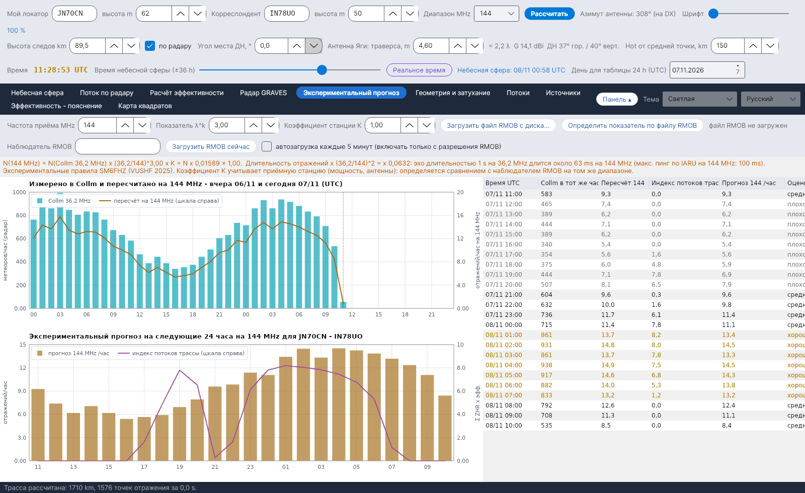

[English](Showers) · [Italiano](Showers-it) · [Deutsch](Showers-de) · [Nederlands](Showers-nl) · [Français](Showers-fr) · [Español](Showers-es) · [Português](Showers-pt) · [Português (Brasil)](Showers-pt-br) · [Dansk](Showers-da) · [Norsk](Showers-nb) · [Svenska](Showers-sv) · [Íslenska](Showers-is) · [Eesti](Showers-et) · [Lietuvių](Showers-lt) · [Latviešu](Showers-lv) · [Polski](Showers-pl) · [Čeština](Showers-cs) · [Magyar](Showers-hu) · [Română](Showers-ro) · **Русский** · [Українська](Showers-uk) · [Türkçe](Showers-tr) · [Afrikaans](Showers-af) · [العربية](Showers-ar) · [עברית](Showers-he) · [اردو](Showers-ur) · [हिन्दी](Showers-hi) · [বাংলা](Showers-bn) · [Bahasa Indonesia](Showers-id) · [Tagalog](Showers-tl) · [日本語](Showers-ja) · [한국어](Showers-ko) · [中文](Showers-zh)

# Потоки

*Вкладка: Потоки.*

[](https://raw.githubusercontent.com/ic8tem/YA-MS/main/docs/screenshots/ru-5.png)

Каталог метеорных потоков, используемый во всех расчётах: **45 потоков** из **IMO Meteor Shower Calendar 2026 и 2027** (таблицы 5 и 7) плюс **Антигелийный источник** (таблица 6), для каждого – **следующий максимум**.

## Столбцы

| Столбец | Значение |
|---|---|
| Код | Код IMO (QUA, PER, GEM, …) |
| Поток | Название |
| Активность | Период активности (день/месяц – день/месяц) |
| λ max | Солнечная долгота максимума (J2000) по IMO |
| **Следующий максимум (UTC)** | Дата и время следующего максимума (см. ниже) |
| **Источник максимума** | *IMO 2026* / *IMO 2027* = дата и время, опубликованные IMO; *IMO 2026 (день)* = IMO указывает только день, показанное время рассчитано (*~hh:mm расч.*); *вычислено по λ* = значения IMO для этого года нет |
| П.в., Скл. | Радиант в максимуме (*подвижный* для Антигелийного источника) |
| v km/s, r | Геоцентрическая скорость и популяционный индекс |
| ZHR | ZHR в максимуме (*перем.* = переменный) |
| Тип | *визуальный* или *радио, дневной* |
| Активен сегодня | *да*, если поток сейчас активен |

## Следующий максимум

Программа всегда показывает **следующий** максимум. Если IMO опубликовала календарь на этот год, используются **дата и время IMO** из `data/massimi_imo.csv` (2026 и 2027 включены); иначе рассчитывается момент, когда Солнце достигает солнечной долготы максимума (Meeus, *Astronomical Algorithms*, гл. 25, решение методом Ньютона).

**Проверка:** расчёт совпадает с календарями IMO 2026 и 2027 с точностью до нескольких минут там, где IMO указывает время (например, Квадрантиды 3/1/2026 21:13 против 21:00; Геминиды 14/12/2027 19:51 против 20:00). Исключения: Дневные каппа-Леониды 2026 на день позже (26/9 вместо 25/9) и время эта-Акварид 2027 (15:10 против 09:00 по IMO) – в этих случаях используется значение IMO.

**Добавление года:** когда IMO опубликует новый календарь, добавьте его строки в `data/massimi_imo.csv` (`year;code;MM-DD;hh:mm`, время пустое, если IMO указывает только день). До тех пор максимум рассчитывается.

## Малые и дневные потоки

Каталог включает **малые потоки** из списка IMO – например, Октябрьские Камелопардалиды (OCT, ZHR 5, активны 5–6 октября), Андромедиды, гамма-Урса-Минориды – и **дневные радиопотоки** апреля–октября (Дневные Апрельские Писциды, Дневные Ариетиды, Дневные дзета-Персеиды, Дневные бета-Тауриды, Дневные каппа-Леониды, Дневные Секстантиды, …). Даже при малых ZHR они вносят вклад в [индекс трассы](Efficiency-Calculation-ru#модель) и в [рекомендуемый Hot](Sky-View-ru#рекомендуемый-hot). Для дневных радиопотоков IMO не даёт ZHR: там, где он не указан, программа использует рабочее значение 5.

## Профиль активности и смещение радианта

```
ZHR(λ☉) = ZHR_max · 10^( −B± · |λ☉ − λ_max| )
α = α0 + (dα/dλ)·Δλ      δ = δ0 + (dδ/dλ)·Δλ      Δλ = λ☉ − λ_max
```

ZHR_max, α0, δ0 и λ_max – из календаря IMO; крутизна B (разная до и после максимума) и суточные смещения dα/dλ, dδ/dλ – это **рабочие значения**, записанные в `data/sciami.csv` (таблица смещений IMO ещё не внесена). *Руководство, ур. 9 и 13.* Положение Антигелийного источника линейно интерполируется между датами таблицы 6 IMO (`data/ant_radiante.csv`; активен с 10 декабря по 20 сентября, ZHR около 4).

## Редактирование каталога

`data/sciami.csv` – обычный текстовый файл (разделитель `;`), который можно редактировать: код, название, начало и конец (MM-DD), λ max, П.в., Скл., смещения, v, r, ZHR, B до/после, тип (V визуальный, R дневной радиопоток). Если строка содержит ошибку, программа выводит сообщение при запуске и пропускает её.

Источники: International Meteor Organization – Meteor Shower Calendar 2026 и 2027, [www.imo.net](https://www.imo.net) (таблицы 5, 6 и 7); Philip G0ISW (максимальные часовые радиочисла); Rossano IZ5TEK (scattertek).
