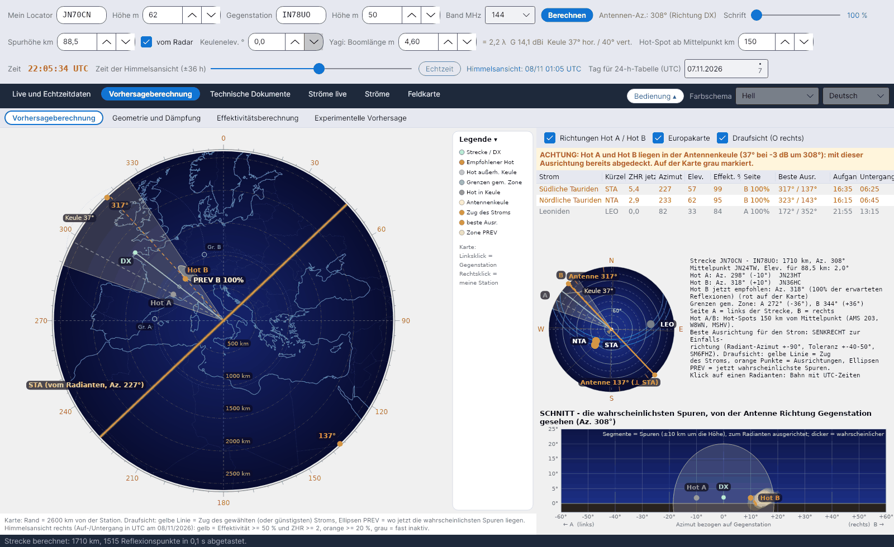

[English](Sky-View) · [Italiano](Sky-View-it) · **Deutsch** · [Nederlands](Sky-View-nl) · [Français](Sky-View-fr) · [Español](Sky-View-es) · [Português](Sky-View-pt) · [Dansk](Sky-View-da) · [Norsk](Sky-View-nb) · [Svenska](Sky-View-sv) · [Íslenska](Sky-View-is) · [Eesti](Sky-View-et) · [Lietuvių](Sky-View-lt) · [Latviešu](Sky-View-lv) · [Русский](Sky-View-ru) · [Українська](Sky-View-uk) · [Türkçe](Sky-View-tr) · [Afrikaans](Sky-View-af) · [العربية](Sky-View-ar) · [עברית](Sky-View-he) · [اردو](Sky-View-ur) · [हिन्दी](Sky-View-hi) · [বাংলা](Sky-View-bn) · [Bahasa Indonesia](Sky-View-id) · [Tagalog](Sky-View-tl) · [日本語](Sky-View-ja) · [한국어](Sky-View-ko) · [中文](Sky-View-zh)

# Himmelsansicht

*Reiter: Vorhersageberechnung › Vorhersageberechnung.*

[](https://raw.githubusercontent.com/ic8tem/YA-MS/main/docs/screenshots/de-2_1.png)

Dieser Unterreiter (die Himmelsansicht früherer Versionen) zeigt auf einem Bildschirm, **wo** die nutzbaren Spuren jetzt liegen und **wohin** du die Antenne richten sollst. Links die **Draufsicht** der Strecke; rechts die Liste der Ströme, eine kleine Himmelsansicht mit den Radianten, der Text der Berechnung und der **Schnitt** von deiner Antenne aus gesehen. Alles bezieht sich auf die Zeit des Schiebereglers *Berechnungszeitpunkt* (standardmäßig Echtzeit; ±36 h in Schritten von 15 Minuten).

Eine **Leiste über der Draufsicht** fasst die Berechnung für diesen Zeitpunkt zusammen: Datum und Uhrzeit (*jetzt* oder Stunden ab jetzt), den **Streckenindex Σ ZHR×η**, den **nützlichsten Strom** mit seiner ZHR und Effektivität, die Zahl der Ströme über dem Horizont und den **empfohlenen Hot** mit seinem Azimut.

In der kleinen Himmelsansicht zeigt eine **orange Linie** durch den Zenit immer die **richtigen Antennenrichtungen**, senkrecht zum Zug des gewählten (oder des günstigsten) Stroms: Radiant-Azimut ±90°, an beiden Enden mit *Antenne NNN°* beschriftet, die Toleranz von ±45° als dünne Linien. Kurze orange Striche am Rand geben die senkrechten Richtungen der anderen nutzbaren Ströme an.

## Draufsicht (links)

Eine Europakarte von oben gesehen (**O rechts**) mit einer Gradskala ringsum. Die Beschriftung unter der Karte nennt ihren Radius (*Karte: Rand = … km von der Station*).

| Element | Darstellung |
|---|---|
| Strecke / DX | Grüne Linie von deiner Station zur Gegenstation (immer die tatsächliche Großkreisstrecke zwischen den Locatoren) |
| **Hot A / Hot B** | Punkte 150 km (einstellbar) beiderseits des Mittelpunkts, senkrecht zur Strecke. **Rot = empfohlen**, **rosa = außerhalb der Antennenkeule**, **grau = in der Keule** (mit Warnung) |
| Antennenkeule | Die horizontale −3-dB-Keule um den Antennenazimut (Antenne immer auf die Gegenstation gerichtet), beschriftet mit *Keule …°* |
| Grenzen gem. Zone | Blasse Punkte *Gr. A* / *Gr. B* und die beiden Kreise, an denen der Horizont jeder Station die E-Schicht trifft (siehe [Geometrie](Geometry-and-Path-Loss-de#grenzen-der-gemeinsamen-zone)) |
| Zug des Stroms | **Gelbe Linie**: Richtung, in der der gewählte (oder der günstigste) Strom über den Himmel zieht, d. h. der Radiant-Azimut |
| Beste Ausr. | **Orange Punkte**: die beiden Ausrichtungen senkrecht zum Zug (Radiant-Azimut ±90°, SM6FHZ) |
| **Zone PREV** | Helle Ellipsen: wo die wahrscheinlichsten Spuren **jetzt** liegen, eine pro Seite der Strecke |

Die Beschriftungen überlappen sich nicht: Hot A und PREV A stehen links der Strecke, B rechts. Die **Legende** ist eine einklappbare Spalte rechts der Karte.

**Maus auf der Karte:** **Linksklick = Gegenstation**, **Rechtsklick = meine Station** (setzt jeweils den Locator). Die Strecke wird sofort neu berechnet.

Optionen über der Liste der Ströme: **Richtungen Hot A / Hot B**, **Europakarte** (Natural Earth, beim ersten Start nach `data/mappa` geladen), **Draufsicht (O rechts)**.

### Empfohlener Hot

Für die angezeigte Zeit summiert das Programm über alle Ströme über dem Horizont das Gewicht ZHR × Effektivität, aufgeteilt auf Seite A (Anteil f_A) und Seite B. Die Seite mit dem größeren Gewicht ergibt den empfohlenen Hot, rot gezeichnet:

```math
W_A = \sum \frac{ZHR\,\eta}{100}\,f_A,\qquad W_B = \sum \frac{ZHR\,\eta}{100}\,(1-f_A),\qquad \mathrm{Hot} = \arg\max(W_A,\ W_B)
```

*Entscheidung des Programms (Handbuch Gl. 23).* Quelle der Idee: DJ5HG, wiedergegeben von DF5HC (DARC-Vortrag 2018) – je nach Lage des Radianten ist einer der beiden Punkte, HOT-A oder HOT-B, günstiger. Das Drehen um 10–30° zu dieser Seite (Side-Scatter) stammt aus dem Artikel Cerrotta–Sartori.

### PREV-Zonen

Für jeden Punkt P der E-Schicht werden die Beiträge aller aktiven Ströme zur Effektivität (gleiche Spiegelbedingung wie bei der [Effektivität](Efficiency-Calculation-de#das-modell)) addiert, gewichtet mit der ZHR. Punkte mit mindestens 3 % des Maximums bilden die PREV-Zonen; jede wird als Ellipse gezeichnet, mit Mittelpunkt = gewichtetes Mittel der Punkte und Achsen = doppelte Streuung.

```math
W_P = \sum ZHR\; c_P(\hat{s}),\qquad c_P = 100\,\frac{w_P S_P \max(0,\ \hat{s}\cdot\hat{u}_P)}{\max F},\qquad PREV:\ W_P \ge 0{.}03\,\max W
```

*Entscheidung des Programms (Handbuch Gl. 34).* Das ist die praktische Regel: Zieht der Strom von Nord nach Süd, liegen die nutzbaren Spuren im Osten und Westen.

## Liste der Ströme (oben rechts)

| Spalte | Bedeutung |
|---|---|
| Strom, Kürzel | Name und IMO-Kürzel |
| ZHR jetzt | Aktivität in diesem Moment (IMO-Maximal-ZHR mit dem Aktivitätsprofil) |
| Azimut, Elev. | Position des Radianten von deiner Station aus |
| Effekt. % | Effektivität des Stroms für diese Strecke |
| Seite | A oder B, die Seite, von der die meisten Reflexionen kommen |
| Beste Ausr. | Radiant-Azimut ±90° |
| Aufgang, Untergang | Auf- und Untergang des Radianten (UTC); *zirkumpolar* oder *nie über Horizont*, wenn zutreffend |

Klicke auf eine Zeile, um den Strom zu wählen: Die gelbe Zuglinie und die orangen Punkte folgen ihm.

## Kleine Himmelsansicht (Mitte rechts)

Die Radianten auf einer Himmelskuppel von deiner Station aus gesehen, mit ihrem **IMO-Kürzel** und der **Tagesbahn in Cyan** (UTC-Stunden). **Klicke auf einen Radianten**, um ihn zu wählen. Farben:

| Farbe | Bedeutung |
|---|---|
| Gelb | Effektivität ≥ 50 % und ZHR ≥ 2 |
| Orange | Effektivität ≥ 20 % |
| Dunkelrot | Effektivität < 20 % |
| Grau | fast inaktiv |

Daneben der Text der Berechnung: Länge und Azimut der Strecke, Mittelpunkt und seine Elevation, Azimute und Abweichungen von Hot A / Hot B, der empfohlene Hot (*… jetzt empfohlen: Az. …° (…% der erwarteten Reflexionen)*), die Grenzen der gemeinsamen Zone und der Hinweis: *Beste Ausrichtung für den Strom: SENKRECHT zur Einfallsrichtung (Radiant-Azimut ±90°, Toleranz ±40–50°, SM6FHZ)*.

## Schnitt (unten rechts)

*SCHNITT - die wahrscheinlichsten Spuren, von der Antenne Richtung Gegenstation gesehen.* Waagerecht der **Azimut bezogen auf Gegenstation** (← A links, B → rechts), senkrecht die **Elevation**. Für jeden Strom werden die 14 stärksten Reflexionspunkte genommen; jede Spur ist ein zum Radianten ausgerichtetes Segment, von 10 km über bis 10 km unter der Spurhöhe (höchstens 60 km pro Seite), dicker, wenn sie wahrscheinlicher ist. Ebenfalls gezeichnet: die Antennenkeule (−3-dB-Kreis um die Keulenelevation), die Gegenstation und Hot A / Hot B.

```math
Q = P \pm t_{1/2}\,\hat{s},\qquad t_{1/2} = \min\left(60\ \mathrm{km},\ \frac{10\ \mathrm{km}}{\max(0{.}17,\ |\hat{s}\cdot\hat{u}_P|)}\right)
```

*Entscheidung des Programms (Handbuch Gl. 35).*

## Warnungen

| Warnung | Wann |
|---|---|
| **ACHTUNG: Hot A (und/oder Hot B) liegt in der Antennenkeule …** | Der Hot-Spot liegt innerhalb von ±θ/2 um den Antennenazimut (θ = horizontaler Öffnungswinkel bei −3 dB): mit dieser Ausrichtung bereits abgedeckt. Auf der Karte grau markiert. Der empfohlene Hot bleibt rot. |
| **RADIANT ZU HOCH (über 70°)** | Ein nutzbarer Radiant steht an deiner Station höher als 70°: Die Spuren verlaufen fast senkrecht und reflektieren wenig in Richtung der Strecke (DF5HC, DH9GCD). Dieselben Stunden sind in der [Stundentabelle](Efficiency-Calculation-de#stundentabelle) mit ↑ markiert. |
| *Keine gemeinsame Zone der E-Schicht* | Die Strecke ist länger als die doppelte Reichweite in Spurhöhe: Die beiden Stationen sehen keinen gemeinsamen Teil der E-Schicht (Einzelsprung unmöglich). |
| *Kein Hot empfohlen* | Derzeit kaum aktive Ströme. |

Vorlage für die Grafik der Himmelsansicht: Swan Meteor Skyview von DL1DBC (swan.ms); Polardiagramm mit der besten Richtung: RadiantCalc von SM6FHZ.
