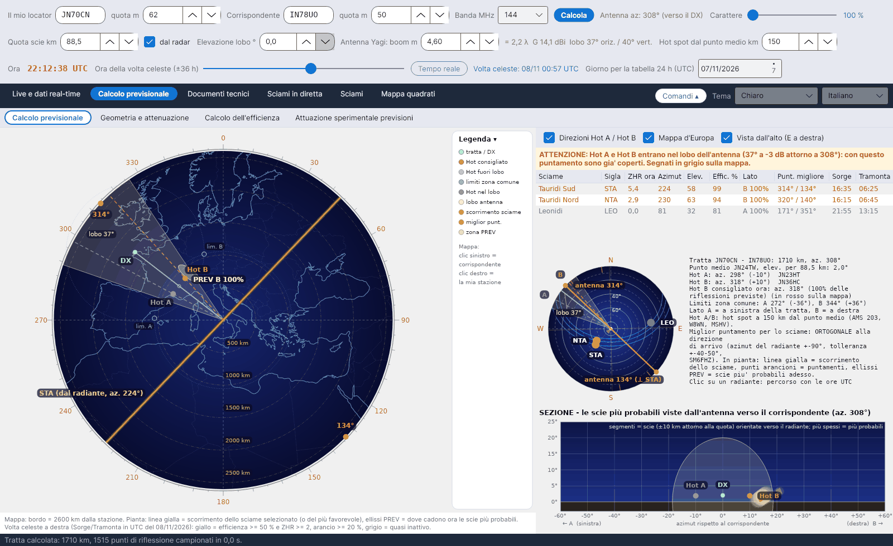

[English](Sky-View) · **Italiano** · [Deutsch](Sky-View-de) · [Nederlands](Sky-View-nl) · [Français](Sky-View-fr) · [Español](Sky-View-es) · [Português](Sky-View-pt) · [Dansk](Sky-View-da) · [Norsk](Sky-View-nb) · [Svenska](Sky-View-sv) · [Íslenska](Sky-View-is) · [Eesti](Sky-View-et) · [Lietuvių](Sky-View-lt) · [Latviešu](Sky-View-lv) · [Русский](Sky-View-ru) · [Українська](Sky-View-uk) · [Türkçe](Sky-View-tr) · [Afrikaans](Sky-View-af) · [العربية](Sky-View-ar) · [עברית](Sky-View-he) · [اردو](Sky-View-ur) · [हिन्दी](Sky-View-hi) · [বাংলা](Sky-View-bn) · [Bahasa Indonesia](Sky-View-id) · [Tagalog](Sky-View-tl) · [日本語](Sky-View-ja) · [한국어](Sky-View-ko) · [中文](Sky-View-zh)

# Volta celeste

*Linguetta: Calcolo previsionale › Calcolo previsionale.*

[](https://raw.githubusercontent.com/ic8tem/YA-MS/main/docs/screenshots/it-2_1.png)

Questa sotto-linguetta (la volta celeste delle versioni precedenti) mette in una sola schermata **dove** si trovano adesso le scie utili e **dove puntare**. A sinistra la **vista in pianta** della tratta; a destra l'elenco degli sciami, una piccola volta celeste con i radianti, il testo del calcolo e la **sezione** vista dalla tua antenna. Tutto si riferisce all'ora del cursore *Ora della volta celeste* (tempo reale per impostazione predefinita; ±36 h a passi di 15 minuti).

Nella piccola volta celeste una **linea arancione** che passa per lo zenit dà sempre le **direzioni d'antenna giuste**, ortogonali allo scorrimento dello sciame selezionato (o del più favorevole): azimut del radiante ±90°, con l'etichetta *antenna NNN°* a entrambe le estremità e la tolleranza di ±45° come linee sottili. Brevi tacche arancioni sul bordo danno le direzioni ortogonali degli altri sciami utili.

## Vista in pianta (sinistra)

Una mappa d'Europa vista dall'alto (**E a destra**) con una scala in gradi tutt'intorno. La didascalia sotto la mappa ne dà il raggio (*Mappa: bordo = … km dalla stazione*).

| Elemento | Disegno |
|---|---|
| Tratta / DX | Linea verde dalla tua stazione al corrispondente (sempre la vera tratta ortodromica tra i locator) |
| **Hot A / Hot B** | Punti a 150 km (regolabili) da una parte e dall'altra del punto medio, perpendicolari alla tratta. **Rosso = consigliato**, **rosa = fuori dal lobo dell'antenna**, **grigio = dentro il lobo** (con un avviso) |
| Lobo antenna | Il lobo orizzontale a −3 dB attorno all'azimut dell'antenna (antenna sempre puntata verso il DX), con l'etichetta *lobo …°* |
| Limiti zona comune | Punti tenui *lim. A* / *lim. B* e i due cerchi dove l'orizzonte di ciascuna stazione incontra lo strato E (vedi [Geometria](Geometry-and-Path-Loss-it#limiti-della-zona-comune)) |
| Scorrimento sciame | **Linea gialla**: direzione in cui lo sciame selezionato (o il più favorevole) spazza il cielo, cioè l'azimut del radiante |
| Puntamenti migliori | **Punti arancioni**: i due puntamenti perpendicolari allo scorrimento (azimut del radiante ±90°, SM6FHZ) |
| **Zone PREV** | Ellissi chiare: dove cadono **adesso** le scie più probabili, una per lato della tratta |

Le etichette non si sovrappongono: Hot A e PREV A sono scritti a sinistra della tratta, B a destra. La **Legenda** è una colonna ripiegabile a destra della mappa.

**Mouse sulla mappa:** **clic sinistro = locator del corrispondente**, **clic destro = locator della mia stazione**. La tratta viene ricalcolata subito.

Opzioni sopra l'elenco degli sciami: **Direzioni Hot A / Hot B**, **Mappa d'Europa** (Natural Earth, scaricata in `data/mappa` al primo avvio), **Vista dall'alto (E a destra)**.

### Hot consigliato

Per l'ora mostrata il programma somma, su tutti gli sciami sopra l'orizzonte, il peso ZHR × efficienza, diviso tra il lato A (frazione f_A) e il lato B. Il lato con il peso maggiore dà l'Hot consigliato, disegnato in rosso:

```math
W_A = \sum \frac{ZHR\,\eta}{100}\,f_A,\qquad W_B = \sum \frac{ZHR\,\eta}{100}\,(1-f_A),\qquad \mathrm{Hot} = \arg\max(W_A,\ W_B)
```

*Scelta del programma (eq. 23 del manuale).* Origine dell'idea: DJ5HG, riportato da DF5HC (convegno DARC 2018) – a seconda della posizione del radiante uno dei due punti, HOT-A o HOT-B, è più favorevole. Il girare di 10–30° verso quel lato (side-scatter) viene dall'articolo Cerrotta–Sartori.

### Zone PREV

Per ogni punto P dello strato E si sommano i contributi di tutti gli sciami attivi all'efficienza (stessa condizione speculare dell'[efficienza](Efficiency-Calculation-it#il-modello)), pesati con lo ZHR. I punti con almeno il 3 % del massimo formano le zone PREV; ognuna è disegnata come un'ellisse con centro = media pesata dei punti e assi = il doppio della loro dispersione.

```math
W_P = \sum ZHR\; c_P(\hat{s}),\qquad c_P = 100\,\frac{w_P S_P \max(0,\ \hat{s}\cdot\hat{u}_P)}{\max F},\qquad PREV:\ W_P \ge 0{.}03\,\max W
```

*Scelta del programma (eq. 34 del manuale).* È la regola pratica: se lo sciame scorre da nord a sud, le scie utili cadono a est e a ovest.

## Elenco degli sciami (in alto a destra)

| Colonna | Significato |
|---|---|
| Sciame, Sigla | Nome e codice IMO |
| ZHR ora | Attività in questo momento (ZHR al massimo secondo l'IMO, con il profilo di attività) |
| Azimut, Elev. | Posizione del radiante vista dalla tua stazione |
| Effic. % | Efficienza dello sciame per questa tratta |
| Lato | A o B, il lato da cui arriva la maggior parte delle riflessioni |
| Punt. migliore | Azimut del radiante ±90° |
| Sorge, Tramonta | Sorgere e tramontare del radiante (UTC); *circumpolare* o *sempre sotto* quando è il caso |

Fai clic su una riga per selezionare lo sciame: la linea gialla dello scorrimento e i punti arancioni lo seguono.

## Piccola volta celeste (al centro a destra)

I radianti su una volta celeste vista dalla tua stazione, con il loro **codice IMO** e il **percorso giornaliero in ciano** (ore UTC). **Fai clic su un radiante** per selezionarlo. Colori:

| Colore | Significato |
|---|---|
| Giallo | efficienza ≥ 50 % e ZHR ≥ 2 |
| Arancione | efficienza ≥ 20 % |
| Rosso scuro | efficienza < 20 % |
| Grigio | quasi inattivo |

Accanto, il testo del calcolo: lunghezza e azimut della tratta, punto medio e sua elevazione, azimut e scostamenti di Hot A / Hot B, l'Hot consigliato (*… consigliato ora: az. …° (…% delle riflessioni previste)*), i limiti della zona comune e il promemoria: *miglior puntamento per lo sciame: ORTOGONALE alla direzione di arrivo (azimut del radiante ±90°, tolleranza ±40–50°, SM6FHZ)*.

## Sezione (in basso a destra)

*SEZIONE – le scie più probabili viste dall'antenna verso il corrispondente.* In orizzontale l'**azimut rispetto al corrispondente** (← A sinistra, B → destra), in verticale l'**elevazione**. Per ogni sciame si prendono i 14 punti di riflessione più forti; ogni scia è un segmento orientato verso il radiante, da 10 km sopra a 10 km sotto la quota delle scie (al massimo 60 km per parte), più spesso quanto più è probabile. Sono disegnati anche il lobo dell'antenna (cerchio a −3 dB attorno all'elevazione del lobo), il corrispondente e Hot A / Hot B.

```math
Q = P \pm t_{1/2}\,\hat{s},\qquad t_{1/2} = \min\left(60\ \mathrm{km},\ \frac{10\ \mathrm{km}}{\max(0{.}17,\ |\hat{s}\cdot\hat{u}_P|)}\right)
```

*Scelta del programma (eq. 35 del manuale).*

## Avvisi

| Avviso | Quando |
|---|---|
| **ATTENZIONE: Hot A (e/o Hot B) entra nel lobo dell'antenna …** | L'hot spot è entro ±θ/2 dall'azimut dell'antenna (θ = lobo orizzontale a −3 dB): con questo puntamento è già coperto. Mostrato in grigio sulla mappa. L'Hot consigliato resta rosso. |
| **RADIANTE TROPPO ALTO (sopra 70°)** | Un radiante utile è sopra 70° dalla tua stazione: le scie scendono quasi verticali e riflettono poco verso la tratta (DF5HC, DH9GCD). Le stesse ore sono segnate con ↑ nella [tabella oraria](Efficiency-Calculation-it#tabella-oraria). |
| *Nessuna zona comune dello strato E* | La tratta è più lunga del doppio della portata alla quota delle scie: le due stazioni non vedono una parte comune dello strato E (salto singolo impossibile). |
| *Nessun Hot consigliato* | Sciami attivi quasi assenti in questo momento. |

Riferimento per la grafica della volta celeste: Swan Meteor Skyview di DL1DBC (swan.ms); diagramma polare con la direzione migliore: RadiantCalc di SM6FHZ.
