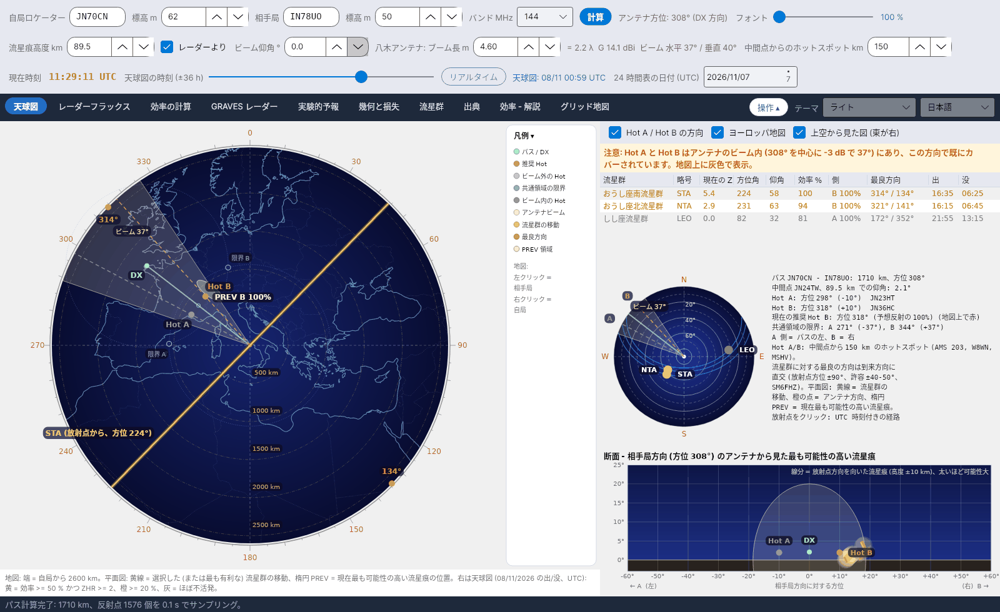

[English](Sky-View) · [Русский](Sky-View-ru) · [Deutsch](Sky-View-de) · **日本語**

# 天球図

*タブ 1。*

[](https://raw.githubusercontent.com/ic8tem/YA-MS/main/docs/screenshots/ja-1.png)

最初のタブは、有効な流星痕が今**どこに**あり、**どこへ**アンテナを向けるべきかを 1 画面にまとめます。左はパスの**平面図**、右は流星群リスト、放射点を示す小さな天球図、計算結果のテキスト、そして自局アンテナから見た**断面**です。すべて *天球図の時刻* スライダーの時刻 (既定はリアルタイム。15 分刻みで ±36 h) に基づきます。

## 左の平面図

上から見たヨーロッパの地図 (**東が右**) で、周囲に角度目盛があります。地図の下の説明に半径が示されます (*地図: 端 = 自局から … km*)。

| 要素 | 描画 |
|---|---|
| パス / DX | 自局から相手局への緑の線 (常にロケーター間の実際の大圏パス) |
| **Hot A / Hot B** | 中間点の両側 150 km (調整可)、パスに垂直な点。**赤 = 推奨**、**ピンク = アンテナビーム外**、**灰 = ビーム内** (注意表示あり) |
| アンテナビーム | アンテナ方位を中心とする −3 dB の水平ビーム (アンテナは常に相手局に向いている)。*ビーム …°* と表示 |
| 共通領域の限界 | 淡い *限界 A* / *限界 B* の点と、各局の地平線が E 層と交わる 2 つの円 ([幾何](Geometry-and-Path-Loss-ja#共通領域の限界) を参照) |
| 流星群の移動 | **黄線**: 選択した (または最も有利な) 流星群が空を掃く方向、つまり放射点の方位 |
| 最良方向 | **橙の点**: 移動方向に垂直な 2 つの方向 (放射点方位 ±90°、SM6FHZ) |
| **PREV 領域** | 淡い楕円: 最も可能性の高い流星痕が**現在**落ちる場所。パスの片側に 1 つずつ |

ラベルは重なりません: Hot A と PREV A はパスの左、B は右に書かれます。**凡例** は地図の右にある折りたたみ可能な列です。

**地図上のマウス操作:** **左クリック = 相手局のロケーター**、**右クリック = 自局のロケーター**。パスはすぐに再計算されます。

流星群リストの上のオプション: **Hot A / Hot B の方向**、**ヨーロッパ地図** (Natural Earth。初回起動時に `data/mappa` へダウンロード)、**上空から見た図 (東が右)**。

### 推奨 Hot

表示中の時刻について、地平線上にあるすべての流星群の重み ZHR × 効率を合計し、A 側 (割合 f_A) と B 側に分けます。重みの大きい側が推奨 Hot となり、赤で描かれます:

```
W_A = Σ (ZHR·η/100)·f_A        W_B = Σ (ZHR·η/100)·(1 − f_A)        recommended = side with larger W
```

*プログラム独自の選択 (マニュアル式 23)。* 考え方の出典: DJ5HG、DF5HC による紹介 (DARC 講演 2018) – 放射点の位置に応じて HOT-A と HOT-B の 2 点のどちらかが有利になる。その側へ 10–30° 振る (サイドスキャッター) のは Cerrotta–Sartori の記事によります。

### PREV 領域

E 層の各点 P について、活動中の全流星群の効率への寄与 ([効率](Efficiency-Calculation-ja#モデル) と同じ鏡面条件) を ZHR で重み付けして合計します。最大値の 3 % 以上の点が PREV 領域となり、それぞれ中心 = 点の重み付き平均、軸 = ばらつきの 2 倍の楕円で描かれます。

```
W_P = Σ ZHR · c_P(ŝ)      c_P = 100 · w_P·S_P·max(0, ŝ·û_P) / max F      PREV: W_P ≥ 0.03 · max W
```

*プログラム独自の選択 (マニュアル式 34)。* 実用上のルールそのものです: 流星群が北から南へ掃くなら、有効な流星痕は東と西に落ちます。

## 右上の流星群リスト

| 列 | 意味 |
|---|---|
| 流星群、略号 | 名称と IMO 略号 |
| 現在の ZHR | この時点の活動度 (IMO の極大 ZHR と活動プロファイル) |
| 方位角、仰角 | 自局から見た放射点の位置 |
| 効率 % | このパスに対する流星群の効率 |
| 側 | A または B。反射の大部分が来る側 |
| 最良方向 | 放射点方位 ±90° |
| 出、没 | 放射点の出と没 (UTC)。該当する場合は *周極* または *常に地平線下* |

行をクリックすると流星群を選択でき、黄色の移動線と橙の点がそれに従います。

## 右中央の小さな天球図

自局から見た天球図上の放射点で、**IMO 略号**と**シアンの日周経路** (UTC 時刻付き) が示されます。**放射点をクリック**すると選択できます。色:

| 色 | 意味 |
|---|---|
| 黄 | 効率 ≥ 50 % かつ ZHR ≥ 2 |
| 橙 | 効率 ≥ 20 % |
| 暗赤 | 効率 < 20 % |
| 灰 | ほぼ不活発 |

その横に計算結果のテキストがあります: パスの長さと方位、中間点とその仰角、Hot A / Hot B の方位と偏差、推奨 Hot (*現在の推奨 …: 方位 …° (予想反射の …%)*)、共通領域の限界、そして注意書き: *流星群に対する最良の方向は到来方向に直交 (放射点方位 ±90°、許容 ±40-50°、SM6FHZ)*。

## 右下の断面

*断面 - 相手局方向 (方位 …°) のアンテナから見た最も可能性の高い流星痕。* 横軸は **相手局方向に対する方位** (← A (左)、(右) B →)、縦軸は**仰角**です。各流星群について最も強い 14 個の反射点を取り、それぞれの流星痕を、流星痕高度の 10 km 上から 10 km 下まで (片側最大 60 km) 放射点の方向を向いた線分として描きます。可能性が高いほど太くなります。アンテナビーム (ビーム仰角を中心とする −3 dB の円)、相手局、Hot A / Hot B も描かれます。

```
Q = P ± t½·ŝ        t½ = min(60 km, 10 km / max(0.17, |ŝ·û_P|))
```

*プログラム独自の選択 (マニュアル式 35)。*

## 警告

| 警告 | 表示される条件 |
|---|---|
| **注意: Hot A (および/または Hot B) はアンテナのビーム内 …** | ホットスポットがアンテナ方位の ±θ/2 以内にある (θ = 水平 −3 dB ビーム幅): この方向で既にカバーされています。地図上に灰色で表示。推奨 Hot は赤のままです。 |
| **放射点が高すぎ (70° 超)** | 有効な放射点が自局から見て 70° より高い: 流星痕がほぼ垂直に落ち、パス方向への反射が少なくなります (DF5HC, DH9GCD)。同じ時間帯は [時間別の表](Efficiency-Calculation-ja#時間別の表) で ↑ が付きます。 |
| *E 層の共通領域なし* | パスが流星痕高度での到達距離の 2 倍より長い: 両局は E 層の共通部分を見られません (1 ホップは不可能)。 |
| *推奨 Hot なし* | この時刻に活動中の流星群がほとんどありません。 |

天球図のグラフィックの参考: DL1DBC の Swan Meteor Skyview (swan.ms)。最良方向を示す極座標グラフ: SM6FHZ の RadiantCalc。
