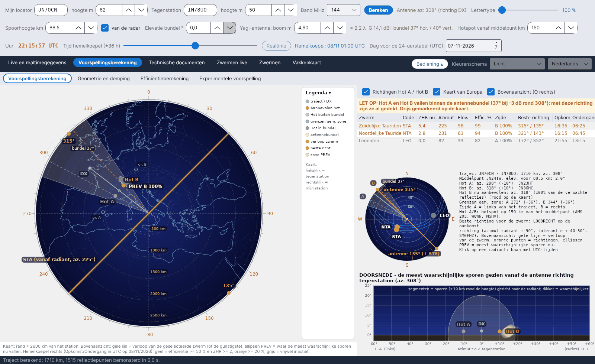

[English](Sky-View) · [Italiano](Sky-View-it) · [Deutsch](Sky-View-de) · **Nederlands** · [Français](Sky-View-fr) · [Español](Sky-View-es) · [Português](Sky-View-pt) · [Português (Brasil)](Sky-View-pt-br) · [Dansk](Sky-View-da) · [Norsk](Sky-View-nb) · [Svenska](Sky-View-sv) · [Íslenska](Sky-View-is) · [Eesti](Sky-View-et) · [Lietuvių](Sky-View-lt) · [Latviešu](Sky-View-lv) · [Polski](Sky-View-pl) · [Čeština](Sky-View-cs) · [Magyar](Sky-View-hu) · [Română](Sky-View-ro) · [Ελληνικά](Sky-View-el) · [Русский](Sky-View-ru) · [Українська](Sky-View-uk) · [Türkçe](Sky-View-tr) · [Afrikaans](Sky-View-af) · [العربية](Sky-View-ar) · [עברית](Sky-View-he) · [اردو](Sky-View-ur) · [हिन्दी](Sky-View-hi) · [বাংলা](Sky-View-bn) · [Bahasa Indonesia](Sky-View-id) · [Tagalog](Sky-View-tl) · [ไทย](Sky-View-th) · [日本語](Sky-View-ja) · [한국어](Sky-View-ko) · [中文](Sky-View-zh) · [中文 (繁體)](Sky-View-zh-tw)

# Hemelkoepel

*Tabblad: Voorspellingsberekening › Voorspellingsberekening.*

[](https://raw.githubusercontent.com/ic8tem/YA-MS/main/docs/screenshots/nl-2_1.png)

Dit subtabblad (de hemelkoepel van eerdere versies) zet op één scherm **waar** de bruikbare sporen nu zijn en **waarheen je moet richten**. Links het **bovenaanzicht** van het traject; rechts de lijst van zwermen, een kleine hemelkoepel met de radianten, de tekst van de berekening en de **doorsnede** gezien vanaf je antenne. Alles verwijst naar het tijdstip van de schuifregelaar *Tijd hemelkoepel* (standaard realtime; ±36 h in stappen van 15 minuten).

In de kleine hemelkoepel geeft een **oranje lijn** door het zenit altijd de **juiste antennerichtingen**, loodrecht op het verloop van de geselecteerde zwerm (of van de gunstigste): azimut van de radiant ±90°, aan beide uiteinden gelabeld met *antenne NNN°*, met de tolerantie van ±45° als dunne lijnen. Korte oranje streepjes op de rand geven de loodrechte richtingen van de andere bruikbare zwermen.

## Bovenaanzicht (links)

Een kaart van Europa van bovenaf gezien (**O rechts**) met een gradenschaal eromheen. Het bijschrift onder de kaart geeft de straal (*Kaart: rand = … km van het station*).

| Element | Tekening |
|---|---|
| Traject / DX | Groene lijn van jouw station naar het tegenstation (altijd het werkelijke grootcirkeltraject tussen de locators) |
| **Hot A / Hot B** | Punten op 150 km (instelbaar) aan weerszijden van het middelpunt, loodrecht op het traject. **Rood = aanbevolen**, **roze = buiten de antennebundel**, **grijs = binnen de bundel** (met een waarschuwing) |
| Antennebundel | De horizontale −3 dB-bundel rond het azimut van de antenne (antenne altijd op de DX gericht), gelabeld *bundel …°* |
| Grenzen gemeenschappelijke zone | Vage punten *gr. A* / *gr. B* en de twee cirkels waar de horizon van elk station de E-laag raakt (zie [Geometrie](Geometry-and-Path-Loss-nl#grenzen-van-de-gemeenschappelijke-zone)) |
| Verloop zwerm | **Gele lijn**: richting waarin de geselecteerde zwerm (of de gunstigste) de hemel doorkruist, d.w.z. het azimut van de radiant |
| Beste richtingen | **Oranje punten**: de twee richtingen loodrecht op het verloop (azimut van de radiant ±90°, SM6FHZ) |
| **PREV-zones** | Lichte ellipsen: waar de meest waarschijnlijke sporen **nu** vallen, één per zijde van het traject |

Labels overlappen niet: Hot A en PREV A staan links van het traject, B rechts. De **Legenda** is een inklapbare kolom rechts van de kaart.

**Muis op de kaart:** **linksklik = locator van het tegenstation**, **rechtsklik = locator van mijn station**. Het traject wordt meteen herberekend.

Opties boven de lijst van zwermen: **Richtingen Hot A / Hot B**, **Kaart van Europa** (Natural Earth, bij de eerste start gedownload naar `data/mappa`), **Bovenaanzicht (O rechts)**.

### Aanbevolen hot

Voor het getoonde tijdstip telt het programma over alle zwermen boven de horizon het gewicht ZHR × efficiëntie op, verdeeld over zijde A (fractie f_A) en zijde B. De zijde met het grootste gewicht levert de aanbevolen hot, rood getekend:

```
W_A = Σ (ZHR·η/100)·f_A        W_B = Σ (ZHR·η/100)·(1 − f_A)        recommended = side with larger W
```

*Keuze van het programma (vgl. 23 van de handleiding).* Herkomst van het idee: DJ5HG, aangehaald door DF5HC (DARC-congres 2018) – afhankelijk van de positie van de radiant is een van de twee punten, HOT-A of HOT-B, gunstiger. Het 10–30° naar die kant draaien (side-scatter) komt uit het artikel van Cerrotta–Sartori.

### PREV-zones

Voor elk punt P van de E-laag worden de bijdragen van alle actieve zwermen aan de efficiëntie (dezelfde spiegelvoorwaarde als bij de [efficiëntie](Efficiency-Calculation-nl#het-model)) opgeteld, gewogen met de ZHR. Punten met minstens 3 % van het maximum vormen de PREV-zones; elke zone wordt getekend als een ellips met middelpunt = gewogen gemiddelde van de punten en assen = tweemaal hun spreiding.

```
W_P = Σ ZHR · c_P(ŝ)      c_P = 100 · w_P·S_P·max(0, ŝ·û_P) / max F      PREV: W_P ≥ 0.03 · max W
```

*Keuze van het programma (vgl. 34 van de handleiding).* Het is de praktische regel: als de zwerm van noord naar zuid trekt, vallen de bruikbare sporen in het oosten en westen.

## Lijst van zwermen (rechtsboven)

| Kolom | Betekenis |
|---|---|
| Zwerm, Code | Naam en IMO-code |
| ZHR nu | Activiteit op dit moment (piek-ZHR volgens IMO met het activiteitsprofiel) |
| Azimut, Elev. | Positie van de radiant gezien vanaf jouw station |
| Effic. % | Efficiëntie van de zwerm voor dit traject |
| Zijde | A of B, de kant waarvan de meeste reflecties komen |
| Beste richting | Azimut van de radiant ±90° |
| Opkomst, Ondergang | Opkomst en ondergang van de radiant (UTC); *circumpolair* of *altijd onder* als dat van toepassing is |

Klik op een regel om de zwerm te selecteren: de gele verlooplijn en de oranje punten volgen hem.

## Kleine hemelkoepel (midden rechts)

De radianten op een hemelkoepel gezien vanaf jouw station, met hun **IMO-code** en **dagelijkse baan in cyaan** (UTC-uren). **Klik op een radiant** om hem te selecteren. Kleuren:

| Kleur | Betekenis |
|---|---|
| Geel | efficiëntie ≥ 50 % en ZHR ≥ 2 |
| Oranje | efficiëntie ≥ 20 % |
| Donkerrood | efficiëntie < 20 % |
| Grijs | vrijwel inactief |

Daarnaast de tekst van de berekening: lengte en azimut van het traject, middelpunt en de elevatie ervan, azimuts en afwijkingen van Hot A / Hot B, de aanbevolen hot (*… nu aanbevolen: az. …° (…% van de verwachte reflecties)*), de grenzen van de gemeenschappelijke zone en de herinnering: *beste richting voor de zwerm: LOODRECHT op de aankomstrichting (azimut radiant ±90°, tolerantie ±40–50°, SM6FHZ)*.

## Doorsnede (rechtsonder)

*DOORSNEDE – de meest waarschijnlijke sporen gezien vanaf de antenne richting tegenstation.* Horizontaal het **azimut t.o.v. het tegenstation** (← A links, B → rechts), verticaal de **elevatie**. Voor elke zwerm worden de 14 sterkste reflectiepunten genomen; elk spoor is een lijnstuk gericht naar de radiant, van 10 km boven tot 10 km onder de spoorhoogte (hooguit 60 km per kant), dikker naarmate het waarschijnlijker is. Ook getekend: de antennebundel (−3 dB-cirkel rond de bundelelevatie), het tegenstation en Hot A / Hot B.

```
Q = P ± t½·ŝ        t½ = min(60 km, 10 km / max(0.17, |ŝ·û_P|))
```

*Keuze van het programma (vgl. 35 van de handleiding).*

## Waarschuwingen

| Waarschuwing | Wanneer |
|---|---|
| **LET OP: Hot A (en/of Hot B) valt binnen de antennebundel …** | De hotspot ligt binnen ±θ/2 van het azimut van de antenne (θ = horizontale −3 dB-bundel): met deze richting is hij al gedekt. Grijs getoond op de kaart. De aanbevolen hot blijft rood. |
| **RADIANT TE HOOG (boven 70°)** | Een bruikbare radiant staat vanaf jouw station hoger dan 70°: de sporen vallen bijna verticaal en reflecteren weinig naar het traject (DF5HC, DH9GCD). Dezelfde uren zijn met ↑ gemarkeerd in de [uurtabel](Efficiency-Calculation-nl#uurtabel). |
| *Geen gemeenschappelijke zone in de E-laag* | Het traject is langer dan tweemaal het bereik op spoorhoogte: de twee stations zien geen gemeenschappelijk deel van de E-laag (enkele sprong onmogelijk). |
| *Geen aanbevolen hot* | Vrijwel geen actieve zwerm op dit moment. |

Referentie voor de grafiek van de hemelkoepel: Swan Meteor Skyview van DL1DBC (swan.ms); poolgrafiek met de beste richting: RadiantCalc van SM6FHZ.
