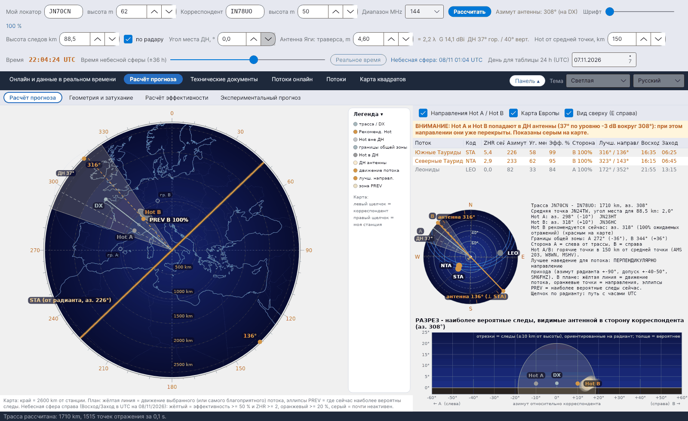

[English](Sky-View) · [Italiano](Sky-View-it) · [Deutsch](Sky-View-de) · [Nederlands](Sky-View-nl) · [Français](Sky-View-fr) · [Español](Sky-View-es) · [Português](Sky-View-pt) · [Português (Brasil)](Sky-View-pt-br) · [Dansk](Sky-View-da) · [Norsk](Sky-View-nb) · [Svenska](Sky-View-sv) · [Íslenska](Sky-View-is) · [Eesti](Sky-View-et) · [Lietuvių](Sky-View-lt) · [Latviešu](Sky-View-lv) · [Polski](Sky-View-pl) · [Čeština](Sky-View-cs) · **Русский** · [Українська](Sky-View-uk) · [Türkçe](Sky-View-tr) · [Afrikaans](Sky-View-af) · [العربية](Sky-View-ar) · [עברית](Sky-View-he) · [اردو](Sky-View-ur) · [हिन्दी](Sky-View-hi) · [বাংলা](Sky-View-bn) · [Bahasa Indonesia](Sky-View-id) · [Tagalog](Sky-View-tl) · [日本語](Sky-View-ja) · [한국어](Sky-View-ko) · [中文](Sky-View-zh)

# Небесная сфера

*Вкладка: Расчёт прогноза › Расчёт прогноза.*

[](https://raw.githubusercontent.com/ic8tem/YA-MS/main/docs/screenshots/ru-2_1.png)

Эта подвкладка (небесная сфера прежних версий) показывает на одном экране, **где** сейчас находятся полезные следы и **куда** направлять антенну. Слева – **план** трассы; справа – список потоков, малая небесная сфера с радиантами, текст расчёта и **разрез**, видимый от вашей антенны. Всё относится к моменту, заданному ползунком *Время небесной сферы* (по умолчанию реальное время; ±36 h с шагом 15 минут).

На малой небесной сфере **оранжевая линия** через зенит всегда показывает **правильные направления антенны**, перпендикулярные движению выбранного (или самого благоприятного) потока: азимут радианта ±90°, с подписью *антенна NNN°* на обоих концах; допуск ±45° показан тонкими линиями. Короткие оранжевые штрихи на краю показывают перпендикулярные направления других полезных потоков.

## План (слева)

Карта Европы, вид сверху (**восток справа**), со шкалой градусов по краю. Подпись под картой указывает её радиус (*Карта: край = … km от станции*).

| Элемент | Изображение |
|---|---|
| Трасса / DX | Зелёная линия от вашей станции к корреспонденту (всегда реальная трасса по дуге большого круга между локаторами) |
| **Hot A / Hot B** | Точки в 150 km (настраивается) по обе стороны от средней точки, перпендикулярно трассе. **Красный = рекомендуемая**, **розовый = вне ДН антенны**, **серый = внутри ДН** (с предупреждением) |
| ДН антенны | Горизонтальная ДН по уровню −3 dB вокруг азимута антенны (антенна всегда направлена на корреспондента), с подписью *ДН …°* |
| Границы общей зоны | Бледные точки *гр. A* / *гр. B* и две окружности, на которых горизонт каждой станции встречает слой E (см. [Геометрия](Geometry-and-Path-Loss-ru#границы-общей-зоны)) |
| Движение потока | **Жёлтая линия**: направление, в котором выбранный (или самый благоприятный) поток «прочёсывает» небо, т. е. азимут радианта |
| Лучшие направления | **Оранжевые точки**: два направления, перпендикулярные движению потока (азимут радианта ±90°, SM6FHZ) |
| **Зоны PREV** | Светлые эллипсы: где **сейчас** находятся наиболее вероятные следы, по одному с каждой стороны трассы |

Подписи не перекрываются: Hot A и PREV A пишутся слева от трассы, B – справа. **Легенда** – сворачиваемый столбец справа от карты.

**Мышь на карте:** **левый щелчок = локатор корреспондента**, **правый щелчок = локатор моей станции**. Трасса сразу пересчитывается.

Параметры над списком потоков: **Направления Hot A / Hot B**, **Карта Европы** (Natural Earth, загружается в `data/mappa` при первом запуске), **Вид сверху (E справа)**.

### Рекомендуемый Hot

Для показанного момента программа суммирует по всем потокам над горизонтом вес ZHR × эффективность, разделённый между стороной A (доля f_A) и стороной B. Сторона с бо́льшим весом даёт рекомендуемый Hot, рисуемый красным:

```
W_A = Σ (ZHR·η/100)·f_A        W_B = Σ (ZHR·η/100)·(1 − f_A)        recommended = side with larger W
```

*Выбор программы (руководство, ур. 23).* Источник идеи: DJ5HG, по сообщению DF5HC (конференция DARC 2018) – в зависимости от положения радианта одна из двух точек, HOT-A или HOT-B, более благоприятна. Поворот на 10–30° в эту сторону (боковое рассеяние) взят из статьи Cerrotta–Sartori.

### Зоны PREV

Для каждой точки P слоя E суммируются вклады всех активных потоков в эффективность (то же условие зеркальности, что и в [эффективности](Efficiency-Calculation-ru#модель)), взвешенные по ZHR. Точки, набравшие не менее 3 % от максимума, образуют зоны PREV; каждая рисуется эллипсом с центром = взвешенное среднее точек и осями = удвоенный разброс.

```
W_P = Σ ZHR · c_P(ŝ)      c_P = 100 · w_P·S_P·max(0, ŝ·û_P) / max F      PREV: W_P ≥ 0.03 · max W
```

*Выбор программы (руководство, ур. 34).* Это практическое правило: если поток «прочёсывает» небо с севера на юг, полезные следы находятся на востоке и западе.

## Список потоков (справа вверху)

| Столбец | Значение |
|---|---|
| Поток, Код | Название и код IMO |
| ZHR сейчас | Активность в данный момент (пиковый ZHR по IMO с профилем активности) |
| Азимут, Уг. места | Положение радианта, видимое с вашей станции |
| Эфф. % | Эффективность потока для этой трассы |
| Сторона | A или B – сторона, откуда приходит большинство отражений |
| Лучш. направл. | Азимут радианта ±90° |
| Восход, Заход | Восход и заход радианта (UTC); *незаходящий* или *не восходит*, когда это применимо |

Щелчок по строке выбирает поток: за ним следуют жёлтая линия движения и оранжевые точки.

## Малая небесная сфера (справа в середине)

Радианты на небесной сфере, видимой с вашей станции, с их **кодом IMO** и **суточным путём голубым цветом** (часы UTC). **Щелчок по радианту** выбирает его. Цвета:

| Цвет | Значение |
|---|---|
| Жёлтый | эффективность ≥ 50 % и ZHR ≥ 2 |
| Оранжевый | эффективность ≥ 20 % |
| Тёмно-красный | эффективность < 20 % |
| Серый | почти неактивен |

Рядом – текст расчёта: длина и азимут трассы, средняя точка и угол места на неё, азимуты и смещения Hot A / Hot B, рекомендуемый Hot (*… рекомендуется сейчас: аз. …° (…% ожидаемых отражений)*), границы общей зоны и напоминание: *Лучшее наведение для потока: ПЕРПЕНДИКУЛЯРНО направлению прихода (азимут радианта +-90°, допуск +-40-50°, SM6FHZ)*.

## Разрез (справа внизу)

*РАЗРЕЗ - наиболее вероятные следы, видимые антенной в сторону корреспондента.* По горизонтали – **азимут относительно корреспондента** (← A слева, B → справа), по вертикали – **угол места**. Для каждого потока берутся 14 самых сильных точек отражения; каждый след – отрезок, ориентированный на радиант, от 10 km выше до 10 km ниже высоты следов (не более 60 km в каждую сторону), тем толще, чем вероятнее. Также рисуются: ДН антенны (окружность −3 dB вокруг угла места ДН), корреспондент и Hot A / Hot B.

```
Q = P ± t½·ŝ        t½ = min(60 km, 10 km / max(0.17, |ŝ·û_P|))
```

*Выбор программы (руководство, ур. 35).*

## Предупреждения

| Предупреждение | Когда |
|---|---|
| **ВНИМАНИЕ: Hot A (и/или Hot B) попадает в ДН антенны …** | Горячая точка находится в пределах ±θ/2 от азимута антенны (θ = горизонтальная ширина ДН по уровню −3 dB): при этом направлении она уже перекрыта. Показывается серым на карте. Рекомендуемый Hot остаётся красным. |
| **РАДИАНТ СЛИШКОМ ВЫСОКО (выше 70°)** | Полезный радиант находится выше 70° над вашей станцией: следы падают почти вертикально и слабо отражают в сторону трассы (DF5HC, DH9GCD). Те же часы отмечены ↑ в [почасовой таблице](Efficiency-Calculation-ru#почасовая-таблица). |
| *Нет общей зоны слоя E* | Трасса длиннее удвоенной дальности на высоте следов: у двух станций нет общей видимой части слоя E (один скачок невозможен). |
| *Нет рекомендуемого Hot* | В этот момент активных потоков почти нет. |

Образец графики небесной сферы: Swan Meteor Skyview от DL1DBC (swan.ms); полярная диаграмма с лучшим направлением: RadiantCalc от SM6FHZ.
