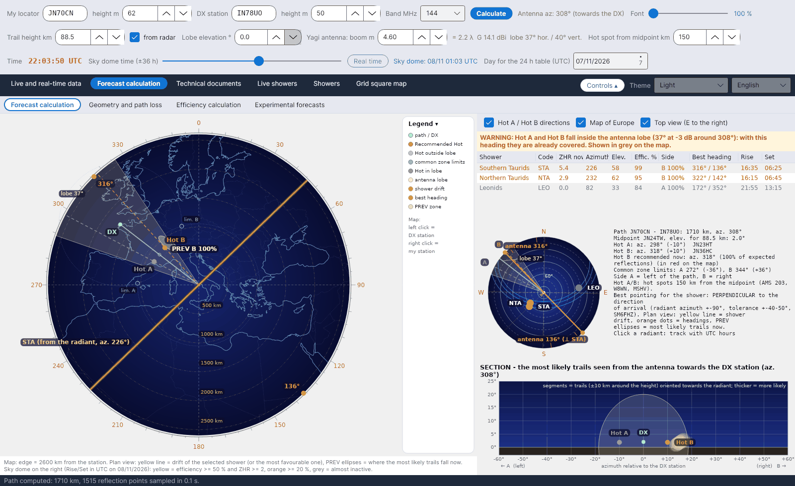

[English](Sky-View) · [Italiano](Sky-View-it) · [Deutsch](Sky-View-de) · [Nederlands](Sky-View-nl) · [Français](Sky-View-fr) · [Español](Sky-View-es) · [Português](Sky-View-pt) · [Dansk](Sky-View-da) · [Norsk](Sky-View-nb) · [Svenska](Sky-View-sv) · [Íslenska](Sky-View-is) · [Eesti](Sky-View-et) · [Lietuvių](Sky-View-lt) · [Latviešu](Sky-View-lv) · [Русский](Sky-View-ru) · [Українська](Sky-View-uk) · [Türkçe](Sky-View-tr) · [Afrikaans](Sky-View-af) · [العربية](Sky-View-ar) · [עברית](Sky-View-he) · [اردو](Sky-View-ur) · [हिन्दी](Sky-View-hi) · [বাংলা](Sky-View-bn) · [Bahasa Indonesia](Sky-View-id) · **Tagalog** · [日本語](Sky-View-ja) · [한국어](Sky-View-ko) · [中文](Sky-View-zh)

# Kalangitan (sky dome)

*Tab: Kalkulasyon ng pagtataya › Kalkulasyon ng pagtataya.*

[](https://raw.githubusercontent.com/ic8tem/YA-MS/main/docs/screenshots/en-2_1.png)

Inilalagay ng sub-tab na ito (ang kalangitan ng mga naunang bersyon) sa iisang screen kung **saan** naroon ngayon ang mga magagamit na bakas at **saan itututok**. Sa kaliwa, ang **tanaw mula sa itaas** ng landas; sa kanan, ang listahan ng mga shower, isang maliit na kalangitan na may mga radiant, ang teksto ng kalkulasyon at ang **seksiyon** na nakikita mula sa iyong antenna. Lahat ay tumutukoy sa sandaling pinili gamit ang *Petsa ng kalkulasyon (UTC)* at ang slider na *Mga oras (mula −12 hanggang +36 h)* (real time bilang default, sa mga hakbang na 15 minuto).

Ibinubuod ng isang **strip sa itaas ng tanaw mula sa itaas** ang kalkulasyon para sa sandaling iyon: petsa at oras (*ngayon* o ilang oras mula ngayon), ang **indeks ng landas Σ ZHR×η**, ang **pinakakapaki-pakinabang na shower** kasama ang ZHR at episyensya nito (pati sa dB kaugnay ng reperensiya ni DJ5HG, tingnan ang [Kalkulasyon ng episyensya](Efficiency-Calculation-tl)), ang bilang ng mga shower sa itaas ng horizon at ang **inirerekomendang Hot** kasama ang azimuth nito.

Sa maliit na kalangitan, laging ibinibigay ng isang **kahel na linya** na dumaraan sa zenith ang **tamang direksiyon ng antenna**, orthogonal sa pag-usad ng napiling shower (o ng pinakapaborable): azimuth ng radiant ±90°, may label na *antenna NNN°* sa magkabilang dulo, at manipis na linya para sa ±45° na tolerance. Ibinibigay ng maiikling kahel na guhit sa gilid ang orthogonal na direksiyon ng iba pang magagamit na shower.

## Tanaw mula sa itaas (kaliwa)

Isang mapa ng Europa na tinatanaw mula sa itaas (**E sa kanan**) na may iskala ng digri sa paligid. Ibinibigay ng caption sa ilalim ng mapa ang radius nito (*Mapa: gilid = … km mula sa istasyon*).

| Elemento | Guhit |
|---|---|
| Landas / DX | Berdeng linya mula sa iyong istasyon patungo sa DX station (laging ang totoong great-circle na landas sa pagitan ng mga locator) |
| **Hot A / Hot B** | Mga punto sa magkabilang panig ng gitnang punto, patayo sa landas, sa distansiyang ibinibigay ng talahanayan ng offset ng AMS (o mano-manong inilagay). **Pula = inirerekomenda**, **rosas = labas sa lobe ng antenna**, **abo = nasa loob ng lobe** (may babala) |
| Lobe ng antenna | Ang −3 dB na pahalang na lobe sa paligid ng azimuth ng antenna (laging nakatutok ang antenna sa DX), may label na *lobe …°* |
| Mga hangganan ng karaniwang sona | Malalabong puntong *hang. A* / *hang. B* at ang dalawang bilog kung saan sinasalubong ng horizon ng bawat istasyon ang E layer (tingnan ang [Heometriya](Geometry-and-Path-Loss-tl#mga-hangganan-ng-karaniwang-sona)) |
| Pag-usad ng shower | **Dilaw na linya**: ang direksiyon kung saan winawalis ng napiling shower (o ng pinakapaborable) ang langit, ibig sabihin ang azimuth ng radiant |
| Pinakamahusay na tutok | **Mga kahel na tuldok**: ang dalawang tutok na patayo sa pag-usad (azimuth ng radiant ±90°, SM6FHZ) |
| **Mga PREV na sona** | Mga mapusyaw na ellipse: kung saan bumabagsak **ngayon** ang pinakamalamang na bakas, isa bawat panig ng landas |

Hindi nagpapatong-patong ang mga label: isinusulat ang Hot A at PREV A sa kaliwa ng landas, ang B sa kanan. Ang **Leyenda** ay isang naititiklop na column sa kanan ng mapa.

**Mouse sa mapa:** **kaliwang click = locator ng DX station**, **kanang click = locator ng aking istasyon**. Agad na muling kinakalkula ang landas.

Mga opsiyon sa itaas ng listahan ng mga shower: **Mga direksiyong Hot A / Hot B**, **Mapa ng Europa** (Natural Earth, dina-download sa `data/mappa` sa unang pagsisimula), **Tanaw mula sa itaas (E sa kanan)**.

### Inirerekomendang Hot

Para sa ipinapakitang oras, pinagsasama ng programa sa lahat ng shower na nasa itaas ng horizon ang timbang na ZHR × episyensya, na hinati sa panig A (bahaging f_A) at panig B. Ang panig na may mas malaking timbang ang nagbibigay ng inirerekomendang Hot, na iginuguhit nang pula:

```math
W_A = \sum \frac{ZHR\,\eta}{100}\,f_A,\qquad W_B = \sum \frac{ZHR\,\eta}{100}\,(1-f_A),\qquad \mathrm{Hot} = \arg\max(W_A,\ W_B)
```

*Pagpili ng programa (manwal eq. 23).* Pinagmulan ng ideya: si DJ5HG, ayon sa ulat ni DF5HC (kumperensiya ng DARC 2018) – depende sa posisyon ng radiant, mas paborable ang isa sa dalawang punto, HOT-A o HOT-B. Ang pagpihit nang 10–30° patungo sa panig na iyon (side-scatter) ay mula sa artikulong Cerrotta–Sartori.

### Mga PREV na sona

Para sa bawat punto P ng E layer, pinagsasama ang mga kontribusyon ng lahat ng aktibong shower sa episyensya (parehong specular na kondisyon gaya sa [episyensya](Efficiency-Calculation-tl#ang-modelo)), na tinimbang ayon sa ZHR. Ang mga puntong may hindi bababa sa 3 % ng pinakamataas ang bumubuo sa mga PREV na sona; bawat isa ay iginuguhit bilang ellipse na ang gitna = tinimbang na mean ng mga punto at ang mga axis = dalawang ulit ng kanilang pagkakalat.

```math
W_P = \sum ZHR\; c_P(\hat{s}),\qquad c_P = 100\,\frac{w_P S_P \max(0,\ \hat{s}\cdot\hat{u}_P)}{\max F},\qquad PREV:\ W_P \ge 0{.}03\,\max W
```

*Pagpili ng programa (manwal eq. 34).* Ito ang praktikal na tuntunin: kung winawalis ng shower ang langit mula hilaga patimog, bumabagsak sa silangan at kanluran ang mga magagamit na bakas.

## Listahan ng mga shower (kanang itaas)

| Column | Kahulugan |
|---|---|
| Shower, Kodigo | Pangalan at kodigo ng IMO |
| ZHR ngayon | Aktibidad sa sandaling ito (peak ZHR ng IMO na may profile ng aktibidad) |
| Azimuth, Elev. | Posisyon ng radiant ayon sa iyong istasyon |
| Epis. % | Episyensya ng shower para sa landas na ito |
| Panig | A o B, ang panig na pinagmumulan ng karamihan ng repleksiyon |
| Pinakamahusay na tutok | Azimuth ng radiant ±90° |
| Sikat, Lubog | Pagsikat at paglubog ng radiant (UTC); *circumpolar* o *laging nasa ilalim* kapag naaangkop |

I-click ang isang hanay para piliin ang shower: sumusunod dito ang dilaw na linya ng pag-usad at ang mga kahel na tuldok.

## Maliit na kalangitan (gitna sa kanan)

Ang mga radiant sa isang kalangitan na tinatanaw mula sa iyong istasyon, kasama ang kanilang **kodigo ng IMO** at **araw-araw na daanan na cyan** (mga oras na UTC). **I-click ang isang radiant** para piliin ito. Mga kulay:

| Kulay | Kahulugan |
|---|---|
| Dilaw | episyensya ≥ 50 % at ZHR ≥ 2 |
| Kahel | episyensya ≥ 20 % |
| Madilim na pula | episyensya < 20 % |
| Abo | halos hindi aktibo |

Katabi nito, ang teksto ng kalkulasyon: haba at azimuth ng landas, ang gitnang punto at ang elebasyon nito, mga azimuth at offset ng Hot A / Hot B, ang inirerekomendang Hot (*… inirerekomenda ngayon: az. …° (…% ng inaasahang repleksiyon)*), ang mga hangganan ng karaniwang sona, at ang paalala: *pinakamahusay na pagtutok para sa shower: PATAYO sa direksiyon ng pagdating (azimuth ng radiant ±90°, tolerance ±40–50°, SM6FHZ)*.

## Seksiyon (kanang ibaba)

*SEKSIYON – ang pinakamalamang na bakas na nakikita mula sa antenna patungo sa DX station.* Pahalang ang **azimuth kaugnay ng DX station** (← A kaliwa, B → kanan), patayo ang **elebasyon**. Para sa bawat shower, kinukuha ang 14 na pinakamalakas na punto ng repleksiyon; bawat bakas ay isang segment na nakaharap sa radiant, mula 10 km sa itaas hanggang 10 km sa ibaba ng taas ng bakas (hanggang 60 km bawat panig), mas makapal kapag mas malamang. Iginuguhit din: ang lobe ng antenna (−3 dB na bilog sa paligid ng elebasyon ng lobe), ang DX station at ang Hot A / Hot B.

```math
Q = P \pm t_{1/2}\,\hat{s},\qquad t_{1/2} = \min\left(60\ \mathrm{km},\ \frac{10\ \mathrm{km}}{\max(0{.}17,\ |\hat{s}\cdot\hat{u}_P|)}\right)
```

*Pagpili ng programa (manwal eq. 35).*

## Mga babala

| Babala | Kailan |
|---|---|
| **BABALA: ang Hot A (at/o Hot B) ay pasok sa lobe ng antenna …** | Nasa loob ng ±θ/2 ng azimuth ng antenna ang hot spot (θ = pahalang na −3 dB na lobe): sa tutok na ito ay sakop na ito. Kulay abo sa mapa. Nananatiling pula ang inirerekomendang Hot. |
| **MASYADONG MATAAS ANG RADIANT (higit sa 70°)** | May magagamit na radiant na higit sa 70° mula sa iyong istasyon: halos patayong bumabagsak ang mga bakas at kaunti lang ang repleksiyon patungo sa landas (DF5HC, DH9GCD). Minamarkahan ng ↑ ang parehong mga oras sa [talahanayan bawat oras](Efficiency-Calculation-tl#talahanayan-bawat-oras). |
| **MABABANG RADIANT SA KAHABAAN NG LANDAS** | May aktibong radiant na mas mababa sa 20° at nasa loob ng 30° mula sa direksiyon ng landas. Nananatiling mababa (maingat) ang kinalkulang episyensya, ngunit inaasahan ni DJ5HG ang bihira ngunit malalakas na repleksiyon mula sa mga sumasayad na bakas na nakahanay sa landas (Hamburg–Narvik, Quadrantids, mga 19 UTC): sulit pakinggan. |
| *Walang karaniwang sona ng E layer* | Mas mahaba ang landas kaysa dalawang ulit ng abot sa taas ng bakas: walang karaniwang bahagi ng E layer na nakikita ng dalawang istasyon (imposible ang iisang hop). |
| *Walang inirerekomendang Hot* | Halos walang aktibong shower sa oras na ito. |

Sanggunian para sa grapika ng kalangitan: Swan Meteor Skyview ni DL1DBC (swan.ms); polar plot na may pinakamahusay na direksiyon: RadiantCalc ni SM6FHZ.
