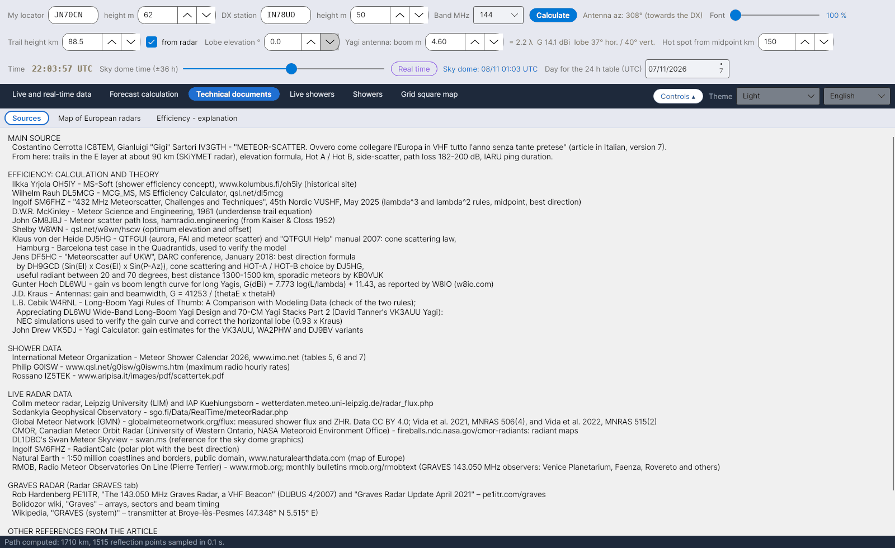

[English](Sources) · [Italiano](Sources-it) · [Deutsch](Sources-de) · [Nederlands](Sources-nl) · [Français](Sources-fr) · [Español](Sources-es) · [Português](Sources-pt) · [Português (Brasil)](Sources-pt-br) · [Dansk](Sources-da) · [Norsk](Sources-nb) · [Svenska](Sources-sv) · [Íslenska](Sources-is) · [Eesti](Sources-et) · [Lietuvių](Sources-lt) · [Latviešu](Sources-lv) · [Polski](Sources-pl) · [Čeština](Sources-cs) · [Magyar](Sources-hu) · [Română](Sources-ro) · [Ελληνικά](Sources-el) · [Русский](Sources-ru) · [Українська](Sources-uk) · [Türkçe](Sources-tr) · [Afrikaans](Sources-af) · **العربية** · [עברית](Sources-he) · [اردو](Sources-ur) · [हिन्दी](Sources-hi) · [বাংলা](Sources-bn) · [ไทย](Sources-th) · [Bahasa Indonesia](Sources-id) · [Tagalog](Sources-tl) · [日本語](Sources-ja) · [한국어](Sources-ko) · [中文](Sources-zh) · [中文 (繁體)](Sources-zh-tw)

# المصادر

*علامة التبويب: وثائق تقنية › المصادر.*

تسرد علامة التبويب **المصادر** كل عمل بُني عليه YA-MS، مجمَّعة كما يلي (النص قابل للتحديد، فيمكنك نسخ المراجع). المصادر نفسها، مرقَّمة، تختم دليل الحسابات (`doc/YA-MS_manuale_calcoli.docx`) ووثيقة [شرح حساب الكفاءة](Efficiency-Explanation-ar).

## المصدر الرئيسي

| المصدر | استُخدم من أجل |
|---|---|
| Costantino Cerrotta **IC8TEM**، Gianluigi "Gigi" Sartori **IV3GTH** – *"METEOR-SCATTER. Ovvero come collegare l'Europa in VHF tutto l'anno senza tante pretese"* (مقال بالإيطالية، الإصدار 7) | الآثار في الطبقة E على نحو 90 km (رادار SKiYMET)، نصف قطر الأرض 6372.7955 km، صيغة زاوية الارتفاع، Hot A / Hot B، التشتت الجانبي 10–30°، توهين المسار، الحد الأدنى للإشارة −130 dBm، مدد النبضات وفق IARU، ذروة الشهب المتفرقة عند 06 UTC |

## الكفاءة: الحساب والنظرية

| المصدر | استُخدم من أجل |
|---|---|
| Ilkka Yrjölä **OH5IY** – MS-Soft، www.kolumbus.fi/oh5iy (موقع تاريخي) | مفهوم كفاءة الزخة؛ متوسط توهين المسار 200 dB |
| Wilhelm Rauh **DL5MCG** – MCG_MS، MS Efficiency Calculator v1.61، qsl.net/dl5mcg | الكفاءة على أربعة اتجاهات ثابتة (للمقارنة) |
| Ingolf **SM6FHZ** – *"432 MHz Meteorscatter, Challenges and Techniques"*، 45th Nordic VUSHF، مايو 2025 | قاعدتا λ³ وλ²، نقطة المنتصف، أفضل اتجاه (سمت نقطة الإشعاع ±90°) |
| D.W.R. **McKinley** – *Meteor Science and Engineering*، McGraw-Hill، 1961 | الانعكاس المرآوي، معادلة الأثر منخفض الكثافة |
| John **GM8JBJ** – Meteor scatter path loss، hamradio.engineering (عن Kaiser & Closs 1952) | توهين المسار 172–190 dB الذي حسبه John Worsnop **G4BAO** (أطروحة دكتوراه)، وأقل بنحو 6 dB للآثار المحاذية للمسار؛ لا يُستخدم جدول الصفحة نفسها ذو 182 dB (انظر [الهندسة والتوهين](Geometry-and-Path-Loss-ar)) |
| Shelby **W8WN** – qsl.net/w8wn/hscw (جدول الإزاحة في AMS Bulletin 203) | زاوية الارتفاع والإزاحة المثلى، البقع الساخنة 50–150 km |
| **LZ2HV** – MSHV | Hot A / Hot B (للمقارنة؛ في الدليل) |
| Klaus von der Heide **DJ5HG** – QTFGUI ودليل "QTFGUI Help" ‏(2007) | قانون التشتت المخروطي؛ حالة الاختبار هامبورغ – برشلونة خلال الربعيات، المستخدمة للتحقق من النموذج |
| Jens **DF5HC** – *"Meteorscatter auf UKW"*، مؤتمر DARC، يناير 2018 | صيغة أفضل اتجاه لـ **DH9GCD**؛ التشتت المخروطي واختيار HOT-A / HOT-B لـ DJ5HG؛ نقطة إشعاع مفيدة 20–70°؛ أفضل مسافة 1300–1500 km؛ الشهب المتفرقة لـ KB0VUK |
| L. Edwards VE7BQH - جداول كسب هوائيات Yagi للترددات 50 و144 و432 MHz: dxmaps.com/VE7BQH6.html، dxmaps.com/VE7BQH.html، atlas.dxmaps.com/VE7BQH70.html (نسخ على qsl.net/dk7zb وsm2cew.com). | 50 MHz: 7,36 log(L/λ) + 11,67 · 144 MHz: 8,27 log(L/λ) + 11,31 · 432 MHz: 8,68 log(L/λ) + 11,03 (dBi) |
| G. Hoch DL6WU - "Extremely Long Yagi Antennas"، VHF Communications 14، 3/1982، ص 130-138، الشكل 1 (مصدر أولي)؛ ويورد المنحنى أيضاً W8IO، www.w8io.com. | G(dBi) = 7,81 log(L/λ) + 11,35 (W8IO: 7,773 log + 11,43) |
| J.D. **Kraus** – *Antennas*، McGraw-Hill | G = 41253 / (θE·θH) |
| L.B. Cebik **W4RNL** – *Long-Boom Yagi Rules of Thumb: A Comparison with Modeling Data*؛ *Appreciating DL6WU Wide-Band Long-Boom Yagi Design*؛ *70-CM Yagi Stacks Part 2* (هوائيات VK3AUU لـ David Tanner) | محاكاة NEC المستخدمة للتحقق من منحنى الكسب وتصحيح الفص الأفقي (0.93 × Kraus) |
| John Drew **VK5DJ** – Yagi Calculator | تقديرات الكسب لنسخ VK3AUU وWA2PHW وDJ9BV |
| J. **Meeus** – *Astronomical Algorithms*، الطبعة الثانية، Willmann-Bell، 1998 | اليوم اليولياني، الزمن النجمي، خط الطول الشمسي، السمت/زاوية الارتفاع (في الدليل) |
| National Geospatial-Intelligence Agency – *World Geodetic System 1984* (NGA.STND.0036, 2014; NIMA TR8350.2) | المجسم الإهليلجي WGS84 (مواقع المحطات والآثار) |
| C. F. F. **Karney** – *Algorithms for geodesics*, Journal of Geodesy 87 (2013) 43–55; GeographicLib | المسافة والسمت ونقطة المنتصف على الخط الجيوديسي |

## بيانات الزخات

| المصدر | استُخدم من أجل |
|---|---|
| International Meteor Organization – Meteor Shower Calendar 2026 (و2027)، www.imo.net، الجداول 5 و6 و7 | نقاط الإشعاع، λ max، ‏v، ‏r، ‏ZHR، مصدر مقابل الشمس (Antihelion Source)، تواريخ الذروة وأوقاتها |
| Rossano **IZ5TEK** – www.aripisa.it/images/pdf/scattertek.pdf | بيانات الزخات |

## بيانات الرادار المباشرة

| المصدر | استُخدم من أجل |
|---|---|
| رادار الشهب في Collm، جامعة لايبزيغ (LIM) وIAP Kühlungsborn – wetterdaten.meteo.uni-leipzig.de/radar_flux.php | تدفق الشهب الساعي وارتفاعات الآثار ([تدفق الرادار](Radar-Flux-ar)) |
| Sodankylä Geophysical Observatory – sgo.fi/Data/RealTime/meteorRadar.php | صورة عدّ الشهب |
| DL1DBC – Swan Meteor Skyview، swan.ms | مرجع رسومات القبة السماوية |
| SM6FHZ – RadiantCalc | المخطط القطبي مع أفضل اتجاه |
| Natural Earth – السواحل والحدود بمقياس 1:50 مليون، ملكية عامة، www.naturalearthdata.com | خريطة أوروبا |
| RMOB، Radio Meteor Observatories On Line (Pierre Terrier) – www.rmob.org؛ النشرات الشهرية rmob.org/rmobtext | راصدو GRAVES على 143.050 MHz (القبة الفلكية في البندقية، وفاينزا، وروفيريتو وغيرها) للمقارنة |

## رادار GRAVES

| المصدر | استُخدم من أجل |
|---|---|
| Rob Hardenberg **PE1ITR** – *"The 143.050 MHz Graves Radar, a VHF Beacon"* (DUBUS 4/2007) و*"Graves Radar Update April 2021"* – pe1itr.com/graves | القطاعات، الخطوات، توقيت الخطوة 0.8 s / 3.2 s |
| ويكي Bolidozor، "Graves" | المصفوفات والقطاعات وتوقيت الحزمة |
| Wikipedia، "GRAVES (system)" | المرسِل في Broye-lès-Pesmes (47.348° N 5.515° E) |

انظر [رادار GRAVES](GRAVES-Radar-ar).

## مراجع أخرى من المقال

G3WZT، DH8BQA، geekshed.co.uk، دليل WSJT-X، WB2FKO (النبضات)، IU6GIR (النشاط على 143.050 MHz)، IARU Region 1 VHF Handbook.

## الثوابت مع مصادرها

يسرد الملف `data/regole_sperimentali.csv` الثوابت والقواعد التي يستخدمها البرنامج، كلاً منها مع مصدره (ارتفاع الآثار النموذجي، مدى الارتفاعات، نصف قطر الأرض، قاعدتا λ³ / λ²، مدد النبضات وفق IARU، توهينات المسار، الحد الأدنى للإشارة، EIRP الاسترشادي، ذروة الشهب المتفرقة، المسافات المفيدة على 432 MHz، أفضل اتجاه، أقصى زاوية ارتفاع مفيدة لنقطة الإشعاع على 432 MHz، التشتت الجانبي).

> بيانات الرادار ملك للمؤسسات التابعة لها. يجب طلب الإذن قبل جلبها تلقائياً في برنامج يُوزَّع.
