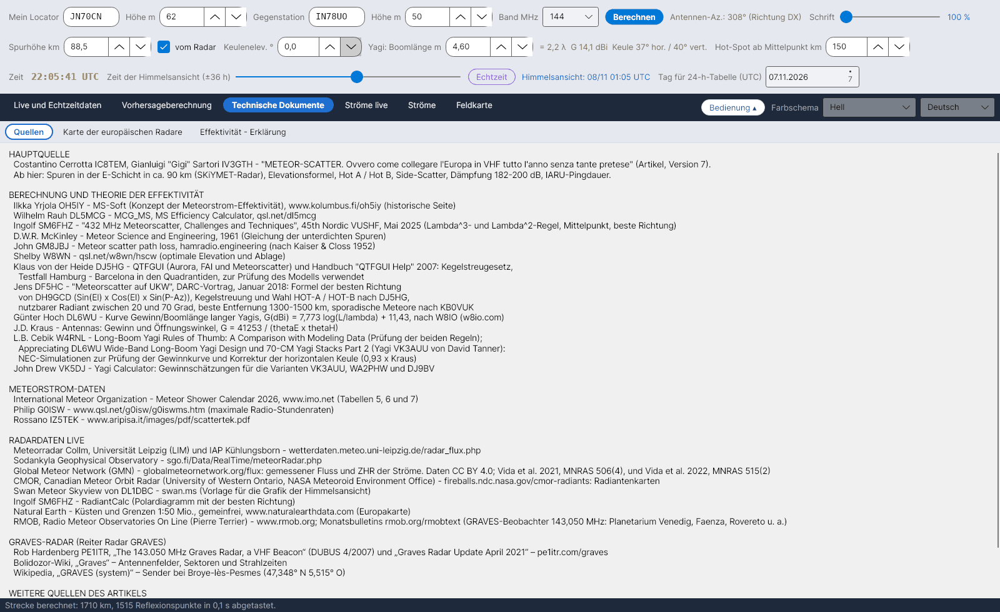

[English](Sources) · [Italiano](Sources-it) · **Deutsch** · [Nederlands](Sources-nl) · [Français](Sources-fr) · [Español](Sources-es) · [Português](Sources-pt) · [Português (Brasil)](Sources-pt-BR) · [Dansk](Sources-da) · [Norsk](Sources-nb) · [Svenska](Sources-sv) · [Íslenska](Sources-is) · [Eesti](Sources-et) · [Lietuvių](Sources-lt) · [Latviešu](Sources-lv) · [Polski](Sources-pl) · [Čeština](Sources-cs) · [Magyar](Sources-hu) · [Română](Sources-ro) · [Ελληνικά](Sources-el) · [Русский](Sources-ru) · [Українська](Sources-uk) · [Türkçe](Sources-tr) · [Afrikaans](Sources-af) · [العربية](Sources-ar) · [עברית](Sources-he) · [اردو](Sources-ur) · [हिन्दी](Sources-hi) · [বাংলা](Sources-bn) · [ไทย](Sources-th) · [Bahasa Indonesia](Sources-id) · [Tagalog](Sources-tl) · [日本語](Sources-ja) · [한국어](Sources-ko) · [中文](Sources-zh) · [中文 (繁體)](Sources-zh-TW)

# Quellen

*Reiter: Technische Dokumente › Quellen.*

Der Reiter **Quellen** listet alle Werke auf, auf denen YA-MS aufbaut, gruppiert wie unten (der Text ist markierbar, du kannst die Angaben also kopieren). Dieselben Quellen, nummeriert, schließen das Berechnungshandbuch (`doc/YA-MS_manuale_calcoli.docx`) und das Dokument [Effektivität - Erklärung](Efficiency-Explanation-de) ab.

## HAUPTQUELLE

| Quelle | Verwendet für |
|---|---|
| Costantino Cerrotta **IC8TEM**, Gianluigi "Gigi" Sartori **IV3GTH** – *"METEOR-SCATTER. Ovvero come collegare l'Europa in VHF tutto l'anno senza tante pretese"* (Artikel auf Italienisch, Version 7) | Spuren in der E-Schicht in ca. 90 km (SKiYMET-Radar), Erdradius 6372,7955 km, Elevationsformel, Hot A / Hot B, Side-Scatter 10–30°, Streckendämpfung, Empfangsschwelle −130 dBm, IARU-Pingdauern, sporadisches Maximum um 06 UTC |

## BERECHNUNG UND THEORIE DER EFFEKTIVITÄT

| Quelle | Verwendet für |
|---|---|
| Ilkka Yrjölä **OH5IY** – MS-Soft, www.kolumbus.fi/oh5iy (historische Seite) | Konzept der Meteorstrom-Effektivität; mittlere Streckendämpfung 200 dB |
| Wilhelm Rauh **DL5MCG** – MCG_MS, MS Efficiency Calculator v1.61, qsl.net/dl5mcg | Effektivität in vier festen Richtungen (Vergleich) |
| Ingolf **SM6FHZ** – *"432 MHz Meteorscatter, Challenges and Techniques"*, 45th Nordic VUSHF, Mai 2025 | λ³- und λ²-Regel, Mittelpunkt, beste Richtung (Radiant-Az. ±90°) |
| D.W.R. **McKinley** – *Meteor Science and Engineering*, McGraw-Hill, 1961 | Spiegelnde Reflexion, Gleichung der unterdichten Spuren |
| John **GM8JBJ** – Meteor scatter path loss, hamradio.engineering (nach Kaiser & Closs 1952) | Streckendämpfung 172–190 dB, berechnet von John Worsnop **G4BAO** (Doktorarbeit), etwa 6 dB weniger für Spuren in Streckenrichtung; die eigene 182-dB-Tabelle der Seite wird nicht verwendet (siehe [Geometrie und Dämpfung](Geometry-and-Path-Loss-de)) |
| Shelby **W8WN** – qsl.net/w8wn/hscw (Ablagetabelle aus AMS Bulletin 203) | Optimale Elevation und Ablage, Hot-Spots 50–150 km |
| **LZ2HV** – MSHV | Hot A / Hot B (Vergleich; im Handbuch) |
| Klaus von der Heide **DJ5HG** – QTFGUI und das Handbuch "QTFGUI Help" (2007) | Kegelstreugesetz; Testfall Hamburg – Barcelona in den Quadrantiden, zur Prüfung des Modells verwendet |
| Jens **DF5HC** – *"Meteorscatter auf UKW"*, DARC-Vortrag, Januar 2018 | Formel der besten Richtung von **DH9GCD**; Kegelstreuung und Wahl HOT-A / HOT-B nach DJ5HG; nutzbarer Radiant 20–70°; beste Entfernung 1300–1500 km; sporadische Meteore nach KB0VUK |
| Günter Hoch **DL6WU** – Gewinn in Abhängigkeit von der Boomlänge langer Yagis, nach W8IO (w8io.com) | G(dBi) = 7,773 log(L/λ) + 11,43 |
| J.D. **Kraus** – *Antennas*, McGraw-Hill | G = 41253 / (θE·θH) |
| L.B. Cebik **W4RNL** – *Long-Boom Yagi Rules of Thumb: A Comparison with Modeling Data*; *Appreciating DL6WU Wide-Band Long-Boom Yagi Design*; *70-CM Yagi Stacks Part 2* (Yagis VK3AUU von David Tanner) | NEC-Simulationen zur Prüfung der Gewinnkurve und Korrektur der horizontalen Keule (0,93 × Kraus) |
| John Drew **VK5DJ** – Yagi Calculator | Gewinnschätzungen für die Varianten VK3AUU, WA2PHW und DJ9BV |
| J. **Meeus** – *Astronomical Algorithms*, 2. Aufl., Willmann-Bell, 1998 | Julianisches Datum, Sternzeit, Sonnenlänge, Azimut/Elevation (im Handbuch) |

## METEORSTROM-DATEN

| Quelle | Verwendet für |
|---|---|
| International Meteor Organization – Meteor Shower Calendar 2026 (und 2027), www.imo.net, Tabellen 5, 6 und 7 | Radianten, λ max, v, r, ZHR, Antihelion-Quelle, Datum und Uhrzeit der Maxima |
| Rossano **IZ5TEK** – www.aripisa.it/images/pdf/scattertek.pdf | Daten der Meteorströme |

## RADARDATEN LIVE

| Quelle | Verwendet für |
|---|---|
| Meteorradar Collm, Universität Leipzig (LIM) und IAP Kühlungsborn – wetterdaten.meteo.uni-leipzig.de/radar_flux.php | Stündlicher Meteorfluss und Spurhöhen ([Radarfluss](Radar-Flux-de)) |
| Sodankylä Geophysical Observatory – sgo.fi/Data/RealTime/meteorRadar.php | Bild der Meteorzählung |
| DL1DBC – Swan Meteor Skyview, swan.ms | Vorlage für die Grafik der Himmelsansicht |
| SM6FHZ – RadiantCalc | Polardiagramm mit der besten Richtung |
| Natural Earth – Küsten und Grenzen 1:50 Mio., gemeinfrei, www.naturalearthdata.com | Europakarte |
| RMOB, Radio Meteor Observatories On Line (Pierre Terrier) – www.rmob.org; Monatsbulletins rmob.org/rmobtext | GRAVES-Beobachter auf 143,050 MHz (Planetarium Venedig, Faenza, Rovereto u. a.) zum Vergleich |

## GRAVES-RADAR

| Quelle | Verwendet für |
|---|---|
| Rob Hardenberg **PE1ITR** – *„The 143.050 MHz Graves Radar, a VHF Beacon“* (DUBUS 4/2007) und *„Graves Radar Update April 2021“* – pe1itr.com/graves | Sektoren, Schritte, Schrittdauer 0,8 s / 3,2 s |
| Bolidozor-Wiki, „Graves“ | Antennenfelder, Sektoren und Strahlzeiten |
| Wikipedia, „GRAVES (system)“ | Sender bei Broye-lès-Pesmes (47,348° N 5,515° O) |

Siehe [Radar GRAVES](GRAVES-Radar-de).

## WEITERE QUELLEN DES ARTIKELS

G3WZT, DH8BQA, geekshed.co.uk, WSJT-X-Handbuch, WB2FKO (Pings), IU6GIR (Aktivität 143,050 MHz), IARU Region 1 VHF Handbook.

## Konstanten mit Quellenangabe

`data/regole_sperimentali.csv` listet die vom Programm verwendeten Konstanten und Regeln, jede mit ihrer Quelle (typische Spurhöhe, Höhenbereich, Erdradius, λ³- / λ²-Regel, IARU-Pingdauern, Streckendämpfungen, Empfangsschwelle, Richtwert EIRP, sporadisches Maximum, nutzbare Entfernungen auf 432 MHz, beste Richtung, maximale nutzbare Radiantenhöhe auf 432 MHz, Side-Scatter).

> Die Radardaten gehören ihren Einrichtungen. Bevor sie in einem weitergegebenen Programm automatisch abgerufen werden, ist um Erlaubnis zu bitten.
