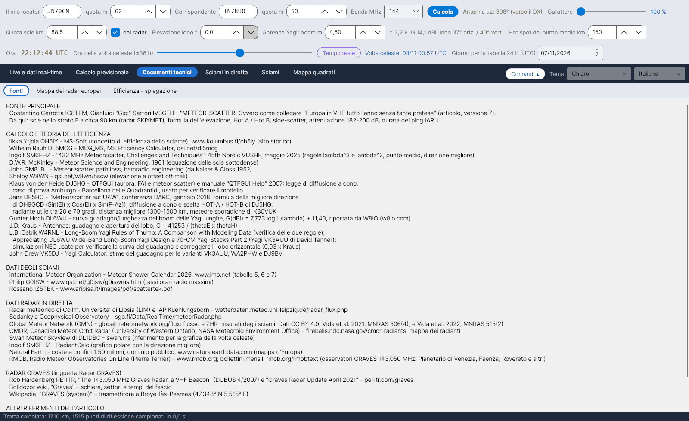

[English](Sources) · **Italiano** · [Deutsch](Sources-de) · [Nederlands](Sources-nl) · [Français](Sources-fr) · [Español](Sources-es) · [Português](Sources-pt) · [Português (Brasil)](Sources-pt-br) · [Dansk](Sources-da) · [Norsk](Sources-nb) · [Svenska](Sources-sv) · [Íslenska](Sources-is) · [Eesti](Sources-et) · [Lietuvių](Sources-lt) · [Latviešu](Sources-lv) · [Polski](Sources-pl) · [Čeština](Sources-cs) · [Magyar](Sources-hu) · [Română](Sources-ro) · [Ελληνικά](Sources-el) · [Русский](Sources-ru) · [Українська](Sources-uk) · [Türkçe](Sources-tr) · [Afrikaans](Sources-af) · [العربية](Sources-ar) · [עברית](Sources-he) · [اردو](Sources-ur) · [हिन्दी](Sources-hi) · [বাংলা](Sources-bn) · [Bahasa Indonesia](Sources-id) · [Tagalog](Sources-tl) · [日本語](Sources-ja) · [한국어](Sources-ko) · [中文](Sources-zh)

# Fonti

*Linguetta: Documenti tecnici › Fonti.*

La linguetta **Fonti** elenca tutti i lavori su cui si basa YA-MS, raggruppati come qui sotto (il testo è selezionabile, così puoi copiare i riferimenti). Le stesse fonti, numerate, chiudono il manuale dei calcoli (`doc/YA-MS_manuale_calcoli.docx`) e il documento [Efficienza - spiegazione](Efficiency-Explanation-it).

## FONTE PRINCIPALE

| Fonte | Usata per |
|---|---|
| Costantino Cerrotta **IC8TEM**, Gianluigi "Gigi" Sartori **IV3GTH** – *"METEOR-SCATTER. Ovvero come collegare l'Europa in VHF tutto l'anno senza tante pretese"* (articolo in italiano, versione 7) | Scie nello strato E a circa 90 km (radar SKiYMET), raggio terrestre 6372,7955 km, formula dell'elevazione, Hot A / Hot B, side-scatter 10–30°, attenuazione di tratta 182–200 dB, segnale minimo −130 dBm, durate dei ping IARU, massimo delle sporadiche alle 06 UTC |

## CALCOLO E TEORIA DELL'EFFICIENZA

| Fonte | Usata per |
|---|---|
| Ilkka Yrjölä **OH5IY** – MS-Soft, www.kolumbus.fi/oh5iy (sito storico) | Concetto di efficienza dello sciame; attenuazione media di 200 dB |
| Wilhelm Rauh **DL5MCG** – MCG_MS, MS Efficiency Calculator v1.61, qsl.net/dl5mcg | Efficienza su quattro direzioni fisse (confronto) |
| Ingolf **SM6FHZ** – *"432 MHz Meteorscatter, Challenges and Techniques"*, 45th Nordic VUSHF, maggio 2025 | Regole λ³ e λ², punto medio, direzione migliore (az. del radiante ±90°) |
| D.W.R. **McKinley** – *Meteor Science and Engineering*, McGraw-Hill, 1961 | Riflessione speculare, equazione delle scie sottodense |
| John **GM8JBJ** – Meteor scatter path loss, hamradio.engineering (da Kaiser & Closs 1952) | Attenuazione minima di 182 dB |
| Shelby **W8WN** – qsl.net/w8wn/hscw (tabella degli scostamenti dell'AMS Bulletin 203) | Elevazione e scostamento ottimali, hot spot a 50–150 km |
| **LZ2HV** – MSHV | Hot A / Hot B (confronto; nel manuale) |
| Klaus von der Heide **DJ5HG** – QTFGUI e il manuale "QTFGUI Help" (2007) | Legge del cone scattering; caso di prova Amburgo – Barcellona con le Quadrantidi usato per verificare il modello |
| Jens **DF5HC** – *"Meteorscatter auf UKW"*, convegno DARC, gennaio 2018 | Formula della direzione migliore di **DH9GCD**; cone scattering e scelta HOT-A / HOT-B di DJ5HG; radiante utile 20–70°; distanza migliore 1300–1500 km; meteore sporadiche secondo KB0VUK |
| Günter Hoch **DL6WU** – guadagno in funzione della lunghezza del boom delle Yagi lunghe, riportato da W8IO (w8io.com) | G(dBi) = 7,773 log(L/λ) + 11,43 |
| J.D. **Kraus** – *Antennas*, McGraw-Hill | G = 41253 / (θE·θH) |
| L.B. Cebik **W4RNL** – *Long-Boom Yagi Rules of Thumb: A Comparison with Modeling Data*; *Appreciating DL6WU Wide-Band Long-Boom Yagi Design*; *70-CM Yagi Stacks Part 2* (Yagi VK3AUU di David Tanner) | Simulazioni NEC usate per verificare la curva del guadagno e correggere il lobo orizzontale (0,93 × Kraus) |
| John Drew **VK5DJ** – Yagi Calculator | Stime del guadagno per le varianti VK3AUU, WA2PHW e DJ9BV |
| J. **Meeus** – *Astronomical Algorithms*, 2ª ed., Willmann-Bell, 1998 | Giorno giuliano, tempo siderale, longitudine solare, azimut/elevazione (nel manuale) |

## DATI DEGLI SCIAMI

| Fonte | Usata per |
|---|---|
| International Meteor Organization – Meteor Shower Calendar 2026 (e 2027), www.imo.net, tabelle 5, 6 e 7 | Radianti, λ max, v, r, ZHR, Sorgente Antielio, date e ore dei massimi |
| Philip **G0ISW** – www.qsl.net/g0isw/g0iswms.htm | Tassi orari radio massimi |
| Rossano **IZ5TEK** – www.aripisa.it/images/pdf/scattertek.pdf | Dati degli sciami |

## DATI RADAR IN DIRETTA

| Fonte | Usata per |
|---|---|
| Radar meteorico di Collm, Università di Lipsia (LIM) e IAP Kühlungsborn – wetterdaten.meteo.uni-leipzig.de/radar_flux.php | Flusso orario di meteore e quote delle scie ([Flusso radar](Radar-Flux-it)) |
| Sodankylä Geophysical Observatory – sgo.fi/Data/RealTime/meteorRadar.php | Immagine dei conteggi di meteore |
| DL1DBC – Swan Meteor Skyview, swan.ms | Riferimento per la grafica della volta celeste |
| SM6FHZ – RadiantCalc | Diagramma polare con la direzione migliore |
| Natural Earth – coste e confini 1:50 milioni, pubblico dominio, www.naturalearthdata.com | Mappa d'Europa |
| RMOB, Radio Meteor Observatories On Line (Pierre Terrier) – www.rmob.org; bollettini mensili rmob.org/rmobtext | Osservatori di GRAVES su 143,050 MHz (Planetario di Venezia, Faenza, Rovereto e altri) per il confronto |

## RADAR GRAVES

| Fonte | Usata per |
|---|---|
| Rob Hardenberg **PE1ITR** – *"The 143.050 MHz Graves Radar, a VHF Beacon"* (DUBUS 4/2007) e *"Graves Radar Update April 2021"* – pe1itr.com/graves | Settori, passi, tempi dei passi di 0,8 s / 3,2 s |
| Wiki di Bolidozor, "Graves" | Schiere, settori e tempi del fascio |
| Wikipedia, "GRAVES (system)" | Trasmettitore a Broye-lès-Pesmes (47,348° N 5,515° E) |

Vedi [Radar GRAVES](GRAVES-Radar-it).

## ALTRI RIFERIMENTI DELL'ARTICOLO

G3WZT, DH8BQA, geekshed.co.uk, manuale di WSJT-X, WB2FKO (ping), IU6GIR (attività su 143,050 MHz), IARU Regione 1 VHF Handbook.

## Costanti con la loro fonte

`data/regole_sperimentali.csv` elenca le costanti e le regole usate dal programma, ognuna con la sua fonte (quota tipica delle scie, intervallo delle quote, raggio terrestre, regole λ³ / λ², durate dei ping IARU, attenuazioni di tratta, segnale minimo, EIRP indicativa, massimo delle sporadiche, distanze utili a 432 MHz, direzione migliore, elevazione massima utile del radiante a 432 MHz, side-scatter).

> I dati radar appartengono ai rispettivi istituti. Prima di prelevarli automaticamente in un programma distribuito bisogna chiedere il permesso.
