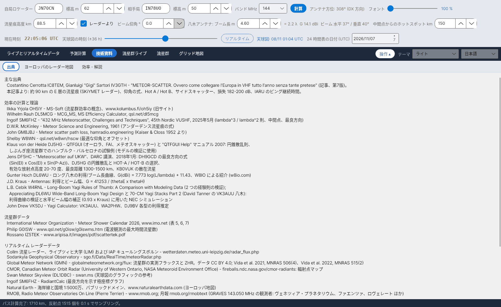

[English](Sources) · [Italiano](Sources-it) · [Deutsch](Sources-de) · [Nederlands](Sources-nl) · [Français](Sources-fr) · [Español](Sources-es) · [Português](Sources-pt) · [Português (Brasil)](Sources-pt-br) · [Dansk](Sources-da) · [Norsk](Sources-nb) · [Svenska](Sources-sv) · [Íslenska](Sources-is) · [Eesti](Sources-et) · [Lietuvių](Sources-lt) · [Latviešu](Sources-lv) · [Polski](Sources-pl) · [Čeština](Sources-cs) · [Magyar](Sources-hu) · [Română](Sources-ro) · [Ελληνικά](Sources-el) · [Русский](Sources-ru) · [Українська](Sources-uk) · [Türkçe](Sources-tr) · [Afrikaans](Sources-af) · [العربية](Sources-ar) · [עברית](Sources-he) · [اردو](Sources-ur) · [हिन्दी](Sources-hi) · [বাংলা](Sources-bn) · [Bahasa Indonesia](Sources-id) · [Tagalog](Sources-tl) · **日本語** · [한국어](Sources-ko) · [中文](Sources-zh) · [中文 (繁體)](Sources-zh-tw)

# 出典

*タブ: 技術資料 › 出典。*

**出典** タブには、YA-MS の基礎となったすべての著作が以下のように分類して列挙されています (テキストは選択できるので、参考文献をコピーできます)。同じ出典が番号付きで計算マニュアル (`doc/YA-MS_manuale_calcoli.docx`) と [効率 - 解説](Efficiency-Explanation-ja) 文書の末尾にも載っています。

## 主な出典

| 出典 | 用途 |
|---|---|
| Costantino Cerrotta **IC8TEM**、Gianluigi "Gigi" Sartori **IV3GTH** – *"METEOR-SCATTER. Ovvero come collegare l'Europa in VHF tutto l'anno senza tante pretese"* (イタリア語の記事、第 7 版) | 約 90 km の E 層の流星痕 (SKiYMET レーダー)、地球半径 6372.7955 km、仰角の式、Hot A / Hot B、サイドスキャッター 10–30°、パス損失 182–200 dB、最小信号 −130 dBm、IARU のピング継続時間、06 UTC の散在流星のピーク |

## 効率の計算と理論

| 出典 | 用途 |
|---|---|
| Ilkka Yrjölä **OH5IY** – MS-Soft、www.kolumbus.fi/oh5iy (旧サイト) | 流星群効率の概念; 平均パス損失 200 dB |
| Wilhelm Rauh **DL5MCG** – MCG_MS, MS Efficiency Calculator v1.61、qsl.net/dl5mcg | 4 つの固定方向での効率 (比較用) |
| Ingolf **SM6FHZ** – *"432 MHz Meteorscatter, Challenges and Techniques"*、45th Nordic VUSHF、2025 年 5 月 | λ³ / λ² 則、中間点、最良方向 (放射点方位 ±90°) |
| D.W.R. **McKinley** – *Meteor Science and Engineering*、McGraw-Hill、1961 | 鏡面反射、アンダーデンス流星痕の式 |
| John **GM8JBJ** – Meteor scatter path loss、hamradio.engineering (Kaiser & Closs 1952 より) | 最小パス損失 182 dB |
| Shelby **W8WN** – qsl.net/w8wn/hscw (AMS Bulletin 203 の偏差表) | 最適な仰角とオフセット、50–150 km のホットスポット |
| **LZ2HV** – MSHV | Hot A / Hot B (比較用; マニュアル内) |
| Klaus von der Heide **DJ5HG** – QTFGUI と "QTFGUI Help" マニュアル (2007) | 円錐散乱則; モデルの検証に使ったしぶんぎ座流星群でのハンブルク – バルセロナの試験例 |
| Jens **DF5HC** – *"Meteorscatter auf UKW"*、DARC 講演、2018 年 1 月 | **DH9GCD** の最良方向の式; DJ5HG の円錐散乱と HOT-A / HOT-B の選択; 有効な放射点高度 20–70°; 最良距離 1300–1500 km; KB0VUK の散在流星 |
| Günter Hoch **DL6WU** – ロング八木の利得/ブーム長、W8IO による紹介 (w8io.com) | G(dBi) = 7.773 log(L/λ) + 11.43 |
| J.D. **Kraus** – *Antennas*、McGraw-Hill | G = 41253 / (θE·θH) |
| L.B. Cebik **W4RNL** – *Long-Boom Yagi Rules of Thumb: A Comparison with Modeling Data*; *Appreciating DL6WU Wide-Band Long-Boom Yagi Design*; *70-CM Yagi Stacks Part 2* (David Tanner の VK3AUU 八木) | 利得曲線の検証と水平ビーム幅の補正 (0.93 × Kraus) に用いた NEC シミュレーション |
| John Drew **VK5DJ** – Yagi Calculator | VK3AUU、WA2PHW、DJ9BV 各型の利得推定 |
| J. **Meeus** – *Astronomical Algorithms*、第 2 版、Willmann-Bell、1998 | ユリウス日、恒星時、太陽黄経、方位/仰角 (マニュアル内) |

## 流星群データ

| 出典 | 用途 |
|---|---|
| International Meteor Organization – Meteor Shower Calendar 2026 (および 2027)、www.imo.net、表 5、6、7 | 放射点、λ max、v、r、ZHR、反太陽源、極大の日時 |
| Philip **G0ISW** – www.qsl.net/g0isw/g0iswms.htm | 電波観測の最大時間流星数 |
| Rossano **IZ5TEK** – www.aripisa.it/images/pdf/scattertek.pdf | 流星群データ |

## リアルタイム レーダーデータ

| 出典 | 用途 |
|---|---|
| Collm 流星レーダー、ライプツィヒ大学 (LIM) および IAP キュールングスボルン – wetterdaten.meteo.uni-leipzig.de/radar_flux.php | 時間別の流星フラックスと流星痕高度 ([レーダーフラックス](Radar-Flux-ja)) |
| Sodankylä Geophysical Observatory – sgo.fi/Data/RealTime/meteorRadar.php | 流星数の画像 |
| DL1DBC – Swan Meteor Skyview、swan.ms | 天球図のグラフィックの参考 |
| SM6FHZ – RadiantCalc | 最良方向を示す極座標グラフ |
| Natural Earth – 海岸線と国境 1:5000万、パブリックドメイン、www.naturalearthdata.com | ヨーロッパ地図 |
| RMOB, Radio Meteor Observatories On Line (Pierre Terrier) – www.rmob.org; 月報 rmob.org/rmobtext | 比較用の GRAVES 143.050 MHz の観測者 (ヴェネツィア・プラネタリウム、ファエンツァ、ロヴェレート ほか) |

## GRAVES レーダー

| 出典 | 用途 |
|---|---|
| Rob Hardenberg **PE1ITR** – *「The 143.050 MHz Graves Radar, a VHF Beacon」* (DUBUS 4/2007) および *「Graves Radar Update April 2021」* – pe1itr.com/graves | セクター、ステップ、0.8 s / 3.2 s のステップ時間 |
| Bolidozor wiki「Graves」 | アレイ、セクター、ビームのタイミング |
| Wikipedia「GRAVES (system)」 | Broye-lès-Pesmes の送信所 (北緯 47.348° 東経 5.515°) |

[GRAVES レーダー](GRAVES-Radar-ja) を参照してください。

## 記事のその他の参考文献

G3WZT, DH8BQA, geekshed.co.uk, WSJT-X マニュアル, WB2FKO (ピング), IU6GIR (143.050 MHz の活動), IARU Region 1 VHF Handbook。

## 出典付きの定数

`data/regole_sperimentali.csv` には、プログラムが使う定数と規則がそれぞれの出典とともに列挙されています (典型的な流星痕高度、高度範囲、地球半径、λ³ / λ² 則、IARU のピング継続時間、パス損失、最小信号、目安の EIRP、散在流星のピーク、432 MHz の有効距離、最良方向、432 MHz での放射点高度の有効上限、サイドスキャッター)。

> レーダーデータの権利は各機関に属します。配布するプログラムで自動的に取得する前に、許可を求める必要があります。
