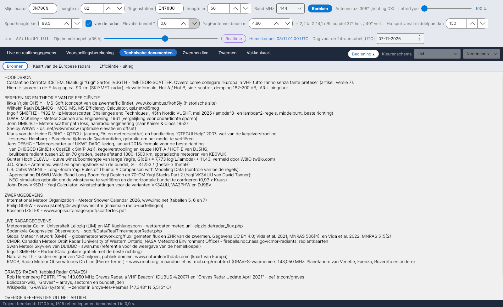

[English](Sources) · [Italiano](Sources-it) · [Deutsch](Sources-de) · **Nederlands** · [Français](Sources-fr) · [Español](Sources-es) · [Português](Sources-pt) · [Português (Brasil)](Sources-pt-br) · [Dansk](Sources-da) · [Norsk](Sources-nb) · [Svenska](Sources-sv) · [Íslenska](Sources-is) · [Eesti](Sources-et) · [Lietuvių](Sources-lt) · [Latviešu](Sources-lv) · [Polski](Sources-pl) · [Čeština](Sources-cs) · [Magyar](Sources-hu) · [Română](Sources-ro) · [Ελληνικά](Sources-el) · [Русский](Sources-ru) · [Українська](Sources-uk) · [Türkçe](Sources-tr) · [Afrikaans](Sources-af) · [العربية](Sources-ar) · [עברית](Sources-he) · [اردو](Sources-ur) · [हिन्दी](Sources-hi) · [বাংলা](Sources-bn) · [Bahasa Indonesia](Sources-id) · [Tagalog](Sources-tl) · [日本語](Sources-ja) · [한국어](Sources-ko) · [中文](Sources-zh) · [中文 (繁體)](Sources-zh-tw)

# Bronnen

*Tabblad: Technische documenten › Bronnen.*

Het tabblad **Bronnen** somt elk werk op waarop YA-MS is gebouwd, gegroepeerd zoals hieronder (de tekst is selecteerbaar, zodat je de referenties kunt kopiëren). Dezelfde bronnen, genummerd, sluiten de rekenhandleiding (`doc/YA-MS_manuale_calcoli.docx`) en het document [Efficiëntie - uitleg](Efficiency-Explanation-nl) af.

## HOOFDBRON

| Bron | Gebruikt voor |
|---|---|
| Costantino Cerrotta **IC8TEM**, Gianluigi "Gigi" Sartori **IV3GTH** – *"METEOR-SCATTER. Ovvero come collegare l'Europa in VHF tutto l'anno senza tante pretese"* (artikel in het Italiaans, versie 7) | Sporen in de E-laag op ongeveer 90 km (SKiYMET-radar), aardstraal 6372,7955 km, elevatieformule, Hot A / Hot B, side-scatter 10–30°, trajectdemping 182–200 dB, minimaal signaal −130 dBm, IARU-pingduur, sporadisch maximum om 06 UTC |

## BEREKENING EN THEORIE VAN DE EFFICIËNTIE

| Bron | Gebruikt voor |
|---|---|
| Ilkka Yrjölä **OH5IY** – MS-Soft, www.kolumbus.fi/oh5iy (historische site) | Begrip efficiëntie van een zwerm; gemiddelde trajectdemping van 200 dB |
| Wilhelm Rauh **DL5MCG** – MCG_MS, MS Efficiency Calculator v1.61, qsl.net/dl5mcg | Efficiëntie op vier vaste richtingen (vergelijking) |
| Ingolf **SM6FHZ** – *"432 MHz Meteorscatter, Challenges and Techniques"*, 45th Nordic VUSHF, mei 2025 | λ³- en λ²-regels, middelpunt, beste richting (az. radiant ±90°) |
| D.W.R. **McKinley** – *Meteor Science and Engineering*, McGraw-Hill, 1961 | Spiegelende reflectie, vergelijking voor onderdichte sporen |
| John **GM8JBJ** – Meteor scatter path loss, hamradio.engineering (naar Kaiser & Closs 1952) | Minimale trajectdemping van 182 dB |
| Shelby **W8WN** – qsl.net/w8wn/hscw (afwijkingstabel uit AMS Bulletin 203) | Optimale elevatie en afwijking, hotspots op 50–150 km |
| **LZ2HV** – MSHV | Hot A / Hot B (vergelijking; in de handleiding) |
| Klaus von der Heide **DJ5HG** – QTFGUI en de handleiding "QTFGUI Help" (2007) | Wet van cone scattering; testgeval Hamburg – Barcelona met de Quadrantiden, gebruikt om het model te verifiëren |
| Jens **DF5HC** – *"Meteorscatter auf UKW"*, DARC-congres, januari 2018 | Formule voor de beste richting van **DH9GCD**; cone scattering en keuze HOT-A / HOT-B van DJ5HG; bruikbare radiant 20–70°; beste afstand 1300–1500 km; sporadische meteoren volgens KB0VUK |
| Günter Hoch **DL6WU** – winst als functie van de boomlengte van lange Yagi's, aangehaald door W8IO (w8io.com) | G(dBi) = 7,773 log(L/λ) + 11,43 |
| J.D. **Kraus** – *Antennas*, McGraw-Hill | G = 41253 / (θE·θH) |
| L.B. Cebik **W4RNL** – *Long-Boom Yagi Rules of Thumb: A Comparison with Modeling Data*; *Appreciating DL6WU Wide-Band Long-Boom Yagi Design*; *70-CM Yagi Stacks Part 2* (VK3AUU-Yagi's van David Tanner) | NEC-simulaties gebruikt om de winstcurve te verifiëren en de horizontale bundel te corrigeren (0,93 × Kraus) |
| John Drew **VK5DJ** – Yagi Calculator | Winstschattingen voor de varianten VK3AUU, WA2PHW en DJ9BV |
| J. **Meeus** – *Astronomical Algorithms*, 2e druk, Willmann-Bell, 1998 | Juliaanse dag, sterrentijd, zonnelengte, azimut/elevatie (in de handleiding) |

## ZWERMGEGEVENS

| Bron | Gebruikt voor |
|---|---|
| International Meteor Organization – Meteor Shower Calendar 2026 (en 2027), www.imo.net, tabellen 5, 6 en 7 | Radianten, λ max, v, r, ZHR, Antihelion-bron, data en tijden van de maxima |
| Philip **G0ISW** – www.qsl.net/g0isw/g0iswms.htm | Maximale radio-uurtellingen |
| Rossano **IZ5TEK** – www.aripisa.it/images/pdf/scattertek.pdf | Zwermgegevens |

## LIVE RADARGEGEVENS

| Bron | Gebruikt voor |
|---|---|
| Meteorradar Collm, Universiteit Leipzig (LIM) en IAP Kühlungsborn – wetterdaten.meteo.uni-leipzig.de/radar_flux.php | Meteorflux per uur en spoorhoogtes ([Radarflux](Radar-Flux-nl)) |
| Sodankylä Geophysical Observatory – sgo.fi/Data/RealTime/meteorRadar.php | Beeld met meteortellingen |
| DL1DBC – Swan Meteor Skyview, swan.ms | Referentie voor de grafiek van de hemelkoepel |
| SM6FHZ – RadiantCalc | Poolgrafiek met de beste richting |
| Natural Earth – kustlijnen en grenzen 1:50 miljoen, publiek domein, www.naturalearthdata.com | Kaart van Europa |
| RMOB, Radio Meteor Observatories On Line (Pierre Terrier) – www.rmob.org; maandbulletins rmob.org/rmobtext | GRAVES-waarnemers op 143,050 MHz (Planetarium van Venetië, Faenza, Rovereto en anderen) ter vergelijking |

## GRAVES-RADAR

| Bron | Gebruikt voor |
|---|---|
| Rob Hardenberg **PE1ITR** – *"The 143.050 MHz Graves Radar, a VHF Beacon"* (DUBUS 4/2007) en *"Graves Radar Update April 2021"* – pe1itr.com/graves | Sectoren, stappen, staptijden van 0,8 s / 3,2 s |
| Bolidozor-wiki, "Graves" | Arrays, sectoren en bundeltijden |
| Wikipedia, "GRAVES (system)" | Zender in Broye-lès-Pesmes (47,348° N 5,515° O) |

Zie [Radar GRAVES](GRAVES-Radar-nl).

## OVERIGE REFERENTIES UIT HET ARTIKEL

G3WZT, DH8BQA, geekshed.co.uk, WSJT-X-handleiding, WB2FKO (pings), IU6GIR (activiteit op 143,050 MHz), IARU Regio 1 VHF Handbook.

## Constanten met hun bron

`data/regole_sperimentali.csv` somt de constanten en regels op die het programma gebruikt, elk met zijn bron (typische spoorhoogte, hoogtebereik, aardstraal, λ³- / λ²-regels, IARU-pingduur, trajectdempingen, minimaal signaal, indicatieve EIRP, sporadisch maximum, bruikbare afstanden op 432 MHz, beste richting, maximale bruikbare radiantelevatie op 432 MHz, side-scatter).

> De radargegevens behoren toe aan hun instituten. Voordat je ze in een verspreid programma automatisch ophaalt, moet je om toestemming vragen.
