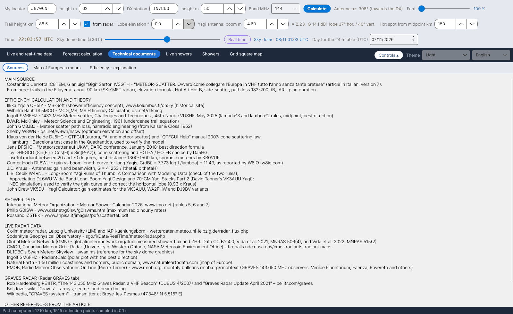

[English](Sources) · [Italiano](Sources-it) · [Deutsch](Sources-de) · [Nederlands](Sources-nl) · [Français](Sources-fr) · [Español](Sources-es) · **Português** · [Português (Brasil)](Sources-pt-BR) · [Dansk](Sources-da) · [Norsk](Sources-nb) · [Svenska](Sources-sv) · [Íslenska](Sources-is) · [Eesti](Sources-et) · [Lietuvių](Sources-lt) · [Latviešu](Sources-lv) · [Polski](Sources-pl) · [Čeština](Sources-cs) · [Magyar](Sources-hu) · [Română](Sources-ro) · [Ελληνικά](Sources-el) · [Русский](Sources-ru) · [Українська](Sources-uk) · [Türkçe](Sources-tr) · [Afrikaans](Sources-af) · [العربية](Sources-ar) · [עברית](Sources-he) · [اردو](Sources-ur) · [हिन्दी](Sources-hi) · [বাংলা](Sources-bn) · [ไทย](Sources-th) · [Bahasa Indonesia](Sources-id) · [Tagalog](Sources-tl) · [日本語](Sources-ja) · [한국어](Sources-ko) · [中文](Sources-zh) · [中文 (繁體)](Sources-zh-TW)

# Fontes

*Separador: Documentos técnicos › Fontes.*

O separador **Fontes** enumera todas as obras em que o YA-MS se baseia, agrupadas como abaixo (o texto é selecionável, para poder copiar as referências). As mesmas fontes, numeradas, fecham o manual de cálculo (`doc/YA-MS_manuale_calcoli.docx`) e o documento [Eficiência - explicação](Efficiency-Explanation-pt).

## FONTE PRINCIPAL

| Fonte | Usada para |
|---|---|
| Costantino Cerrotta **IC8TEM**, Gianluigi "Gigi" Sartori **IV3GTH** – *"METEOR-SCATTER. Ovvero come collegare l'Europa in VHF tutto l'anno senza tante pretese"* (artigo em italiano, versão 7) | Rastos na camada E a cerca de 90 km (radar SKiYMET), raio terrestre 6372,7955 km, fórmula da elevação, Hot A / Hot B, side-scatter 10–30°, atenuação do percurso, sinal mínimo −130 dBm, duração dos pings IARU, máximo dos esporádicos às 06 UTC |

## CÁLCULO E TEORIA DA EFICIÊNCIA

| Fonte | Usada para |
|---|---|
| Ilkka Yrjölä **OH5IY** – MS-Soft, www.kolumbus.fi/oh5iy (sítio histórico) | Conceito de eficiência de uma chuva; atenuação média do percurso de 200 dB |
| Wilhelm Rauh **DL5MCG** – MCG_MS, MS Efficiency Calculator v1.61, qsl.net/dl5mcg | Eficiência em quatro direções fixas (comparação) |
| Ingolf **SM6FHZ** – *"432 MHz Meteorscatter, Challenges and Techniques"*, 45th Nordic VUSHF, maio de 2025 | Regras λ³ e λ², ponto médio, melhor direção (az do radiante ±90°) |
| D.W.R. **McKinley** – *Meteor Science and Engineering*, McGraw-Hill, 1961 | Reflexão especular, equação do rasto subdenso |
| John **GM8JBJ** – Meteor scatter path loss, hamradio.engineering (de Kaiser & Closs 1952) | Atenuação do percurso de 172–190 dB calculada por John Worsnop **G4BAO** (tese de doutoramento), cerca de 6 dB menos para rastos alinhados com o percurso; a tabela de 182 dB da própria página não é usada (ver [Geometria e atenuação](Geometry-and-Path-Loss-pt)) |
| Shelby **W8WN** – qsl.net/w8wn/hscw (tabela de desvios do AMS Bulletin 203) | Elevação e desvio ótimos, hot spots a 50–150 km |
| **LZ2HV** – MSHV | Hot A / Hot B (comparação; no manual) |
| Klaus von der Heide **DJ5HG** – QTFGUI e o manual "QTFGUI Help" (2007) | Lei do cone scattering; caso de teste Hamburgo – Barcelona com as Quadrântidas usado para verificar o modelo |
| Jens **DF5HC** – *"Meteorscatter auf UKW"*, conferência DARC, janeiro de 2018 | Fórmula da melhor direção de **DH9GCD**; cone scattering e escolha HOT-A / HOT-B de DJ5HG; radiante útil entre 20 e 70°; melhor distância 1300–1500 km; meteoros esporádicos segundo KB0VUK |
| Günter Hoch **DL6WU** – ganho em função do comprimento do boom das Yagis longas, citado por W8IO (w8io.com) | G(dBi) = 7.773 log(L/λ) + 11.43 |
| J.D. **Kraus** – *Antennas*, McGraw-Hill | G = 41253 / (θE·θH) |
| L.B. Cebik **W4RNL** – *Long-Boom Yagi Rules of Thumb: A Comparison with Modeling Data*; *Appreciating DL6WU Wide-Band Long-Boom Yagi Design*; *70-CM Yagi Stacks Part 2* (Yagis VK3AUU de David Tanner) | Simulações NEC usadas para verificar a curva de ganho e corrigir o lóbulo horizontal (0,93 × Kraus) |
| John Drew **VK5DJ** – Yagi Calculator | Estimativas de ganho para as variantes VK3AUU, WA2PHW e DJ9BV |
| J. **Meeus** – *Astronomical Algorithms*, 2.ª ed., Willmann-Bell, 1998 | Dia juliano, tempo sideral, longitude solar, azimute/elevação (no manual) |

## DADOS DAS CHUVAS

| Fonte | Usada para |
|---|---|
| International Meteor Organization – Meteor Shower Calendar 2026 (e 2027), www.imo.net, tabelas 5, 6 e 7 | Radiantes, λ máx, v, r, ZHR, Fonte Anti-helion, datas e horas dos máximos |
| Rossano **IZ5TEK** – www.aripisa.it/images/pdf/scattertek.pdf | Dados das chuvas |

## DADOS DE RADAR EM DIRETO

| Fonte | Usada para |
|---|---|
| Radar meteórico de Collm, Universidade de Leipzig (LIM) e IAP Kühlungsborn – wetterdaten.meteo.uni-leipzig.de/radar_flux.php | Fluxo horário de meteoros e altitudes dos rastos ([Fluxo radar](Radar-Flux-pt)) |
| Sodankylä Geophysical Observatory – sgo.fi/Data/RealTime/meteorRadar.php | Imagem das contagens de meteoros |
| DL1DBC – Swan Meteor Skyview, swan.ms | Referência para o gráfico da abóbada celeste |
| SM6FHZ – RadiantCalc | Gráfico polar com a melhor direção |
| Natural Earth – costas e fronteiras à escala 1:50 milhões, domínio público, www.naturalearthdata.com | Mapa da Europa |
| RMOB, Radio Meteor Observatories On Line (Pierre Terrier) – www.rmob.org; boletins mensais rmob.org/rmobtext | Observadores do GRAVES em 143,050 MHz (Planetário de Veneza, Faenza, Rovereto e outros) para comparação |

## RADAR GRAVES

| Fonte | Usada para |
|---|---|
| Rob Hardenberg **PE1ITR** – *"The 143.050 MHz Graves Radar, a VHF Beacon"* (DUBUS 4/2007) e *"Graves Radar Update April 2021"* – pe1itr.com/graves | Setores, passos, temporização dos passos de 0,8 s / 3,2 s |
| Wiki do Bolidozor, "Graves" | Agrupamentos, setores e tempos do feixe |
| Wikipedia, "GRAVES (system)" | Transmissor em Broye-lès-Pesmes (47,348° N 5,515° E) |

Ver [Radar GRAVES](GRAVES-Radar-pt).

## OUTRAS REFERÊNCIAS DO ARTIGO

G3WZT, DH8BQA, geekshed.co.uk, manual do WSJT-X, WB2FKO (pings), IU6GIR (atividade em 143,050 MHz), IARU Region 1 VHF Handbook.

## Constantes com a sua fonte

`data/regole_sperimentali.csv` enumera as constantes e regras usadas pelo programa, cada uma com a sua fonte (altitude típica dos rastos, intervalo de altitudes, raio terrestre, regras λ³ / λ², duração dos pings IARU, atenuações do percurso, sinal mínimo, PIRE indicativa, máximo dos esporádicos, distâncias úteis a 432 MHz, melhor direção, elevação máxima útil do radiante a 432 MHz, side-scatter).

> Os dados de radar pertencem às respetivas instituições. É preciso pedir autorização antes de os descarregar automaticamente num programa distribuído.
