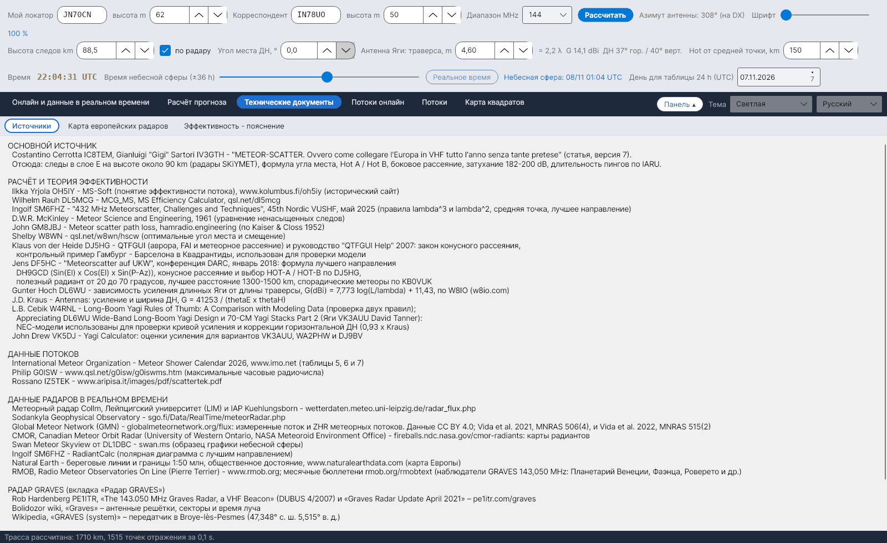

[English](Sources) · [Italiano](Sources-it) · [Deutsch](Sources-de) · [Nederlands](Sources-nl) · [Français](Sources-fr) · [Español](Sources-es) · [Português](Sources-pt) · [Português (Brasil)](Sources-pt-br) · [Dansk](Sources-da) · [Norsk](Sources-nb) · [Svenska](Sources-sv) · [Íslenska](Sources-is) · [Eesti](Sources-et) · [Lietuvių](Sources-lt) · [Latviešu](Sources-lv) · [Polski](Sources-pl) · [Čeština](Sources-cs) · [Magyar](Sources-hu) · [Română](Sources-ro) · [Ελληνικά](Sources-el) · **Русский** · [Українська](Sources-uk) · [Türkçe](Sources-tr) · [Afrikaans](Sources-af) · [العربية](Sources-ar) · [עברית](Sources-he) · [اردو](Sources-ur) · [हिन्दी](Sources-hi) · [বাংলা](Sources-bn) · [Bahasa Indonesia](Sources-id) · [Tagalog](Sources-tl) · [日本語](Sources-ja) · [한국어](Sources-ko) · [中文](Sources-zh) · [中文 (繁體)](Sources-zh-tw)

# Источники

*Вкладка: Технические документы › Источники.*

Вкладка **Источники** перечисляет все работы, на которых построена YA-MS, сгруппированные, как показано ниже (текст можно выделить и скопировать ссылки). Те же источники, пронумерованные, завершают руководство по расчётам (`doc/YA-MS_manuale_calcoli.docx`) и документ [Эффективность - пояснение](Efficiency-Explanation-ru).

## ОСНОВНОЙ ИСТОЧНИК

| Источник | Для чего используется |
|---|---|
| Costantino Cerrotta **IC8TEM**, Gianluigi "Gigi" Sartori **IV3GTH** – *"METEOR-SCATTER. Ovvero come collegare l'Europa in VHF tutto l'anno senza tante pretese"* (статья на итальянском, версия 7) | Следы в слое E на высоте около 90 km (радары SKiYMET), радиус Земли 6372,7955 km, формула угла места, Hot A / Hot B, боковое рассеяние 10–30°, затухание 182–200 dB, минимальный сигнал −130 dBm, длительность пингов по IARU, максимум спорадических метеоров в 06 UTC |

## РАСЧЁТ И ТЕОРИЯ ЭФФЕКТИВНОСТИ

| Источник | Для чего используется |
|---|---|
| Ilkka Yrjölä **OH5IY** – MS-Soft, www.kolumbus.fi/oh5iy (исторический сайт) | Понятие эффективности потока; среднее затухание на трассе 200 dB |
| Wilhelm Rauh **DL5MCG** – MCG_MS, MS Efficiency Calculator v1.61, qsl.net/dl5mcg | Эффективность для четырёх фиксированных направлений (сравнение) |
| Ingolf **SM6FHZ** – *"432 MHz Meteorscatter, Challenges and Techniques"*, 45th Nordic VUSHF, май 2025 | Правила λ³ и λ², средняя точка, лучшее направление (азимут радианта ±90°) |
| D.W.R. **McKinley** – *Meteor Science and Engineering*, McGraw-Hill, 1961 | Зеркальное отражение, уравнение ненасыщенных следов |
| John **GM8JBJ** – Meteor scatter path loss, hamradio.engineering (по Kaiser & Closs 1952) | Минимальное затухание на трассе 182 dB |
| Shelby **W8WN** – qsl.net/w8wn/hscw (таблица смещений AMS Bulletin 203) | Оптимальные угол места и смещение, горячие точки в 50–150 km |
| **LZ2HV** – MSHV | Hot A / Hot B (сравнение; в руководстве) |
| Klaus von der Heide **DJ5HG** – QTFGUI и руководство "QTFGUI Help" (2007) | Закон конусного рассеяния; контрольный пример Гамбург – Барселона в Квадрантиды, использованный для проверки модели |
| Jens **DF5HC** – *"Meteorscatter auf UKW"*, конференция DARC, январь 2018 | Формула лучшего направления **DH9GCD**; конусное рассеяние и выбор HOT-A / HOT-B по DJ5HG; полезный радиант 20–70°; лучшее расстояние 1300–1500 km; спорадические метеоры по KB0VUK |
| Günter Hoch **DL6WU** – зависимость усиления длинных Яги от длины траверсы, по W8IO (w8io.com) | G(dBi) = 7.773 log(L/λ) + 11.43 |
| J.D. **Kraus** – *Antennas*, McGraw-Hill | G = 41253 / (θE·θH) |
| L.B. Cebik **W4RNL** – *Long-Boom Yagi Rules of Thumb: A Comparison with Modeling Data*; *Appreciating DL6WU Wide-Band Long-Boom Yagi Design*; *70-CM Yagi Stacks Part 2* (Яги VK3AUU David Tanner) | NEC-модели, использованные для проверки кривой усиления и коррекции горизонтальной ДН (0,93 × Kraus) |
| John Drew **VK5DJ** – Yagi Calculator | Оценки усиления для вариантов VK3AUU, WA2PHW и DJ9BV |
| J. **Meeus** – *Astronomical Algorithms*, 2nd ed., Willmann-Bell, 1998 | Юлианская дата, звёздное время, солнечная долгота, азимут/угол места (в руководстве) |

## ДАННЫЕ ПОТОКОВ

| Источник | Для чего используется |
|---|---|
| International Meteor Organization – Meteor Shower Calendar 2026 (и 2027), www.imo.net, таблицы 5, 6 и 7 | Радианты, λ max, v, r, ZHR, Антигелийный источник, даты и время максимумов |
| Philip **G0ISW** – www.qsl.net/g0isw/g0iswms.htm | Максимальные часовые радиочисла |
| Rossano **IZ5TEK** – www.aripisa.it/images/pdf/scattertek.pdf | Данные потоков |

## ДАННЫЕ РАДАРОВ В РЕАЛЬНОМ ВРЕМЕНИ

| Источник | Для чего используется |
|---|---|
| Метеорный радар Collm, Лейпцигский университет (LIM) и IAP Kühlungsborn – wetterdaten.meteo.uni-leipzig.de/radar_flux.php | Почасовой поток метеоров и высоты следов ([Поток по радару](Radar-Flux-ru)) |
| Sodankylä Geophysical Observatory – sgo.fi/Data/RealTime/meteorRadar.php | Изображение с числом метеоров |
| DL1DBC – Swan Meteor Skyview, swan.ms | Образец графики небесной сферы |
| SM6FHZ – RadiantCalc | Полярная диаграмма с лучшим направлением |
| Natural Earth – береговые линии и границы 1:50 млн, общественное достояние, www.naturalearthdata.com | Карта Европы |
| RMOB, Radio Meteor Observatories On Line (Pierre Terrier) – www.rmob.org; месячные бюллетени rmob.org/rmobtext | Наблюдатели GRAVES 143,050 MHz (Планетарий Венеции, Фаэнца, Роверето и др.) для сравнения |

## РАДАР GRAVES

| Источник | Для чего используется |
|---|---|
| Rob Hardenberg **PE1ITR** – *«The 143.050 MHz Graves Radar, a VHF Beacon»* (DUBUS 4/2007) и *«Graves Radar Update April 2021»* – pe1itr.com/graves | Секторы, шаги, длительность шага 0,8 s / 3,2 s |
| Вики Bolidozor, «Graves» | Антенные решётки, секторы и время луча |
| Wikipedia, «GRAVES (system)» | Передатчик в Broye-lès-Pesmes (47,348° с. ш. 5,515° в. д.) |

См. [Радар GRAVES](GRAVES-Radar-ru).

## ДРУГИЕ ИСТОЧНИКИ СТАТЬИ

G3WZT, DH8BQA, geekshed.co.uk, руководство WSJT-X, WB2FKO (пинги), IU6GIR (активность 143,050 MHz), IARU Region 1 VHF Handbook.

## Константы и их источники

`data/regole_sperimentali.csv` перечисляет константы и правила, используемые программой, каждое со своим источником (типичная высота следов, диапазон высот, радиус Земли, правила λ³ / λ², длительность пингов по IARU, затухание на трассе, минимальный сигнал, ориентировочная ЭИИМ, максимум спорадических метеоров, полезные расстояния на 432 MHz, лучшее направление, максимальный полезный угол места радианта на 432 MHz, боковое рассеяние).

> Данные радаров принадлежат соответствующим организациям. Перед автоматической загрузкой этих данных в распространяемой программе нужно получить разрешение.
