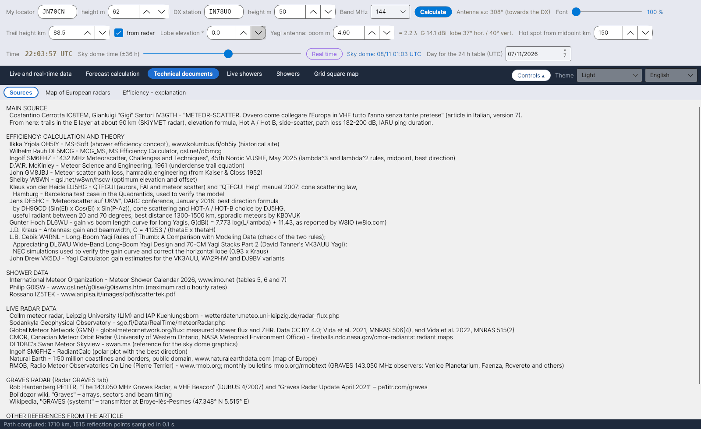

[English](Sources) · [Italiano](Sources-it) · [Deutsch](Sources-de) · [Nederlands](Sources-nl) · [Français](Sources-fr) · [Español](Sources-es) · [Português](Sources-pt) · [Português (Brasil)](Sources-pt-br) · [Dansk](Sources-da) · [Norsk](Sources-nb) · [Svenska](Sources-sv) · [Íslenska](Sources-is) · [Eesti](Sources-et) · [Lietuvių](Sources-lt) · [Latviešu](Sources-lv) · [Polski](Sources-pl) · [Čeština](Sources-cs) · [Magyar](Sources-hu) · [Română](Sources-ro) · [Ελληνικά](Sources-el) · [Русский](Sources-ru) · [Українська](Sources-uk) · [Türkçe](Sources-tr) · [Afrikaans](Sources-af) · [العربية](Sources-ar) · [עברית](Sources-he) · [اردو](Sources-ur) · [हिन्दी](Sources-hi) · [বাংলা](Sources-bn) · **ไทย** · [Bahasa Indonesia](Sources-id) · [Tagalog](Sources-tl) · [日本語](Sources-ja) · [한국어](Sources-ko) · [中文](Sources-zh) · [中文 (繁體)](Sources-zh-tw)

# แหล่งอ้างอิง

*แท็บ: เอกสารทางเทคนิค › แหล่งอ้างอิง*

แท็บ **แหล่งอ้างอิง** แสดงรายการผลงานทุกชิ้นที่ YA-MS ใช้เป็นพื้นฐาน จัดกลุ่มตามด้านล่าง (เลือกข้อความได้ จึงคัดลอกการอ้างอิงได้) แหล่งอ้างอิงเดียวกันนี้พร้อมหมายเลขกำกับปรากฏอยู่ท้ายคู่มือการคำนวณ (`doc/YA-MS_manuale_calcoli.docx`) และเอกสาร [คำอธิบายการคำนวณประสิทธิภาพ](Efficiency-Explanation-th)

## แหล่งอ้างอิงหลัก

| แหล่งอ้างอิง | ใช้สำหรับ |
|---|---|
| Costantino Cerrotta **IC8TEM**, Gianluigi "Gigi" Sartori **IV3GTH** – *"METEOR-SCATTER. Ovvero come collegare l'Europa in VHF tutto l'anno senza tante pretese"* (บทความภาษาอิตาลี เวอร์ชัน 7) | รอยดาวตกในชั้น E ที่ประมาณ 90 km (เรดาร์ SKiYMET) รัศมีโลก 6372.7955 km สูตรมุมเงย Hot A / Hot B, side-scatter 10–30° การลดทอนของเส้นทาง สัญญาณต่ำสุด −130 dBm ระยะเวลา ping ของ IARU จุดสูงสุดของดาวตกประปรายที่ 06 UTC |

## ประสิทธิภาพ: การคำนวณและทฤษฎี

| แหล่งอ้างอิง | ใช้สำหรับ |
|---|---|
| Ilkka Yrjölä **OH5IY** – MS-Soft, www.kolumbus.fi/oh5iy (เว็บไซต์เก่า) | แนวคิดเรื่องประสิทธิภาพของฝนดาวตก การลดทอนของเส้นทางเฉลี่ย 200 dB |
| Wilhelm Rauh **DL5MCG** – MCG_MS, MS Efficiency Calculator v1.61, qsl.net/dl5mcg | ประสิทธิภาพบนทิศคงที่สี่ทิศ (การเปรียบเทียบ) |
| Ingolf **SM6FHZ** – *"432 MHz Meteorscatter, Challenges and Techniques"*, 45th Nordic VUSHF, พฤษภาคม 2025 | กฎ λ³ และ λ² จุดกึ่งกลาง ทิศที่ดีที่สุด (az ของจุดเรเดียนต์ ±90°) |
| D.W.R. **McKinley** – *Meteor Science and Engineering*, McGraw-Hill, 1961 | การสะท้อนแบบสเปคูลาร์ สมการรอยดาวตกแบบ underdense |
| John **GM8JBJ** – Meteor scatter path loss, hamradio.engineering (จาก Kaiser & Closs 1952) | การลดทอนของเส้นทาง 172–190 dB ที่คำนวณโดย John Worsnop **G4BAO** (วิทยานิพนธ์ปริญญาเอก) น้อยลงประมาณ 6 dB สำหรับรอยดาวตกที่อยู่แนวเดียวกับเส้นทาง ไม่ได้ใช้ตาราง 182 dB ของหน้านั้นเอง (ดูที่ [เรขาคณิตและการลดทอน](Geometry-and-Path-Loss-th)) |
| Shelby **W8WN** – qsl.net/w8wn/hscw (ตารางการเบี่ยงใน AMS Bulletin 203) | มุมเงยและการเบี่ยงที่เหมาะสมที่สุด hot spot 50–150 km |
| **LZ2HV** – MSHV | Hot A / Hot B (การเปรียบเทียบ อยู่ในคู่มือ) |
| Klaus von der Heide **DJ5HG** – QTFGUI และคู่มือ "QTFGUI Help" (2007) | กฎการกระเจิงแบบกรวย กรณีทดสอบ Hamburg – Barcelona ช่วง Quadrantids ที่ใช้ตรวจสอบแบบจำลอง |
| Jens **DF5HC** – *"Meteorscatter auf UKW"*, การประชุม DARC มกราคม 2018 | สูตรทิศที่ดีที่สุดของ **DH9GCD** การกระเจิงแบบกรวยและการเลือก HOT-A / HOT-B ของ DJ5HG จุดเรเดียนต์ที่ใช้ได้ 20–70° ระยะที่ดีที่สุด 1300–1500 km ดาวตกประปรายตาม KB0VUK |
| L. Edwards VE7BQH - ตารางอัตราขยายของ Yagi สำหรับ 50, 144 และ 432 MHz: dxmaps.com/VE7BQH6.html, dxmaps.com/VE7BQH.html, atlas.dxmaps.com/VE7BQH70.html (สำเนาที่ qsl.net/dk7zb และ sm2cew.com) | 50 MHz: 7.36 log(L/λ) + 11.67 · 144 MHz: 8.27 log(L/λ) + 11.31 · 432 MHz: 8.68 log(L/λ) + 11.03 (dBi) |
| G. Hoch DL6WU - "Extremely Long Yagi Antennas", VHF Communications 14, 3/1982, หน้า 130-138, รูปที่ 1 (แหล่งข้อมูลปฐมภูมิ); W8IO ก็อ้างเส้นโค้งนี้ด้วย, www.w8io.com. | G(dBi) = 7.81 log(L/λ) + 11.35 (W8IO: 7.773 log + 11.43) |
| J.D. **Kraus** – *Antennas*, McGraw-Hill | G = 41253 / (θE·θH) |
| L.B. Cebik **W4RNL** – *Long-Boom Yagi Rules of Thumb: A Comparison with Modeling Data*; *Appreciating DL6WU Wide-Band Long-Boom Yagi Design*; *70-CM Yagi Stacks Part 2* (ยากิ VK3AUU ของ David Tanner) | การจำลอง NEC ที่ใช้ตรวจสอบเส้นโค้งอัตราขยายและแก้ไขโลบแนวนอน (0.93 × Kraus) |
| John Drew **VK5DJ** – Yagi Calculator | ค่าประมาณอัตราขยายสำหรับรุ่น VK3AUU, WA2PHW และ DJ9BV |
| J. **Meeus** – *Astronomical Algorithms*, 2nd ed., Willmann-Bell, 1998 | วันจูเลียน เวลาดาราคติ ลองจิจูดสุริยะ แอซิมัท/มุมเงย (อยู่ในคู่มือ) |
| National Geospatial-Intelligence Agency – *World Geodetic System 1984* (NGA.STND.0036, 2014; NIMA TR8350.2) | ทรงรี WGS84 (ตำแหน่งของสถานีและรอย) |
| C. F. F. **Karney** – *Algorithms for geodesics*, Journal of Geodesy 87 (2013) 43–55; GeographicLib | ระยะทาง มุมทิศ และจุดกึ่งกลางบนเส้นจีโอเดสิก |

## ข้อมูลฝนดาวตก

| แหล่งอ้างอิง | ใช้สำหรับ |
|---|---|
| International Meteor Organization – Meteor Shower Calendar 2026 (และ 2027), www.imo.net, ตารางที่ 5, 6 และ 7 | จุดเรเดียนต์ λ max, v, r, ZHR, Antihelion Source วันที่และเวลาจุดสูงสุด |
| Rossano **IZ5TEK** – www.aripisa.it/images/pdf/scattertek.pdf | ข้อมูลฝนดาวตก |

## ข้อมูลเรดาร์แบบสด

| แหล่งอ้างอิง | ใช้สำหรับ |
|---|---|
| เรดาร์ดาวตก Collm, Leipzig University (LIM) และ IAP Kühlungsborn – wetterdaten.meteo.uni-leipzig.de/radar_flux.php | ฟลักซ์ดาวตกรายชั่วโมงและความสูงของรอยดาวตก ([ฟลักซ์เรดาร์](Radar-Flux-th)) |
| Sodankylä Geophysical Observatory – sgo.fi/Data/RealTime/meteorRadar.php | ภาพจำนวนดาวตก |
| DL1DBC – Swan Meteor Skyview, swan.ms | ค่าอ้างอิงสำหรับกราฟิกโดมท้องฟ้า |
| SM6FHZ – RadiantCalc | กราฟเชิงขั้วพร้อมทิศที่ดีที่สุด |
| Natural Earth – แนวชายฝั่งและพรมแดนมาตราส่วน 1:50 ล้าน สาธารณสมบัติ www.naturalearthdata.com | แผนที่ยุโรป |
| RMOB, Radio Meteor Observatories On Line (Pierre Terrier) – www.rmob.org; วารสารรายเดือน rmob.org/rmobtext | ผู้สังเกตการณ์ GRAVES 143.050 MHz (ท้องฟ้าจำลองเวนิส, Faenza, Rovereto และอื่น ๆ) เพื่อการเปรียบเทียบ |

## เรดาร์ GRAVES

| แหล่งอ้างอิง | ใช้สำหรับ |
|---|---|
| Rob Hardenberg **PE1ITR** – *"The 143.050 MHz Graves Radar, a VHF Beacon"* (DUBUS 4/2007) และ *"Graves Radar Update April 2021"* – pe1itr.com/graves | เซกเตอร์ ขั้น จังหวะเวลาของขั้น 0.8 s / 3.2 s |
| วิกิของ Bolidozor, "Graves" | แอร์เรย์ เซกเตอร์ และจังหวะเวลาของลำคลื่น |
| Wikipedia, "GRAVES (system)" | เครื่องส่งที่ Broye-lès-Pesmes (47.348° N 5.515° E) |

ดูที่ [เรดาร์ GRAVES](GRAVES-Radar-th)

## ค่าอ้างอิงอื่น ๆ จากบทความ

G3WZT, DH8BQA, geekshed.co.uk, คู่มือ WSJT-X, WB2FKO (ping), IU6GIR (กิจกรรมบน 143.050 MHz), IARU Region 1 VHF Handbook

## ค่าคงที่พร้อมแหล่งอ้างอิง

`data/regole_sperimentali.csv` แสดงรายการค่าคงที่และกฎที่โปรแกรมใช้ แต่ละรายการพร้อมแหล่งอ้างอิง (ความสูงทั่วไปของรอยดาวตก ช่วงความสูง รัศมีโลก กฎ λ³ / λ² ระยะเวลา ping ของ IARU การลดทอนของเส้นทาง สัญญาณต่ำสุด EIRP โดยประมาณ จุดสูงสุดของดาวตกประปราย ระยะที่ใช้ได้ที่ 432 MHz ทิศที่ดีที่สุด มุมเงยสูงสุดที่ใช้ได้ของจุดเรเดียนต์ที่ 432 MHz, side-scatter)

> ข้อมูลเรดาร์เป็นของสถาบันเจ้าของ ต้องขออนุญาตก่อนดึงข้อมูลโดยอัตโนมัติในโปรแกรมที่เผยแพร่
