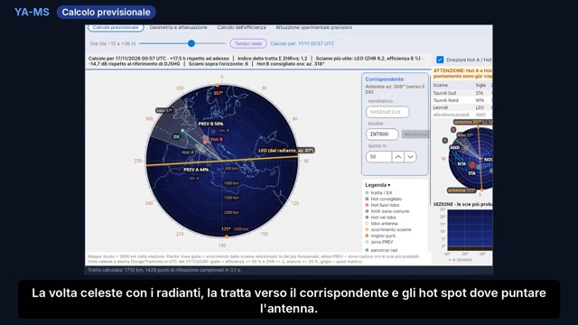
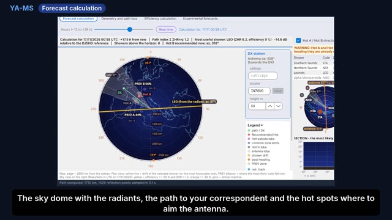
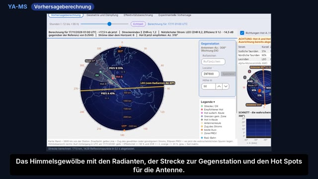

[English](Video) · [Italiano](Video-it) · [Deutsch](Video-de) · [Nederlands](Video-nl) · [Français](Video-fr) · [Español](Video-es) · [Português](Video-pt) · [Português (Brasil)](Video-pt-br) · [Dansk](Video-da) · [Norsk](Video-nb) · [Svenska](Video-sv) · [Íslenska](Video-is) · [Eesti](Video-et) · [Lietuvių](Video-lt) · [Latviešu](Video-lv) · [Polski](Video-pl) · [Čeština](Video-cs) · [Magyar](Video-hu) · [Română](Video-ro) · [Ελληνικά](Video-el) · [Русский](Video-ru) · [Українська](Video-uk) · [Türkçe](Video-tr) · [Afrikaans](Video-af) · [العربية](Video-ar) · [עברית](Video-he) · [اردو](Video-ur) · [हिन्दी](Video-hi) · [বাংলা](Video-bn) · [ไทย](Video-th) · [Bahasa Indonesia](Video-id) · [Tagalog](Video-tl) · [日本語](Video-ja) · **한국어** · [中文](Video-zh) · [中文 (繁體)](Video-zh-tw)

# 소개 영상

약 1분 30초 분량의 YA-MS 소개 영상(자막 포함). 이탈리아어, 영어, 독일어로 볼 수 있습니다. 이미지를 클릭하면 재생됩니다.

<table><tr>
<td width="33%" align="center"> <b>Italiano</b> <a href="https://github.com/ic8tem/YA-MS/blob/main/docs/video/YA-MS-presentazione-it.mp4">▶ 보기</a> · <a href="https://raw.githubusercontent.com/ic8tem/YA-MS/main/docs/video/YA-MS-presentazione-it.mp4">내려받기</a> · <a href="https://raw.githubusercontent.com/ic8tem/YA-MS/main/docs/video/YA-MS-presentazione-it.srt">자막 (.srt)</a></td>
<td width="33%" align="center"> <b>English</b> <a href="https://github.com/ic8tem/YA-MS/blob/main/docs/video/YA-MS-presentazione-en.mp4">▶ 보기</a> · <a href="https://raw.githubusercontent.com/ic8tem/YA-MS/main/docs/video/YA-MS-presentazione-en.mp4">내려받기</a> · <a href="https://raw.githubusercontent.com/ic8tem/YA-MS/main/docs/video/YA-MS-presentazione-en.srt">자막 (.srt)</a></td>
<td width="33%" align="center"> <b>Deutsch</b> <a href="https://github.com/ic8tem/YA-MS/blob/main/docs/video/YA-MS-presentazione-de.mp4">▶ 보기</a> · <a href="https://raw.githubusercontent.com/ic8tem/YA-MS/main/docs/video/YA-MS-presentazione-de.mp4">내려받기</a> · <a href="https://raw.githubusercontent.com/ic8tem/YA-MS/main/docs/video/YA-MS-presentazione-de.srt">자막 (.srt)</a></td>
</tr></table>
